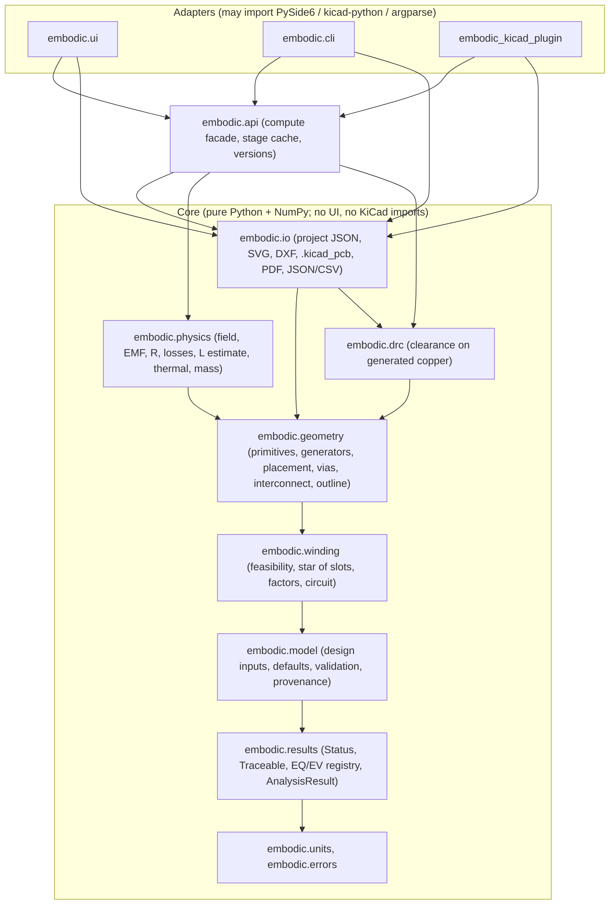
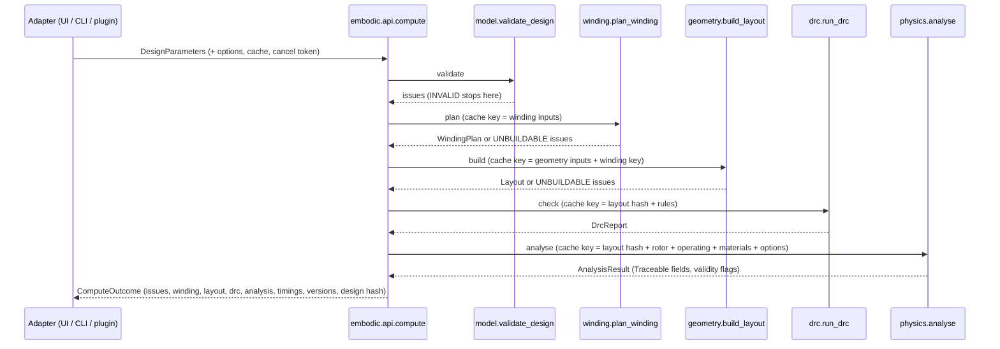
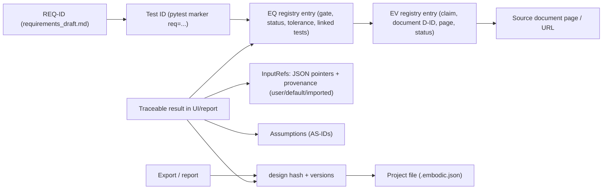

Prepared by: Agent 6 — Software Architecture Specialist — model: claude-opus-5-5

# embodic — System architecture (Phase 1 draft, 2026-10-04)

Status: **draft**. Every design choice in this document is an `assumption` in the sense of PROJECT_BRIEF §3 (a design
decision without empirical evidence) until the corresponding ADR in `decisions/` is accepted. Facts taken from other
agents keep their original status label and reference. No code has been written (BRIEF §3 rule 9); the Python below
is interface sketch only (Python 3.11 syntax — no PEP 695 generics, because the user's minimum is 3.11).

Related documents: `requirements_draft.md` (REQ-IDs), `app_type_comparison.md` (front-end proposal),
`test_plan_draft.md` (test IDs), `decisions/ADR-0001 … ADR-0009`, `user_decisions_needed.md` (UD-01 … UD-26).

## 1. Goals, constraints, quality attributes

| Driver | Source | Architectural consequence |
|---|---|---|
| Python calculation and geometry engine | BRIEF §1 | Core = pure Python + NumPy packages (§3) |
| Engine shared by standalone UI and KiCad plugin | DL D-004; coordinator constraint | Ports-and-adapters layering, enforced by import contracts (ADR-0001) |
| One geometry model for SVG / DXF / .kicad_pcb / KiCad-IPC | Coordinator constraint; proven in Xcoil (`exportSvg`, `exportDxf`, `exportKicad` all walk the same primitive lists, `engine.js` l.2796–2929, `verified` code reading) | `Primitive` model (ADR-0002, §7.5) |
| DRC measured on generated copper | Coordinator constraint; Xcoil DRC test group | `embodic.drc` works on the same primitives (§8.4) |
| Traceable results | Coordinator constraint; BRIEF §3 rules 2–6 | `Traceable[T]` + EQ/EV registries (ADR-0003, §13) |
| Equation-check gate before reuse | BRIEF §1; A2-EQ gate summary | Registry stores gate verdict + status; CI enforces (REQ-T-05) |
| KiCad 9.x: SWIG deprecated (removal planned 11.0), IPC needs running GUI, per-plugin venv | A5-KI §1–§3 (`verified`) | IPC adapter, UI-less; file writer as baseline (ADR-0004) |
| Spiral coils now, serpentine/wave later | Coordinator constraint | `WindingGenerator` interface + tagged-union topology spec (§7.2, §8.3) |
| Interactive recompute < 1 s | REQ-N-01 (`assumption`) | Staged pipeline with caching, vectorised kernels (§11) |
| Windows + Python 3.11 | BRIEF §1; NumPy ≥ 2.5 needs Python ≥ 3.12 (PyPI, `verified`) | Dependency ranges per Python version (ADR-0008) |

## 2. Context (C4 level 1)


External interfaces: the user (UI, CLI); KiCad 9.x over the IPC API (A5-KI §3: Protocol Buffers over NNG, standalone
plugin process, `verified`); the file system; at test time only, the read-only Xcoil v3 JS engine via Node.js to produce
golden JSON (ADR-0006). No network service is used (REQ-N-17).

## 3. Components (C4 level 2/3)



Arrows mean "may import". Transitive imports downward are allowed; upward or sideways imports are forbidden except
where drawn. `physics` and `drc` are independent of each other; `io` must not import `physics` (it only reads
`AnalysisResult`, which lives in `results`).

| Component | Responsibility | Main inputs → outputs | Key REQs |
|---|---|---|---|
| `embodic.units`, `embodic.errors` | Unit vocabulary and conversions; `ValidationIssue`, `IssueCode`, `Severity`, `IssueCategory` | — | REQ-N-21, REQ-F-14 |
| `embodic.results` | `Status`, `Traceable[T]`, `Assumption`, `InputRef`, `ValidityFlag`; EQ and EV registries (packaged JSON); `AnalysisResult`; status combination; display formatting | registry JSON → lookups | REQ-T-01…08 |
| `embodic.model` | Immutable design input dataclasses; defaults (Agent 2 §5.2, all `assumption`); provenance per field; `validate_design()` (INVALID / RANGE issues) | user/project data → `DesignParameters`, issues | REQ-F-03…09, F-14, F-21, T-06 |
| `embodic.winding` | Q/2p feasibility (q, t, balance), integer star of slots, phase belts, polarity, winding factors k_w,n (turn-averaged), phase circuit topology (series chain of parallel groups, star/delta) | rotor poles, Q, phases, layer config → `WindingPlan` | REQ-F-02, F-03, F-08 |
| `embodic.geometry` | Primitives (Line/Arc with width, layer, net, role), transforms, paths; `WindingGenerator` registry (`spiral` in P2; `serpentine`, `wave` reserved); spiral coil artwork (X/Y), placement on layer pairs with rotation, via planning, interconnect (rings, terminals), outline; `Layout` incl. electrical `Circuit`; NumPy array view | `DesignParameters`, `WindingPlan` → `Layout` | REQ-F-01, F-03…06, F-09, F-19 |
| `embodic.drc` | Clearance checks on `Layout`: broad phase (uniform grid), exact narrow phase (line/arc distances), connectivity-aware exemptions, symmetric shortcut with full-check equivalence test | `Layout`, `DrcRules` → `DrcReport` | REQ-F-10 |
| `embodic.physics` | EQ-01…EQ-22 implementations as pure functions; `analyse()` orchestration; per-layer field at z; circuit solution (EQ-07); every output wrapped in `Traceable` via the registry | `DesignParameters`, `WindingPlan`, `Layout` → `AnalysisResult` | REQ-F-07, F-11, F-12, F-20 |
| `embodic.io` | Project file load/save (typed loader + published JSON Schema, migrations, canonical JSON, design hash); writers: SVG, DXF R12, `.kicad_pcb` (own s-expression writer), results JSON/CSV, PDF report; `kicad_items` = pure Layout → KiCad item mapping shared with the plugin | `ComputeOutcome` → files; files → `DesignParameters` | REQ-F-15, F-16, K-01, T-07 |
| `embodic.api` | `compute()` facade: validate → winding → geometry → DRC → physics; stage cache; cancellation; version info; never raises for user input | `DesignParameters` → `ComputeOutcome` | REQ-F-14, N-01, N-04 |
| `embodic.cli` | Headless `compute`, `validate`, `export`, `registry`, `golden-compare` commands; exit codes | project file → JSON/exports | REQ-F-18 |
| `embodic.ui` | Standalone front-end (proposal: PySide6, ADR-0005); MVVM view-models, worker thread, geometry view, phase/layer/results/issues views, export dialogs, string catalogue, theme tokens | user events ↔ `api`, `io` | REQ-F-13, N-02, N-11…16, L-01…07 |
| `embodic_kicad_plugin` | KiCad 9 IPC adapter (thin): version check, stack-up import, applying `ItemSpec`s from `embodic.io.kicad_items` in one commit behind a `BoardApi` protocol, item tracking, no-silent-remap check; optional launcher | `Layout` → kipy items; kipy stack-up → `Stackup` | REQ-K-02…11 |

## 4. Layering rules (enforced)

Enforcement tool: import-linter (BSD licence per PyPI metadata, `verified`) contracts in `pyproject.toml`, run in CI
(MT-01). Proposed contracts (`assumption`):

1. **Layers** (top → bottom): `embodic.ui | embodic.cli` → `embodic.api` → `embodic.io` → `embodic.physics | embodic.drc`
   → `embodic.geometry` → `embodic.winding` → `embodic.model` → `embodic.results` → `embodic.units | embodic.errors`.
2. **Forbidden** in every `embodic.*` module except `embodic.ui`: `PySide6`, `shiboken6`, `wx`, `tkinter`.
3. **Forbidden** in every `embodic.*` module: `kipy`, `pcbnew` (REQ-K-05, K-11). `embodic_kicad_plugin` may import
   `kipy`, never `pcbnew`.
4. **Independence**: `embodic.physics` ⟂ `embodic.drc`; `embodic.io` must not import `embodic.physics`.
5. Core third-party allow-list: standard library + `numpy` only (ADR-0008).

## 5. Runtime flow



Physics runs even when DRC reports violations (the user needs both), but the outcome's `ok` is false and exports of a
layout with DRC errors require an explicit override flag (REQ-F-10, §12).

## 6. Units policy (where units are enforced)

| Rule | Where enforced |
|---|---|
| U1 All lengths in data models, geometry and file formats are **millimetres**, float64 (PCB convention; matches Xcoil and KiCad's mm UI). Field names carry the unit: `trace_width_mm`, `copper_thickness_mm`. | `embodic.model` dataclass field names; review checklist; ruff custom check for dimensional fields without suffix (MT-05) |
| U2 Angles are **radians** inside the core (`_rad`); degrees exist only in UI widgets and project-file fields named `_deg`, converted in `embodic.units`. | `embodic.units.deg_to_rad`; loader converts `_deg` fields once |
| U3 All non-length quantities are SI with explicit suffixes where ambiguous: `remanence_t`, `speed_rpm` (UI convenience, converted to rad/s), `temperature_degc`, `current_rms_a`, `h_w_m2k`. | Field names; `embodic.units` |
| U4 Physics functions convert mm → m at their boundary with `units.mm_to_m()` — no bare `1e-3` / `1e-6` literals in physics code. | ruff rule banning bare power-of-ten literals in `embodic.physics` (MT-05) |
| U5 Every `Traceable` carries a `unit` from a closed vocabulary (`Unit` enum: `mm`, `m`, `mm2`, `T`, `V`, `V_s_per_rad`, `ohm`, `W`, `A`, `A_per_mm2`, `H`, `K`, `degC`, `g`, `N_m`, `rpm`, `rad_per_V_s`, `one`, …) with a display form ("V·s/rad", "Ω", "A/mm²"). | `embodic.results.traceable`; UT-RES-04 |
| U6 KiCad internal units (nm, integer) appear only in `embodic_kicad_plugin` and `embodic.io.kicad_pcb` writer (which writes mm text). Conversion `mm_to_nm(x)` = round half away from zero of `x * 1e6`, once per coordinate — **not** Python's built-in `round()`, which rounds half to even, unlike JS `Math.round` used by Xcoil's `fmt()` (Agent 3 `calculation_flow_and_port_notes.md` §2.1, `verified (run)` there); connected end points are snapped from one shared coordinate so they round identically (REQ-K-08). | `embodic.units.mm_to_nm`; adapter; PR-04, UT-UNI-02 |
| U7 No unit library at runtime (Pint 0.26 requires Python ≥ 3.12 per PyPI, `verified`; overhead in inner loops `inferred`). Dimensional consistency is tested with scaling properties (PR-06). | ADR-0009 |

## 7. Data models

All inputs are frozen, slotted, keyword-only dataclasses; validation is a separate function so that an invalid design
can still be represented, saved and reported. Enums are `StrEnum` (Python 3.11+) whose values are the JSON strings.

### 7.1 Design inputs (`embodic.model`)

```python
from __future__ import annotations
from dataclasses import dataclass, field
from enum import StrEnum
from typing import Literal

class Phase(StrEnum):
    A = "A"; B = "B"; C = "C"

class RotorType(StrEnum):
    DOUBLE = "double"              # two identical rotors, N facing S (EQ-05: G = (t_s + 2g)/2)
    SINGLE_YOKE = "single_yoke"    # single rotor, opposite back iron (G = t_s + 2g)
    SINGLE_OPEN = "single_open"    # single rotor, no opposite iron (G -> infinity)

class Magnetisation(StrEnum):
    PARALLEL = "parallel"          # P2
    HALBACH = "halbach"            # reserved (D11 eq. 8-9, A2-EQ EQ-05 change); rejected until implemented

@dataclass(frozen=True, slots=True, kw_only=True)
class ArcMagnet:                   # constant pole-arc ratio (EQ-05)
    kind: Literal["arc"] = "arc"
    pole_arc_ratio: float          # alpha_p, 0 < alpha_p <= 1
    r_inner_mm: float
    r_outer_mm: float
    thickness_mm: float            # axial l_m

@dataclass(frozen=True, slots=True, kw_only=True)
class BlockMagnet:                 # rectangular block centred on a radial line (EQ-04: alpha_p(r))
    kind: Literal["block"] = "block"
    width_mm: float                # tangential w_PM
    length_mm: float               # radial
    r_center_mm: float
    thickness_mm: float

MagnetGeometry = ArcMagnet | BlockMagnet

@dataclass(frozen=True, slots=True, kw_only=True)
class RotorSpec:
    poles: int                     # 2p, even
    rotor_type: RotorType
    magnet: MagnetGeometry
    remanence_t: float             # B_r at the reference temperature
    recoil_permeability: float     # mu_r
    remanence_temp_coeff_per_k: float | None = None   # reserved: B_r(T) (A2-EQ EQ-05 change)
    magnetisation: Magnetisation = Magnetisation.PARALLEL
    air_gap_mm: float              # per side, magnet face to board surface
    back_iron_thickness_mm: float  # used by inertia/mass; field model assumes unsaturated iron (A2-EQ EQ-05)
    magnet_offset_rad: float = 0.0 # rotor angle reference

class SideStyle(StrEnum):
    RADIAL = "radial"; PARALLEL = "parallel"          # A2-TOP §3.1 S1, S2

class EndStyle(StrEnum):
    ARC = "arc"; STRAIGHT = "straight"; STADIUM = "stadium"   # S3 = stadium

class InnerTurnMode(StrEnum):
    FIXED = "fixed"                # Xcoil behaviour (A2-REV C5)
    MOVING = "moving"              # trapezoidal + triangular turns (D08 eq. 3.25-3.26, A2-EQ EQ-02)

class Sense(StrEnum):
    CW = "cw"; CCW = "ccw"

class LeadStyle(StrEnum):
    RADIAL_THEN_ARC = "radial_then_arc"; STRAIGHT = "straight"   # lead from innermost turn to the centre via

class EyeArrangement(StrEnum):
    RADIAL = "radial"; TANGENTIAL = "tangential"   # how n centre vias sit in the coil eye

@dataclass(frozen=True, slots=True, kw_only=True)
class EyeRequirement:              # derived by the planner, not a user input: count from LayerConfig, sizes from ViaSpec/DrcRules
    centre_via_count: int
    via_pad_mm: float
    clearance_mm: float
    arrangement: EyeArrangement = EyeArrangement.RADIAL

@dataclass(frozen=True, slots=True, kw_only=True)
class SpiralCoilSpec:              # fields and conventions per Agent 2 answers_to_agents.md §3.2 and §1.4
    coil_count: int                # Q per layer (3...96 proposal; = 2p for M4)
    r_inner_mm: float              # COPPER-EDGE radius of the coil body; centre-line R_i0 = r_inner + w_in/2
    r_outer_mm: float              # copper-edge radius; centre-line R_o0 = r_outer - w_out/2
    trace_width_mm: float          # w
    clearance_mm: float            # s (UI id param-trace-spacing, see §19)
    coil_gap_mm: float             # copper-to-copper between neighbouring coils; first side offset = gap/2 + w/2
    turns: int | None = None       # N per coil per layer; None = maximum feasible
    side_style: SideStyle = SideStyle.PARALLEL
    end_style: EndStyle = EndStyle.ARC
    inner_turn_mode: InnerTurnMode = InnerTurnMode.MOVING   # EQ-02 loop criterion (trapezoidal/triangular)
    corner_radius_mm: float = 0.0  # reduced automatically if nested fillets do not fit -> reported as an issue, never silent
    end_width_outer_mm: float | None = None   # None = trace width
    end_width_inner_mm: float | None = None
    width_profile: Literal["constant"] = "constant"   # reserved: "radius_proportional" (S5, D10)
    first_coil_angle_rad: float = math.pi / 2         # theta_0: coil 1 centred at the top (Agent 2 §1.4)
    x_inward_sense: Sense = Sense.CW                   # layer X spirals inward clockwise = "positive coil"
    lead_style: LeadStyle = LeadStyle.RADIAL_THEN_ARC
    terminal_offset_mm: float | None = None            # None = clearance + pad/2 beyond r_outer
    min_side_length_mm: float | None = None            # None = 2*w; rejects degenerate triangular loops
    # 'strands' (parallel traces per turn) is deliberately absent: not recommended for spirals (circulating current,
    # Agent 2 answers §1.3). A project file containing it is rejected with UNSUPPORTED_STRANDS.

class PhaseSequence(StrEnum):
    ABC = "abc"; ACB = "acb"       # swapping B and C reverses rotation for the same terminal order (Agent 2 §1.4)

@dataclass(frozen=True, slots=True, kw_only=True)
class SpiralWindingSpec:
    kind: Literal["spiral"] = "spiral"
    coil: SpiralCoilSpec
    layers: LayerConfig
    assignment: PhaseAssignmentInput | None = None    # None = star of slots (automatic)
    phase_sequence: PhaseSequence = PhaseSequence.ABC  # Agent 1 #param-phase-sequence
    parallel_paths: int = 1        # a <= t, only between identical-phasor, identical-z groups (A2-TOP §3.4)

# Reserved, not implemented in P2 (REQ-F-19): loader accepts the kind, validator reports UNSUPPORTED_TOPOLOGY.
@dataclass(frozen=True, slots=True, kw_only=True)
class SerpentineWindingSpec:
    kind: Literal["serpentine"] = "serpentine"
    params: dict[str, object]      # to be specified when the generator is ported

@dataclass(frozen=True, slots=True, kw_only=True)
class WaveWindingSpec:
    kind: Literal["wave"] = "wave"
    params: dict[str, object]

WindingSpec = SpiralWindingSpec | SerpentineWindingSpec | WaveWindingSpec
```

Stack-up and layer configuration (Agent 2 requests: custom z, per-pair phase/rotation/connection):

```python
@dataclass(frozen=True, slots=True, kw_only=True)
class CopperLayer:
    kind: Literal["copper"] = "copper"
    name: str                      # unique, e.g. "L1"; mapped to KiCad names by order (F.Cu, In1.Cu, ..., B.Cu)
    thickness_mm: float

@dataclass(frozen=True, slots=True, kw_only=True)
class DielectricLayer:
    kind: Literal["dielectric"] = "dielectric"
    name: str
    thickness_mm: float
    material: str                  # e.g. "FR-4"
    relative_permittivity: float | None = None
    density_g_per_cm3: float | None = None   # EQ-16; laminate density unsourced (assumption); copper 8.89 g/cm3 from EV-53

class StackupSource(StrEnum):
    USER = "user"; GENERATED_EVEN = "generated_even"; IMPORTED_KICAD = "imported_kicad"

@dataclass(frozen=True, slots=True, kw_only=True)
class Stackup:
    layers: tuple[CopperLayer | DielectricLayer, ...]   # top to bottom; always explicit
    source: StackupSource = StackupSource.USER

    def copper_layers(self) -> tuple[CopperLayer, ...]: ...
    def copper_z_mm(self) -> dict[str, float]: ...      # centre z from the top surface (exact cumulative sum)
    def board_thickness_mm(self) -> float: ...

class PairConnection(StrEnum):
    SERIES = "series"; PARALLEL = "parallel"

@dataclass(frozen=True, slots=True, kw_only=True)
class LayerPair:
    index: int
    layer_in: str                  # copper layer name of X (spiral in)
    layer_out: str                 # copper layer name of Y (spiral out, mirrored artwork)
    rotation_rad: float = 0.0      # option M3 (A2-TOP §4.2)
    phases: tuple[Phase, ...] | None = None   # None = all phases (FSCW); one phase = option M4

@dataclass(frozen=True, slots=True, kw_only=True)
class LayerConfig:
    pairs: tuple[LayerPair, ...]
    series_groups: tuple[tuple[int, ...], ...]
    # Pair indices: inner tuples are connected in PARALLEL, the groups in SERIES (EQ-07).
    # ((0,), (1,), (2,)) = all series (M2); ((0, 1, 2),) = all parallel (M1); ((0, 1), (2, 3)) = D10 style.

@dataclass(frozen=True, slots=True, kw_only=True)
class CoilAssignmentInput:
    coil_index: int
    phase: Phase
    polarity: Literal[1, -1]

@dataclass(frozen=True, slots=True, kw_only=True)
class PhaseAssignmentInput:        # manual override of the star of slots
    coils: tuple[CoilAssignmentInput, ...]
```

Vias, connection, outline, operating point, materials, analysis options, DRC rules:

```python
class ViaSpan(StrEnum):
    THROUGH = "through"; BLIND = "blind"; BURIED = "buried"

@dataclass(frozen=True, slots=True, kw_only=True)
class ViaSpec:
    drill_mm: float
    pad_mm: float
    plating_um: float              # EQ-11 input (D05 assumed 25 um)
    vias_per_transition: int = 1   # multi-via eyes (A2-EQ EQ-11 change)
    allowed_spans: tuple[ViaSpan, ...] = (ViaSpan.THROUGH,)   # blind/buried: open question Q3

class ConnectionTopology(StrEnum):
    STAR = "star"; DELTA = "delta"; OPEN = "open"

@dataclass(frozen=True, slots=True, kw_only=True)
class ConnectionSpec:
    topology: ConnectionTopology = ConnectionTopology.STAR
    draw_interconnect: bool = True
    ring_width_mm: float
    terminal_pad_mm: float
    terminal_drill_mm: float       # 0 = SMD pad
    terminal_location: Literal["outer"] = "outer"   # A2-TOP §3.4 (hub terminals conflict with bore)
    neutral_pad: bool = False

@dataclass(frozen=True, slots=True, kw_only=True)
class OutlineSpec:
    shape: Literal["circle", "polygon"]
    sides: int | None
    across_flats_mm: float | None
    radius_mm: float | None
    corner_radius_mm: float = 0.0
    rotation_rad: float = 0.0
    bore_diameter_mm: float | None
    holes: tuple[HoleSpec, ...] = ()

@dataclass(frozen=True, slots=True, kw_only=True)
class OperatingPoint:
    speed_rpm: float
    line_current_rms_a: float
    winding_temperature_degc: float
    ambient_temperature_degc: float
    dc_link_v: float | None = None
    modulation: Literal["svpwm", "spwm", "six_step"] = "svpwm"   # EQ-20 (cannot verify yet)
    convection_h_w_m2k: float      # A2-EQ EQ-17: source disagreement 10 vs 30 W/m2K

@dataclass(frozen=True, slots=True, kw_only=True)
class MaterialConstant:            # constants with provenance (G6: rho20, alpha need a cited source)
    name: str
    value: float
    unit: str
    source_ref: str | None         # EV-ID / document reference, None = unsourced
    status: str                    # Status value

@dataclass(frozen=True, slots=True, kw_only=True)
class MaterialSet:
    copper_resistivity_20c: MaterialConstant
    copper_temp_coeff: MaterialConstant
    copper_density: MaterialConstant
    laminate_density: MaterialConstant

@dataclass(frozen=True, slots=True, kw_only=True)
class AnalysisOptions:
    harmonics: tuple[int, ...] = (1, 3, 5, 7, 9, 11, 13)   # odd only (A2-EQ EQ-05)
    max_segment_mm: float = 0.5                            # EQ-06 validity
    radial_edge_correction: Literal["none"] = "none"        # reserved (D09 p.4-5, A2-EQ EQ-05)
    inductance_model: Literal["magnetising_estimate", "current_sheet_estimate"] = "magnetising_estimate"

@dataclass(frozen=True, slots=True, kw_only=True)
class DrcRules:
    trace_clearance_mm: float
    via_clearance_mm: float
    edge_clearance_mm: float
    hole_clearance_mm: float
    min_trace_width_mm: float
    min_drill_mm: float
    min_annular_ring_mm: float

@dataclass(frozen=True, slots=True, kw_only=True)
class DesignParameters:
    schema_version: int
    name: str
    rotor: RotorSpec
    winding: WindingSpec
    stackup: Stackup
    vias: ViaSpec
    connection: ConnectionSpec
    outline: OutlineSpec
    operating: OperatingPoint
    materials: MaterialSet
    analysis: AnalysisOptions
    drc_rules: DrcRules
    phases: Literal[3] = 3         # P2 scope; the winding code is written for general m

class InputSource(StrEnum):
    USER = "user"; DEFAULT = "default"; IMPORTED_KICAD = "imported_kicad"; MIGRATED = "migrated"
    MEASURED = "measured"          # only via an explicit "mark as measured" action with a named source (D-007)

class InputKind(StrEnum):
    DESIGN = "design"              # geometry, layer configuration, operating point: the user's design choices
    PROPERTY = "property"          # material/physical/manufacturing-outcome values: B_r, mu_r, finished copper thickness,
                                   # plating, h, densities, resistivity — assumptions unless measured (ADR-0003)

@dataclass(frozen=True, slots=True, kw_only=True)
class FieldProvenance:             # per input field, keyed by JSON pointer ("/rotor/remanence_t")
    source: InputSource
    kind: InputKind
    source_ref: str | None = None  # mandatory for MEASURED (datasheet, coupon, LCR record); EV-ID for sourced defaults
    note: str = ""                 # e.g. "typical NdFeB grade value; mu_r unsourced (G23)"
# "default" is decided by value equality with the default, so re-typing a default changes nothing (D-007, PR-12).

ProvenanceMap = dict[str, FieldProvenance]
```

### 7.2 Winding plan (`embodic.winding`)

```python
@dataclass(frozen=True, slots=True, kw_only=True)
class Feasibility:
    coils: int; poles: int; phases: int
    q: Fraction                    # Q / (2p m), exact
    periodicity: int               # t = gcd(Q, p)
    balanced: bool                 # Q / (m t) integer
    max_parallel_paths: int        # = t (A2-TOP §2.2 / §3.4)

@dataclass(frozen=True, slots=True, kw_only=True)
class CoilAssignment:
    coil_index: int
    phasor_index: int              # p*k mod Q (exact integer arithmetic; fixes A2-REV Q-1)
    phase: Phase
    polarity: Literal[1, -1]

@dataclass(frozen=True, slots=True, kw_only=True)
class WindingPlan:
    feasibility: Feasibility
    assignment: tuple[CoilAssignment, ...]
    pattern: str                   # e.g. "ACBACBACBACB" / "AabBCcaABbcC" (upper = +, lower = -)
    winding_factors: dict[int, Traceable[float]]   # k_w,n textbook, turn-averaged later from geometry (EQ-08)
    layer_config: LayerConfig
    connection: ConnectionTopology
    issues: tuple[ValidationIssue, ...]
```

### 7.3 Via plan (Agent 2 request)

```python
class ViaRole(StrEnum):
    CENTRE = "centre"; TRANSFER = "transfer"; TERMINAL = "terminal"; RING = "ring"; STITCH = "stitch"

@dataclass(frozen=True, slots=True, kw_only=True)
class PlannedVia:
    id: int
    x_mm: float; y_mm: float
    role: ViaRole
    span: ViaSpan
    layer_from: str; layer_to: str # copper layer names it connects
    net: str
    coil_index: int | None
    pair_index: int | None
    group_index: int | None        # index into LayerConfig.series_groups

@dataclass(frozen=True, slots=True, kw_only=True)
class ViaPlan:
    vias: tuple[PlannedVia, ...]
    vias_per_transition: int
```

Expected winding-via count — **confirmed by Agent 2** (`docs/phase1/engineering/answers_to_agents.md` §3.1, `inferred`
counting argument; through vias, v vias per transition, interconnect vias excluded; used by UT-GEO-13):
- general, k series groups, group g with n_g parallel pairs: **N = Q · v · (2k − 1 + [n_1 > 1] + [n_k > 1])** — one shared
  centre via per group, one through via per series node (joins the Y layers of group g and the X layers of group g + 1),
  and an entry/exit stitch via only when an end group has more than one pair;
- M2 (all series, k = n): N = Q · v · (2n − 1) → default (Q = 12, n = 3, v = 1): **60**;
- M1 (all parallel, k = 1, n > 1): N = 3 · Q · v → default: **36**;
- D10 style ((0, 1), (2, 3)): 5 per coil; M4 (one phase per pair): Σ over pairs of Q_pair · v (e.g. 16/16 × 3 pairs → 48);
- M3 rotation does not change counts; blind/buried vias change positions, not counts; all centre vias of an M2 coil must fit
  in its eye (`EyeRequirement`, EQ-02 eye term).

### 7.4 Electrical circuit (output of geometry, input of physics)

```python
@dataclass(frozen=True, slots=True, kw_only=True)
class Member:                      # one conductive route between two group nodes, in current direction
    path_ids: tuple[int, ...]      # CopperPath ids (each on one layer; EMF evaluated at that layer's z)
    via_ids: tuple[int, ...]

@dataclass(frozen=True, slots=True, kw_only=True)
class ParallelGroup:
    members: tuple[Member, ...]    # connected in parallel (EQ-07: conductance-weighted EMF, circulating loss)

@dataclass(frozen=True, slots=True, kw_only=True)
class PhaseCircuit:
    phase: Phase
    groups: tuple[ParallelGroup, ...]   # connected in series
    terminal_net: str              # "U" / "V" / "W"

@dataclass(frozen=True, slots=True, kw_only=True)
class Circuit:
    phases: tuple[PhaseCircuit, ...]
    topology: ConnectionTopology
    interconnect_path_ids: tuple[int, ...]   # rings/stubs: in R (EQ-10) and integrated by the EQ-06 kernel like any path
```

Note: interconnect copper outside the magnet span produces no EMF in the EQ-05/06 model (field clipped to the magnet
span, A2-REV §2.2 `verified` code reading); inside the span its radial parts would — the physics code integrates every
path with the same EQ-06 kernel rather than assuming zero (`assumption`, avoids a hidden special case).

### 7.5 Geometry primitives and layout (`embodic.geometry`, ADR-0002)

```python
class PrimitiveRole(StrEnum):
    SIDE = "side"; END_TURN = "end_turn"; LEAD = "lead"; FILLET = "fillet"; RING = "ring"
    STUB = "stub"; OUTLINE = "outline"

@dataclass(frozen=True, slots=True, kw_only=True)
class Line:
    x1_mm: float; y1_mm: float; x2_mm: float; y2_mm: float
    width_mm: float                # 0 for outline geometry
    role: PrimitiveRole

@dataclass(frozen=True, slots=True, kw_only=True)
class Arc:
    cx_mm: float; cy_mm: float; r_mm: float
    start_rad: float; sweep_rad: float   # signed sweep: positive = counter-clockwise (y up)
    width_mm: float
    role: PrimitiveRole
    def start_point(self) -> tuple[float, float]: ...
    def mid_point(self) -> tuple[float, float]: ...   # KiCad arcs are start/mid/end
    def end_point(self) -> tuple[float, float]: ...

Primitive = Line | Arc

@dataclass(frozen=True, slots=True, kw_only=True)
class CopperPath:                  # continuous chain on ONE copper layer, ordered in current direction
    id: int
    layer: str
    net: str
    primitives: tuple[Primitive, ...]
    phase: Phase | None            # None for neutral/interconnect
    coil_index: int | None
    pair_index: int | None
    polarity: Literal[1, -1, 0]

@dataclass(frozen=True, slots=True, kw_only=True)
class Pad:
    id: int; x_mm: float; y_mm: float
    shape: Literal["round", "square", "oblong", "rect"]
    width_mm: float; height_mm: float; rotation_rad: float
    drill_mm: float                # 0 = SMD
    layer: str | None              # SMD layer; None = all copper layers
    net: str; label: str

@dataclass(frozen=True, slots=True, kw_only=True)
class BoardOutline:
    outer: tuple[Primitive, ...]   # closed loop
    cutouts: tuple[tuple[Primitive, ...], ...]   # bore etc., closed loops
    holes: tuple[tuple[float, float, float], ...]   # (x_mm, y_mm, diameter_mm)

@dataclass(frozen=True, slots=True, kw_only=True)
class Layout:
    generator: str                 # "spiral" (P2); "serpentine" / "wave" later
    copper_layers: tuple[str, ...] # top to bottom, = Stackup copper names
    copper_z_mm: dict[str, float]
    paths: tuple[CopperPath, ...]
    vias: ViaPlan
    pads: tuple[Pad, ...]
    outline: BoardOutline
    circuit: Circuit
    turns_per_coil: Traceable[int]
    derived: GeometryDerived       # feasibility-rail values (§7.7), Agent 1 review item 10
    envelope_mm: tuple[float, float]   # r_min_cu, r_max_cu
    layout_hash: str               # SHA-256 of the canonical primitive list (cache key, export metadata)
    def arrays(self) -> LayoutArrays: ...   # cached NumPy view for DRC/physics (§11)
```

`LayoutArrays` (per layer): `lines: ndarray (N, 5)` [x1, y1, x2, y2, w], `arcs: ndarray (M, 6)` [cx, cy, r, start, sweep, w],
`path_index`, `prim_index` (to map violations back), `vias: ndarray (K, 4)` [x, y, pad, drill] + span mask per layer.

Spiral generator output (fields from Agent 2 `answers_to_agents.md` §3.2; feeds hints REQ-F-28 and the EQ-02/EQ-03
cross-checks shown next to the constructive result):

```python
class TurnLimitReason(StrEnum):
    RADIAL = "radial"; LATERAL = "lateral"; EYE = "eye"; USER = "user"

@dataclass(frozen=True, slots=True, kw_only=True)
class TurnLimit:
    radial_bound: float            # EQ-02 radial bound (strict "<")
    loops_trapezoidal: int; loops_triangular: int   # loop criterion used by the generator
    printed_3_25: float; printed_3_26: float        # D08 printed formulas, reported as cross-check only
    eye_limit: int | None
    limiting_reason: TurnLimitReason

@dataclass(frozen=True, slots=True, kw_only=True)
class TurnRecord:
    index: int; kind: Literal["trapezoid", "triangle"]
    side_offset_mm: float; r_out_mm: float; r_in_or_apex_mm: float
    span_mean_rad: float           # sigma_t at mean radius (EQ-08 per-turn pitch factor)
    length_mm: float

@dataclass(frozen=True, slots=True, kw_only=True)
class SpiralArtwork:
    x_prims: tuple[Primitive, ...]; y_prims: tuple[Primitive, ...]   # canonical coil, layer X (in) and Y (out, mirrored)
    turns_achieved: int
    turn_limit: TurnLimit
    turn_table: tuple[TurnRecord, ...]
    track_length_mm: dict[str, float]          # per layer role "X"/"Y"; EQ-03 closed form reported alongside
    eye_vias_mm: tuple[tuple[float, float], ...]
    terminals: dict[str, tuple[float, float, str]]   # entry/exit point and layer role
    envelope: tuple[float, float, float]       # r_min_cu, r_max_cu, angular half-width (rad)
    copper_area_mm2: dict[str, float]          # EQ-16
    min_spacing_mm: float                      # DRC pre-check
```

### 7.6 DRC report (`embodic.drc`)

```python
class DrcCheckKind(StrEnum):
    TRACE_TRACE = "trace_trace"; TRACE_VIA = "trace_via"; VIA_VIA = "via_via"; PAD_TRACE = "pad_trace"
    PAD_PAD = "pad_pad"; COPPER_EDGE = "copper_edge"; COPPER_HOLE = "copper_hole"
    MIN_WIDTH = "min_width"; MIN_DRILL = "min_drill"; ANNULAR_RING = "annular_ring"

@dataclass(frozen=True, slots=True, kw_only=True)
class DrcViolation:
    kind: DrcCheckKind
    layer: str | None
    measured_mm: float
    required_mm: float
    at_mm: tuple[float, float]
    objects: tuple[str, ...]       # e.g. ("path:17/prim:4", "via:33")

@dataclass(frozen=True, slots=True, kw_only=True)
class DrcCheckSummary:
    kind: DrcCheckKind
    measured_min_mm: float | None  # None = no pair of this kind exists
    required_mm: float
    pairs_checked: int

@dataclass(frozen=True, slots=True, kw_only=True)
class DrcReport:
    passed: bool
    summaries: tuple[DrcCheckSummary, ...]
    violations: tuple[DrcViolation, ...]     # capped list (first 1 000) + total count
    violation_count: int
    method: str                    # "grid+exact" or "symmetric+grid+exact"
    tolerance_mm: float = 1e-6     # epsilon of the acceptance rule below
```

**Acceptance rule (decision_log D-006):** a violation is reported whenever the measured clearance — exact, or a provably
conservative bound if any discretisation is used — is < rule − ε with ε = `tolerance_mm` ≤ 1e-6 mm. There is no slack band
(Xcoil passes down to rule − 0.004 mm, `engine.js` l.757, l.774). Golden comparisons with Xcoil check DRC values and require
pass/fail agreement only outside that 0.004 mm band (test plan §3).

Connectivity-aware exemption (`inferred` from the spiral topology): turns of one spiral belong to the **same net but must
keep clearance**; only primitives adjacent in a path (sharing a joint) and a via/pad with the path ends it terminates
are exempt. Net-based exemption, as in generic PCB DRC, would hide turn-to-turn shorts.

### 7.7 Results (`embodic.results`, ADR-0003)

```python
from typing import Generic, TypeVar
T = TypeVar("T")

class Status(StrEnum):
    VERIFIED = "verified"; INFERRED = "inferred"; ASSUMPTION = "assumption"
    UNRESOLVED = "unresolved"; NOT_TESTED = "not tested"

STATUS_STRENGTH = {Status.UNRESOLVED: 0, Status.NOT_TESTED: 1, Status.ASSUMPTION: 2,
                   Status.INFERRED: 3, Status.VERIFIED: 4}   # weakest-link order: ADR-0003, confirmed by Agent 2

@dataclass(frozen=True, slots=True, kw_only=True)
class Assumption:
    id: str                        # e.g. "AS-ROTOR-NS-ALIGNED"
    text: str
    status: Status
    source_ref: str | None = None  # EV-ID, document reference, "A2-TOP §5.2", or None

@dataclass(frozen=True, slots=True, kw_only=True)
class InputRef:                    # an input the kernel actually used; does NOT influence the badge (D-007)
    pointer: str                   # JSON pointer into DesignParameters ("/winding/coil/trace_width_mm") or "result:<quantity>"
    value: float | int | str
    unit: str
    source: InputSource | None     # default / user / imported_kicad / measured / migrated
    kind: InputKind
    is_default: bool               # value == default value (value-based, keystroke-independent)
    label: Status | None           # input label: ASSUMPTION for unmeasured property inputs; min(EV, applicability)
                                   # (typically INFERRED) for sourced constants; None for non-default design inputs

@dataclass(frozen=True, slots=True, kw_only=True)
class AssumedInput:                # one entry of the "n assumed inputs" tag (ADR-0003 decision 3)
    item: str                      # JSON pointer, or "EQ-10: PCB copper = IACS copper" for an equation-level assumption
    value_text: str                # value + unit, or "" for equation-level assumptions
    reason: Literal["default", "unmeasured_property", "equation_assumption"]
    label: Status                  # ASSUMPTION or INFERRED (sourced constant)
    dominant: bool                 # listed first (registry dominant_assumptions)

@dataclass(frozen=True, slots=True, kw_only=True)
class ValidityFlag:
    code: str                      # "RANGE_SKIN_DEPTH"
    message: str
    eq_id: str

@dataclass(frozen=True, slots=True, kw_only=True)
class Tolerance:
    relative: float | None
    absolute: float | None
    against: str                   # "measured DC resistance at known temperature (D09, D10)"
    source_ref: str                # "A2-EQ EQ-10"

@dataclass(frozen=True, slots=True, kw_only=True)
class Traceable(Generic[T]):
    quantity: str                  # machine name, e.g. "phase_resistance_operating"
    value: T
    unit: Unit
    eq_ids: tuple[str, ...]
    evidence_ids: tuple[str, ...]  # filled from the registry for the eq_ids
    kind_tag: Literal["computed", "input", "derived", "count"] = "computed"
    assumptions: tuple[Assumption, ...]          # equation-level assumptions of the chain (from the registry)
    inputs: tuple[InputRef, ...]
    assumed_inputs: tuple[AssumedInput, ...]     # the "n assumed inputs" tag, dominant first
    validity: tuple[ValidityFlag, ...]
    tolerance: Tolerance | None
    status: Status                 # badge = calculation trust = weakest(EQ evidence status, test state, validity cap);
                                   # never derived from inputs, never set by hand (ADR-0003, D-007)
    status_reasons: tuple[str, ...]   # e.g. ("EQ-07 inferred", "tests passed", "no validity limit exceeded")
    label: str | None = None       # "estimate" / "guideline (unverified)" for cannot-verify-yet equations

def traced(quantity: str, value: T, unit: Unit, *, eq_ids: Sequence[str],
           inputs: Sequence[InputRef], assumptions: Sequence[Assumption] = (),
           validity: Sequence[ValidityFlag] = (), registry: Registry) -> Traceable[T]:
    """Build a Traceable: evidence IDs, EQ evidence status, test state, tolerance and equation-level assumptions come from
    the registry; the badge combines only EQ status, test state and validity cap; the tag is built from `inputs`."""

@dataclass(frozen=True, slots=True, kw_only=True)
class LayerResult:
    layer: str; z_mm: Traceable[float]; b1_peak_mid_radius_t: Traceable[float]

@dataclass(frozen=True, slots=True, kw_only=True)
class PhaseResult:
    phase: Phase
    ke_peak_v_s_per_rad: Traceable[float]
    resistance_20c_ohm: Traceable[float]
    resistance_operating_ohm: Traceable[float]
    circulating_loss_w: Traceable[float]

@dataclass(frozen=True, slots=True, kw_only=True)
class AnalysisResult:
    ke_phase: Traceable[float]          # EQ-06, EQ-09
    ke_line: Traceable[float]           # EQ-09
    kt_per_line_a_rms: Traceable[float] # EQ-09
    kv_rpm_per_v: Traceable[float]      # EQ-09
    winding_factor_1: Traceable[float]  # EQ-08 textbook (turn-averaged)
    utilisation_factor: Traceable[float]   # Xcoil "kw1 (num)" renamed (A2-REV §1)
    resistance_phase_20c: Traceable[float]       # EQ-10, EQ-11
    resistance_phase_operating: Traceable[float]
    resistance_line: Traceable[float]
    emf_phase_rms: Traceable[float]
    torque: Traceable[float]
    loss_copper: Traceable[float]       # EQ-10 with operating current
    loss_eddy: Traceable[float]         # EQ-12
    loss_circulating: Traceable[float]  # EQ-07
    loss_delta_circulating: Traceable[float]   # EQ-19
    thd_phase: Traceable[float]; thd_line: Traceable[float]   # EQ-18 (both, A2-EQ)
    current_density: Traceable[float]   # EQ-22
    skin_depth: Traceable[float]        # EQ-13
    inductance_estimate: Traceable[float]      # EQ-14 -> status unresolved, "estimate"
    ipc_guideline_current: Traceable[float]    # EQ-15 -> status unresolved, "guideline (unverified)"
    mass_copper: Traceable[float]; mass_laminate: Traceable[float]   # EQ-16
    temperature_rise: Traceable[float]  # EQ-17
    layers: tuple[LayerResult, ...]
    phases: tuple[PhaseResult, ...]
    emf_waveform: Traceable[tuple[float, ...]]   # EQ-18 samples over one electrical period
    torque_speed: TorqueSpeedEstimate | None     # EQ-20 (cannot verify yet): badge unresolved, label "estimate";
                                                 # None when no DC link voltage is given (Agent 1 review item 9)
    registry_version: str

@dataclass(frozen=True, slots=True, kw_only=True)
class TorqueSpeedEstimate:         # every curve point inherits EQ-20's badge `unresolved` and label "estimate"
    speed_rpm: Traceable[tuple[float, ...]]
    torque_n_m: Traceable[tuple[float, ...]]
    power_w: Traceable[tuple[float, ...]]
    no_load_speed_rpm: Traceable[float]
    base_speed_rpm: Traceable[float]

@dataclass(frozen=True, slots=True, kw_only=True)
class GeometryDerived:             # feasibility-rail values (Agent 1 review item 10); attached as Layout.derived
    pole_pitch_mid_mm: Traceable[float]          # EQ-01
    coil_pitch_rad: Traceable[float]             # EQ-01
    turn_limit_radial_bound: Traceable[float]    # EQ-02 (cross-check)
    turns_achieved: Traceable[int]               # constructive generator, kind_tag "count"
    track_length_per_coil_layer_mm: Traceable[float]          # exact sum of generated primitives, kind_tag "derived"
    track_length_closed_form_mm: Traceable[float]             # EQ-03 (cross-check)
    series_turns_per_phase: Traceable[int]       # kind_tag "count"
    winding_factor_1: Traceable[float]           # EQ-08
    balanced_coil_counts: tuple[int, ...]        # for the current pole count (helper below)
    vias_per_coil: Traceable[int]                # §7.3 formula, kind_tag "count"
```

### 7.8 Outcome and issues (`embodic.api`, `embodic.errors`)

```python
class Severity(StrEnum):
    ERROR = "error"; WARNING = "warning"; INFO = "info"

class IssueCategory(StrEnum):
    INVALID = "invalid"; UNSUPPORTED_RANGE = "unsupported_range"; UNBUILDABLE = "unbuildable"
    DRC = "drc"; INTERNAL = "internal"

@dataclass(frozen=True, slots=True, kw_only=True)
class ValidationIssue:
    code: str                      # stable, e.g. "INVALID_ORDER", "RANGE_SKIN_DEPTH", "UNBUILDABLE_ZERO_TURNS"
    category: IssueCategory
    severity: Severity
    message: str                   # English, from the message catalogue
    pointers: tuple[str, ...]      # JSON pointers of the parameters involved
    value: float | int | str | None = None
    limit: float | int | str | None = None
    hint: str = ""
    eq_ids: tuple[str, ...] = ()
    suggestion: Suggestion | None = None   # the engine proposes, never applies (REQ-F-23)

@dataclass(frozen=True, slots=True, kw_only=True)
class Suggestion:
    pointer: str                   # JSON pointer of the input to change
    proposed_value: float | int | str
    reason: str                    # English, e.g. "maximum feasible turns for this annulus"

@dataclass(frozen=True, slots=True, kw_only=True)
class VersionInfo:
    embodic: str; schema: int; registry: str; python: str; numpy: str

@dataclass(frozen=True, slots=True, kw_only=True)
class ComputeOutcome:
    design_hash: str
    issues: tuple[ValidationIssue, ...]
    winding: WindingPlan | None
    layout: Layout | None
    drc: DrcReport | None
    analysis: AnalysisResult | None
    timings_s: dict[str, float]
    versions: VersionInfo
    @property
    def ok(self) -> bool: ...      # no ERROR issue and drc.passed
```

## 8. Component interfaces (public functions)

Naming: functions are verbs, dataclasses nouns (§15.2). Every function below is pure (no I/O, no global state) unless
stated; all raise only on programming errors (wrong types), never on user input.

### 8.1 `embodic.api`

```python
def compute(design: DesignParameters, *, options: ComputeOptions | None = None,
            cache: StageCache | None = None, cancel: CancelToken | None = None) -> ComputeOutcome: ...
def compute_project(path: Path, *, options: ComputeOptions | None = None) -> ComputeOutcome: ...
    # headless entry point requested by Agent 3 (N-13): load_project + compute; used by embodic-cli, the KiCad
    # plugin's "Apply embodic project" action, the golden/oracle tests and CI. Never raises for user input.
def outcome_to_json(outcome: ComputeOutcome) -> dict[str, object]: ...   # JSON-serialisable result, non-finite encoded
def default_design() -> tuple[DesignParameters, ProvenanceMap]: ...
def version_info() -> VersionInfo: ...
```

Stage cache and partial recompute (Agent 3 request; `assumption` design):

| Stage | Cache key = SHA-256 of | Re-runs when the user changes … | Skipped when the user changes … |
|---|---|---|---|
| validate | whole design | anything | — |
| winding | poles, coil count, phases, layer config, assignment, phase sequence | winding combination, pairs, manual assignment | geometry sizes, rotor, operating point |
| geometry | winding key + coil spec + stack-up + vias + connection + outline | any geometry input | rotor material/field inputs, operating point, materials, analysis options |
| drc | layout hash + DRC rules | geometry or rules | rotor, operating point |
| physics | layout hash + rotor + operating point + materials + analysis options | rotor, speed, current, temperature | — |

```python
class StageCache:                  # in-process LRU per stage (size 8, assumption), lock-protected
    def get(self, stage: str, key: str) -> object | None: ...
    def put(self, stage: str, key: str, value: object) -> None: ...

class CancelToken:                 # cooperative; checked between stages and inside DRC/EMF chunk loops
    def cancel(self) -> None: ...
    @property
    def cancelled(self) -> bool: ...
```

### 8.2 `embodic.model` and `embodic.winding`

```python
def validate_design(design: DesignParameters) -> tuple[ValidationIssue, ...]: ...
def generate_even_stackup(copper_count: int, copper_thickness_mm: float,
                          board_thickness_mm: float, material: str = "FR-4") -> Stackup: ...

def check_feasibility(coil_count: int, poles: int, phases: int = 3, *, phase_per_pair: bool = False) -> Feasibility: ...
    # phase_per_pair=True (option M4): Q = 2p full-pitch coils per pair are accepted (e.g. 16/16), balance comes from
    # rotating the three pairs by 2*pi/(3p); with all phases sharing the layers 16/16 is UNBUILDABLE_UNBALANCED_WINDING
def balanced_coil_counts(poles: int, phases: int = 3, max_coils: int = 96) -> tuple[int, ...]: ...   # exact arithmetic
def assign_phases(coil_count: int, poles: int, phases: int = 3) -> tuple[CoilAssignment, ...]: ...
def compute_winding_factors(assignment: Sequence[CoilAssignment], poles: int, coil_count: int,
                            spans_rad: Sequence[float], harmonics: Sequence[int],
                            registry: Registry) -> dict[int, Traceable[float]]: ...
def plan_winding(design: DesignParameters, registry: Registry) -> WindingPlan: ...
```

### 8.3 `embodic.geometry`

```python
class WindingGenerator(Protocol):
    """Builds the winding copper for one topology. Implementations: SpiralGenerator (P2);
    SerpentineGenerator, WaveGenerator (Later, REQ-F-19)."""
    kind: ClassVar[str]
    def max_turns(self, design: DesignParameters, winding: WindingPlan) -> Traceable[int]: ...
    def build(self, design: DesignParameters, winding: WindingPlan) -> WindingArtwork | tuple[ValidationIssue, ...]: ...

def register_generator(generator: WindingGenerator) -> None: ...
def build_layout(design: DesignParameters, winding: WindingPlan,
                 registry: Registry) -> Layout | tuple[ValidationIssue, ...]: ...

# spiral generator building blocks (embodic.geometry.generators.spiral)
def generate_spiral_artwork(coil: SpiralCoilSpec, eye: EyeRequirement) -> SpiralArtwork: ...   # X (in) and Y (out)
def place_coils(artwork: SpiralArtwork, winding: WindingPlan, layers: LayerConfig) -> tuple[CopperPath, ...]: ...
def plan_vias(design: DesignParameters, winding: WindingPlan, paths: Sequence[CopperPath]) -> ViaPlan: ...
def build_interconnect(design: DesignParameters, winding: WindingPlan, paths: Sequence[CopperPath],
                       vias: ViaPlan) -> Interconnect: ...
def build_outline(spec: OutlineSpec, envelope_mm: tuple[float, float]) -> BoardOutline: ...

# primitive utilities (embodic.geometry.primitives / transforms)
def primitive_length_mm(p: Primitive) -> float: ...
def reverse_path(prims: Sequence[Primitive]) -> tuple[Primitive, ...]: ...
def rotate(prims: Sequence[Primitive], angle_rad: float) -> tuple[Primitive, ...]: ...
def mirror(prims: Sequence[Primitive], axis_angle_rad: float) -> tuple[Primitive, ...]: ...
```

### 8.4 `embodic.drc`

```python
def run_drc(layout: Layout, rules: DrcRules, *, use_symmetry: bool = True,
            cancel: CancelToken | None = None) -> DrcReport: ...
def min_distance_line_line(a: ndarray, b: ndarray) -> ndarray: ...   # vectorised, exact
def min_distance_line_arc(a: ndarray, b: ndarray) -> ndarray: ...
def min_distance_arc_arc(a: ndarray, b: ndarray) -> ndarray: ...
```

### 8.5 `embodic.physics`

One module per concern; each function cites its EQ-ID in the docstring and returns plain numbers/arrays; only
`analyse()` wraps values into `Traceable` (keeps kernels testable against closed forms).

```python
def pole_arc_ratio_block(width_mm: float, radius_mm: ndarray, poles: int) -> ndarray: ...       # EQ-04
def field_harmonic(n: int, radius_mm: ndarray, z_mm: ndarray, rotor: RotorSpec,
                   symmetry_plane_mm: float, alpha_p: ndarray) -> tuple[ndarray, ndarray]: ...  # EQ-05 (Bz, Bt peak)
def symmetry_plane_mm(rotor: RotorSpec, board_thickness_mm: float) -> float: ...                 # EQ-05 G
def flux_linkage_harmonics(paths: LayoutArrays, z_by_layer: Mapping[str, float], rotor: RotorSpec,
                           harmonics: Sequence[int]) -> ndarray: ...                             # EQ-06 (complex, per path)
def solve_phase_circuit(circuit: Circuit, path_emf: ndarray, path_r_ohm: ndarray) -> CircuitSolution: ...   # EQ-07
def phase_constants(ke_phase: float, topology: ConnectionTopology, phases: int) -> MotorConstants: ...      # EQ-09
def copper_resistivity(temperature_degc: float, materials: MaterialSet) -> float: ...           # EQ-10
def path_resistance_ohm(arrays: LayoutArrays, thickness_mm_by_layer: Mapping[str, float],
                        resistivity_ohm_m: float) -> ndarray: ...                               # EQ-10
def via_resistance_ohm(drill_mm: float, plating_um: float, length_mm: float,
                       resistivity_ohm_m: float, count: int) -> float: ...                       # EQ-11
def eddy_loss_w(...) -> float: ...                                                               # EQ-12
def skin_depth_mm(frequency_hz: float, resistivity_ohm_m: float) -> float: ...                   # EQ-13
def inductance_estimate_h(...) -> float: ...                                                     # EQ-14 (estimate)
def ipc2221_current_a(...) -> float: ...                                                         # EQ-15 (guideline)
def mass_g(...) -> MassBreakdown: ...                                                            # EQ-16
def temperature_rise_k(...) -> float: ...                                                        # EQ-17
def emf_waveform(...) -> ndarray: ...; def thd(...) -> float: ...                                # EQ-18
def delta_circulating_loss_w(...) -> float: ...                                                  # EQ-19
def analyse(design: DesignParameters, winding: WindingPlan, layout: Layout,
            registry: Registry) -> AnalysisResult: ...
```

### 8.6 `embodic.results` and `embodic.io`

```python
def load_registry(version: str | None = None) -> Registry: ...
def combine_status(*statuses: Status) -> Status: ...
def format_value(t: Traceable[float], *, significant: int = 4) -> str: ...   # locale-independent, SI prefixes

def load_project(path: Path) -> tuple[DesignParameters | None, ProvenanceMap, tuple[ValidationIssue, ...]]: ...
def save_project(path: Path, design: DesignParameters, provenance: ProvenanceMap, ui_state: Mapping[str, object]) -> str: ...  # returns hash
def canonical_json(design: DesignParameters) -> bytes: ...
def design_hash(design: DesignParameters) -> str: ...                     # "sha256:<hex>"
def write_svg(outcome: ComputeOutcome, path: Path) -> ExportSummary: ...
def write_dxf(outcome: ComputeOutcome, path: Path, part: Literal["full", "outline", "holes"]) -> ExportSummary: ...
def write_kicad_pcb(outcome: ComputeOutcome, path: Path, origin_mm: tuple[float, float] = (150.0, 100.0)) -> ExportSummary: ...
def write_results_json(outcome: ComputeOutcome, path: Path) -> None: ...
def write_results_csv(outcome: ComputeOutcome, path: Path) -> None: ...
def write_report_pdf(outcome: ComputeOutcome, path: Path) -> ExportSummary: ...
```

`ExportSummary` returns entity counts (segments, arcs, vias, pads, edges) so tests compare them with the layout (KX-01).
The `(150, 100)` mm origin mirrors Xcoil `exportKicad` (`OX = 150, OY = 100`, engine.js l.2878, `verified` code reading).

### 8.7 `embodic.cli`

```
embodic-cli compute  <project.embodic.json> [--json out.json] [--no-drc] [--timings]
embodic-cli validate <project.embodic.json>
embodic-cli export   <project.embodic.json> --format {svg,dxf,dxf-outline,dxf-holes,kicad_pcb,pdf,json,csv} -o <path> [--allow-drc-errors]
embodic-cli registry {list,show EQ-xx,check}
embodic-cli golden-compare <golden.json> [--tolerance 1e-9]        # test tooling, ADR-0006
embodic [project.embodic.json]                                     # standalone UI (extra "desktop")
```
Exit codes: 0 ok, 1 validation errors, 2 DRC errors, 3 internal error (REQ-F-18). Entry-point names follow Agent 3's
proposal (`dependency_and_tooling_draft.md` §4.1).

## 9. KiCad integration (ADR-0004)

### 9.1 Routes

| Route | When | Status of evidence |
|---|---|---|
| R1 `.kicad_pcb` file writer (`embodic.io.kicad_pcb`) | Always; no KiCad process needed | Writer pattern `verified` in Xcoil with kiutils parsing (`validate_exports.py`); KiCad 9.x acceptance of the written format version `unresolved` → KS-01 |
| R2 IPC plugin (`embodic_kicad_plugin`, KiCad's bundled Python, per-plugin venv) | User invokes action in the PCB editor | API capabilities `verified` from kipy 0.8.0 source (A5-KI §3); behaviour on the user's 9.0.x `unresolved` → T2/T4 |
| R3 Standalone app as IPC client | Optional; launched by R2 (inherits `KICAD_API_SOCKET` / `KICAD_API_TOKEN`, Agent 3 `kicad_plugin_feasibility.md` §4, `verified (doc extract)` there) or by the user | connection from a child or independent process on Windows `unresolved` → T3 |
| R4 `kicad-cli pcb drc --format json` on an exported board | Optional complementary check (REQ-K-12) | documented in the 9.0 CLI manual (Agent 3 §2, `verified (doc extract)`); `not tested` (T5) |
| SWIG `pcbnew` | Not used | Deprecated 9.0, removal planned 11.0 (A5-KI §2, `verified`) |

Route-label mapping between documents: R1 = Agent 3 route C; R2 = Agent 3 route A (A1 toolbar plugin) = Agent 5
route B (IPC); R3 = Agent 3 A2 "external control"; SWIG = Agent 3 route B = Agent 5 route A.

### 9.2 Plugin package

```
embodic_kicad_plugin/                 # PCM archive content: plugins/ (A5-KI §1: runtime "ipc", 9.0.1+)
  plugin.json                         # schema go.kicad.org/api/schemas/v1 (A5-KI §3); actions below
  requirements.txt                    # kicad-python==<pin from T4>, numpy<range>, embodic==<version> (or vendored core)
  main.py                             # entry: parse action id, configure logging, call adapter
  embodic_kicad_plugin/
    connection.py                     # KiCad(), check_version(), get_board(); error mapping
    apply.py                          # ItemSpec (from embodic.io.kicad_items) -> kipy Track/ArcTrack/Via/shapes; BoardApi
    stackup_import.py                 # Board.get_stackup()/get_copper_layer_count() -> embodic Stackup
    tracking.py                       # identify previously placed embodic items (UUID list in project file + net prefix)
    apply_project.py                  # action "Apply embodic project"
    launcher.py                       # action "Open embodic" (could, T3)
  resources/icon.png                  # 64x64 (A5-REG EV-K3)
```

Apply sequence (one undo step, REQ-K-02/04/14): connect → `check_version` → read stack-up and copper layer count →
load project file (convention: `<board-stem>.embodic.json` beside the board, or the path recorded by the standalone app)
→ `embodic.api.compute_project()` → refuse if errors (unless the user confirmed DRC failures in the standalone app,
REQ-F-33) → refuse if the board has fewer copper layers than the design (no silent remap, REQ-K-14) → `begin_commit()` →
`remove_items(previous embodic items)` → `create_items(new items)` → `push_commit()`; on any exception `drop_commit()`.
Method names are those of kipy 0.8.0 `board.py` l.609–912 (A5-KI §3, `verified` source reading); their presence in the
kipy version matching the user's 9.0.x is `unresolved` (T2/T4).

**Two-layer adapter (Agent 3 request, `kicad_plugin_feasibility.md` §4 item 1 — adopted):**

```python
# layer 1 — pure, no kipy import, lives in the CORE as embodic.io.kicad_items (so the .kicad_pcb writer can use it
#           without importing the plugin); fully unit-tested (KX-07)
@dataclass(frozen=True, slots=True, kw_only=True)
class ItemSpec:
    kind: Literal["track", "arc", "via", "edge_line", "edge_arc", "edge_circle", "pad"]
    layer: str                     # KiCad layer name, e.g. "F.Cu", "In1.Cu", "Edge.Cuts"
    points_nm: tuple[tuple[int, int], ...]   # start[, mid], end — integers, y already flipped, origin applied
    width_nm: int
    net: str
    extra: dict[str, int | str]    # via drill/pad and span, pad shape/size …
def layout_to_item_specs(layout: Layout, mapping: LayerMapping, placement: Placement) -> tuple[ItemSpec, ...]: ...

# layer 2 — thin, in embodic_kicad_plugin; the ONLY code importing kipy (connection.py + apply.py)
class BoardApi(Protocol):          # implemented by KipyBoardApi (real) and FakeBoardApi (tests, KX-08)
    def copper_layer_count(self) -> int: ...
    def read_stackup(self) -> Stackup: ...
    def begin(self) -> None: ...; def commit(self, message: str) -> None: ...; def rollback(self) -> None: ...
    def remove(self, item_ids: Sequence[str]) -> None: ...
    def create(self, specs: Sequence[ItemSpec]) -> tuple[str, ...]: ...   # returns created item ids for tracking
def apply_item_specs(api: BoardApi, specs: Sequence[ItemSpec], previous_ids: Sequence[str]) -> ApplyReport: ...
```

The same `layout_to_item_specs` output also drives the `.kicad_pcb` writer's coordinates (R1), so the file route and the
live route place identical geometry on the 1 nm grid (Agent 3 stage 2b exit criterion).

Core distribution into KiCad's venv — two options, decided after T2 (`unresolved`): (a) publish `embodic` core as a
wheel and list it in `requirements.txt`; (b) vendor the pure-Python core package into the plugin archive and list only
`kicad-python` and `numpy`. Option (b) avoids a public package index dependency for the core (`inferred`).

### 9.3 Mapping rules

- Coordinates: KiCad y axis points down; Xcoil writes `Y = OY − y` (engine.js l.2880, `verified`) → the adapter flips y
  and offsets to the chosen origin. Arc orientation must be preserved by passing start/mid/end points.
- Layers: copper layer *i* of *n* → `F.Cu` (i = 0), `B.Cu` (i = n − 1), `In<i>.Cu` otherwise — mirrors Xcoil `layerName`
  usage in `exportKicad` (l.2882, `verified` code reading); KiCad's naming for inner layers in 9.x `inferred`, checked in
  KS-01.
- Nets: one net per phase terminal (U, V, W) plus N when drawn; with an on-board star/delta interconnect Xcoil used a
  single "WINDING" net (l.2886–2889); embodic proposes per-phase nets until the interconnect joins them, then a single
  net per electrical node (`assumption`, REQ-K-09).
- Units: mm float → nm int at one place (§6 U6).

## 10. Standalone UI architecture (proposal: PySide6, ADR-0005)

Structure follows Agent 1's information architecture (`docs/phase1/design/design_spec_draft.md` §2, §10; handoff
`design_handoff_for_agent3.md`): a shell with top bar, six-step navigation, step panel, figure, results rail and status
bar.

```
embodic/ui/
  app.py                 # QApplication setup, theme, logging, crash handler (REQ-N-18), autosave/recovery (REQ-F-31)
  strings.py             # English string catalogue (REQ-L-01/02); spelling variant per UD-17
  theme.py               # Agent 1 tokens (light; dark prepared, UD-06), greyscale phase set, QSS generation; AX-01 reads it
  ids.py                 # element-id contract: objectName for every widget = Agent 1 id (§19)
  workers.py             # ComputeWorker (QThreadPool/QRunnable); debounce 300 ms, immediate on Enter/blur/selection;
                         # latest-wins with CancelToken; "Updating…" after 300 ms; progress line after 1 s (REQ-N-02)
  viewmodels/
    design_vm.py         # DesignParameters + ProvenanceMap; edit -> dataclasses.replace -> undo stack (REQ-F-22);
                         # applies engine Suggestions only with inline notice + Undo (REQ-F-23)
    outcome_vm.py        # latest ComputeOutcome + last valid layout (stale stamp, REQ-F-27); display rows from Traceable
    step_vm.py           # current step, step states (done / n fail), field applicability (REQ-F-32)
  views/
    main_window.py       # shell: #app-topbar, #step-nav, #panel-step, #figure, #rail-results, #statusbar; F6 regions
    coil_panel.py        # step 1 Coil
    phase_panel.py       # step 2 Phases (pattern string, balance, coil table, phase ring data)
    layer_panel.py       # step 3 Layers (stack list, pair connection cards, rotation, vias, path diagram)
    board_rotor_panel.py # step 4 Board & rotor (outline, fasteners, stack-up + manufacturing limits, rotor, operating point)
    results_view.py      # step 5 Results (section nav, status filter, result cards, "How was this computed", charts)
    export_view.py       # step 6 Export (targets, KiCad connection card, layer map, checklist, place/save)
    geometry_view.py     # figure: QGraphicsView; items per (layer, phase, width run); keyboard pan/zoom/fit; colour/greyscale
    results_rail.py      # DRC card + key results (value, unit, badge, EQ link) or step-specific checks
    checks_view.py       # ValidationIssue + DRC list with Locate; Enter focuses the offending field
    status_badge.py      # five shape-coded badges (✓ ≈ ◇ ? ○) with accessible "Status: …" names
    charts.py            # one unit per axis, data-table alternative, keyboard read-out (REQ-N-25)
    dialogs.py           # place/export confirmation listing DRC failures, focus on Cancel (REQ-F-33)
    kicad_compact.py     # compact 880 × 600 window used when launched from the KiCad plugin (REQ-K-15, needs T3)
```

Pattern: MVVM — views never call the engine; view-models call `embodic.api.compute` through `workers.py` and expose
immutable outcomes. The engine is thread-safe by construction (pure functions, frozen dataclasses); the stage cache
(§8.1) is lock-protected (`assumption`). Partial recompute comes from the stage cache: e.g. editing speed re-runs only the
physics stage. All widget texts and accessible names come from `strings.py`.

### 10.1 Screen-to-view mapping (Agent 1's screens ↔ views)

| Agent 1 screen / step (mockup) | View module(s) | View-model(s) | Notes |
|---|---|---|---|
| Shell — 01 Overview (`01_overview_desktop.html`) | `main_window`, `geometry_view`, `results_rail`, status bar in `main_window` | `step_vm`, `outcome_vm` | top bar, step nav (Alt+1…6), F6 region cycling |
| Step 1 Coil (`02_spiral_setup.html`, §10.1) | `coil_panel`; figure "coil detail ↔ ring" in `geometry_view` | `design_vm` | feasibility rail: EQ-02 bound vs constructive limit from `SpiralArtwork.turn_limit`, EQ-01, EQ-08, EQ-03 |
| Step 2 Phases (`03_phase_and_layers.html` frame A, §10.2) | `phase_panel`; phase ring in `geometry_view` | `design_vm`, `outcome_vm` (`WindingPlan`) | manual mode edits `PhaseAssignmentInput`; live balance from `check_feasibility` |
| Step 3 Layers (`03_phase_and_layers.html` frame B, §10.3) | `layer_panel` | `design_vm` (`LayerConfig`, `ViaSpec`, `Stackup`) | path diagram from `Circuit`; rotation overlay from `LayerPair.rotation_rad` |
| Step 4 Board & rotor (no mockup, §10.5) | `board_rotor_panel` | `design_vm` | manufacturing limits → `DrcRules` |
| Step 5 Results (`04_results_traceability.html`, §10.4) | `results_view`, `charts`, `status_badge`, `checks_view` | `outcome_vm` | every number from a `Traceable`; disclosure per REQ-T-13 |
| Step 6 Export (`05_export_kicad.html`, §10.6) | `export_view`, `dialogs` | `outcome_vm`, `design_vm` (`kicad` section) | KiCad connection card = R3 IPC client (needs T3); "Save .kicad_pcb file" = R1 always |
| KiCad plugin dialog (`05_export_kicad.html`, §11 of the spec) | `kicad_compact` (standalone app in compact mode, launched by the plugin) | same | not a dialog inside KiCad's venv (ADR-0004 amendment); without T3 the plugin applies the project file |
| Phone (`06_phone.html`) | — | — | **out of scope** with the desktop option; applies only if the user chooses C-B1 (UD-01) |

### 10.2 Window sizes with the desktop option

Minimum window **960 × 540** device-independent px (= 1920 × 1080 at 200 % scaling, `inferred` arithmetic): ≥ 1280 px →
three panes (Agent 1 grid 340 | fluid | 360 px); 960–1279 px → two panes, results rail as a collapsible bottom panel with
a two-row key-result strip (Agent 1's tablet pattern); vertical scrolling inside panels; the drawing and wide tables
scroll in their own containers; no horizontal scrolling of form panels (REQ-N-15). Phone single-column layout and 44 px
coarse-pointer targets are not implemented unless C-B1 is chosen.

UI behaviours carried over from Agent 1: last valid layout kept with stamp (W1, REQ-F-27); no silent value rewrite —
the engine only suggests, the view-model applies with inline notice + Undo (C2, UX-AC-13, REQ-F-23); export/place
pre-flight with confirmation on DRC failures (C14, REQ-F-33); phases by label + hatch + grey level, colour only if the user
approves (REQ-L-04, N-14, N-23); hidden inapplicable fields (C1, REQ-F-32).

## 11. Performance design (REQ-N-01…03)

Evidence for the budget: the Xcoil JS engine needs 0.10–0.19 s for a comparable 12/16 sector design with 584 025 DRC pairs
on the agent container (requirements_draft.md §7, `verified (measured)` JS only). Agent 3 measured the DRC distance kernel
on the same container: 10⁶ calls take 40 ms in Node, 1 813 ms as a literal CPython port (≈ 45×) and 543 ms NumPy-vectorised
over all pairs (`calculation_flow_and_port_notes.md` §4, `verified (run)` there). Applied naively to all 584 025 pairs, the
vectorised kernel alone would take ≈ 0.32 s (`inferred`, linear scaling) — most of the 0.4 s DRC budget — so pair
reduction (symmetry, broad phase) is required, not optional. Measures:

1. **Stage cache** keyed by sub-model hashes (§5): changing speed or current recomputes physics only; changing B_r skips
   geometry and DRC.
2. **Symmetry reuse**: generate one coil artwork per (pair, polarity) and rotate; DRC of the rotationally periodic winding
   checks one period plus neighbours in canonical coordinates (Xcoil `buildCanonical`/`drcLayer`, engine.js l.406–650,
   `verified` code reading), while interconnect and outline are checked fully. Property test PR-02 asserts the symmetric
   result equals the full check on random designs.
3. **Vectorised kernels**: NumPy arrays per layer (§7.5); uniform-grid broad phase; exact line/arc distance formulas in
   the narrow phase (no discretisation error → conservative by construction, `inferred`).
4. **Field/EMF**: evaluate B_z,n for all segments × harmonics as one array operation per layer z.
5. **Rendering**: one graphics item per (layer, phase, width run), as Xcoil's `widthRuns` (engine.js l.2787), not per
   primitive.
6. **Budgets** (`assumption`): geometry ≤ 0.2 s, DRC ≤ 0.4 s, physics ≤ 0.3 s, UI update ≤ 0.1 s for the default design on
   the reference laptop; CI asserts 3× budget to catch regressions on slower runners (PF-04).

## 12. Error and validation model (REQ-F-14)

| Category | Severity | Pipeline effect | Example codes |
|---|---|---|---|
| **invalid** — input violates a hard constraint or type | error | stop before winding/geometry; no results | `INVALID_TYPE`, `INVALID_NON_POSITIVE` (trace width ≤ 0), `INVALID_ORDER` (r_outer ≤ r_inner), `INVALID_POLE_COUNT_ODD`, `INVALID_PAIR_LAYER_UNKNOWN`, `INVALID_SCHEMA_VERSION_NEWER`, `INVALID_TOO_LARGE` (resource limits, e.g. > 64 copper layers) |
| **unsupported range** — valid input outside an equation's validity or the validated domain | warning | results computed; affected `Traceable`s get a `ValidityFlag` and status capped at `unresolved` | `RANGE_SKIN_DEPTH` (w or t > δ/3, EQ-13), `RANGE_LOW_SPIRAL_UTILISATION` (Q/2p > 1, A2-TOP §2.4), `RANGE_MAGNET_EDGE` (copper within one gap of magnet radial ends, EQ-05), `RANGE_DELTA_TRIPLEN` (delta with k_w3 ≠ 0, EQ-19), `RANGE_PARALLEL_UNEQUAL_Z` (EQ-07), `RANGE_TRIANGULAR_TURN_FORMULA` (EQ-02 −w_d/2 discrepancy) |
| **unbuildable** — valid input but no layout can be produced | error | stop; no layout; analysis skipped | `UNBUILDABLE_UNBALANCED_WINDING`, `UNBUILDABLE_ZERO_TURNS`, `UNBUILDABLE_VIA_DOES_NOT_FIT`, `UNBUILDABLE_ODD_PAIR_LAYERS`, `UNBUILDABLE_PARALLEL_PATHS_EXCEED_T`, `UNSUPPORTED_TOPOLOGY` (serpentine/wave in P2), `UNSUPPORTED_MAGNETISATION` (Halbach) |
| **drc** — layout produced, clearance/manufacturing rule violated | error or warning | analysis still shown; exports need `--allow-drc-errors` / confirmation | `DRC_TRACE_TRACE`, `DRC_TRACE_VIA`, `DRC_PAD_PAD`, `DRC_COPPER_EDGE`, `DRC_MIN_WIDTH` |
| **internal** — bug | exception caught at adapter | logged with correlation ID; English message; offer to save project | `INTERNAL_ERROR` |

Validation order: types (loader) → single-field ranges → cross-field relations → winding feasibility → geometry
feasibility → DRC. Messages are English sentences from a catalogue keyed by code (REQ-L-01); codes never change meaning.

## 13. Traceability chain (REQ-T-01…09)



Worked example (illustrative, values not computed): `resistance_phase_operating` → inputs `/winding/coil/trace_width_mm`
(user), `/stackup/layers/0/thickness_mm` (default → `assumption`), `/operating/winding_temperature_degc` (default) and
`result:path_length_sum` → EQ-10, EQ-11, EQ-07 → EV-08, EV-28, EV-29, EV-44, EV-37 → D08 p.45 eq. 3.37–3.38, D05 p.6–8 →
constants ρ₂₀ = 1.7241e-8 Ω·m, α = 0.00393 /K (EV-53, IACS; "PCB copper = IACS" remains an equation-level assumption, G6) →
badge = weakest(EQ-10 `verified`, EQ-11 `inferred`, EQ-07 `inferred`, tests passed, no validity cap) = `inferred`; tag lists
copper thickness, temperature, PCB copper = IACS, ρ₂₀/α (`inferred`) and the other defaults used (ADR-0003 worked example);
tolerance ±8 % vs measured DC resistance (A2-EQ EQ-10) shown next to the value.

Registry files (packaged data, versioned with the app): `embodic/results/data/equations.v1.json` and
`embodic/results/data/evidence.v1.json`.

**Equation registry — source format adopted from Agent 2.** The source of truth is Agent 2's
`docs/phase1/engineering/equation_registry_draft.json` (22 entries EQ-01…EQ-22; top-level `prepared_by`, `schema`,
`status_vocabulary`, `status_order_weakest_first` = [unresolved, not tested, assumption, inferred, verified],
`gate_vocabulary`, `notes`, `equations`). Each entry has `id`, `name`, `formula`, `variables` [{`symbol`, `unit`,
`meaning`}], `sources` [EV-IDs], `source_notes`, `gate_verdict`, `status` (Phase 1 *evidence* status of the equation),
`tolerance` {`value`, `basis`}, `dominant_assumptions`, `reference_case` {`source`, `inputs`, `expected`, `tolerance`} and
optional `additional_cases` (Agent 2 `answers_to_agents.md` §3.3; file read 2026-10-04). The packaged runtime file keeps
these fields unchanged and adds Phase 2 fields owned as stated:

| Added field | Type | Owner | Purpose |
|---|---|---|---|
| `registry_version` (top level) | string, e.g. "1.0.0" | Fable | shown in `VersionInfo`, exports (REQ-T-07) |
| `tests` | list of test IDs | Agent 3 (writes), Agent 4 (reviews) | TR-03: an EQ is shown `verified` only if ≥ 1 linked test passed in this build |
| `validity_checks` | list of {`code`, `expression`, `cap`} | Agent 2 | machine-checkable limits → `ValidityFlag`, cap `unresolved` (e.g. `RANGE_SKIN_DEPTH`) |
| `implementation` | dotted path, e.g. `embodic.physics.resistance.path_resistance_ohm` | Agent 3 | code ↔ EQ link for reviews and TR-04 |
| `constants` | list of {`name`, `value`, `unit`, `source` (EV-ID or null), `status`} | Agent 2 / Agent 5 | e.g. ρ₂₀ = 1.7241e-8 Ω·m from EV-53 (Agent 2 §2.1) |
| `label` | "estimate" / "guideline (unverified)" / null | Agent 2 | wording for `cannot verify yet` outputs (REQ-T-05) |

Result badge at run time (decision_log **D-007**, ADR-0003) = **calculation trust** = weakest of (a) the evidence `status`
of every EQ in the chain (`cannot verify yet` ⇒ `unresolved`; an EQ whose status is `assumption` gives `assumption`),
(b) the test state (`not tested` until the EQ's linked tests pass in this build), (c) the validity cap (violated limit ⇒
`unresolved`). Inputs never enter the badge. Separately, the **"n assumed inputs" tag** lists, for the inputs the kernel
used, every input equal to its default, every physical-property input not marked `measured` (label `assumption`, or
min(EV, applicability) — typically `inferred` — for sourced constants) and every equation-level assumption not retired by a
measured input; `dominant_assumptions` orders the list. This replaces the earlier input-weighted rule (Agent 4 DEF-02).

**Evidence register — JSON export format (Agent 5 produces it in Phase 2 from `evidence_register.md`):**

```json
{
  "prepared_by": "Prepared by: Agent 5 — Research & Evidence Specialist — model: <id>",
  "schema": "embodic evidence register",
  "schema_version": 1,
  "generated_from": "docs/phase1/evidence/evidence_register.md@<git commit>",
  "status_vocabulary": ["verified", "inferred", "assumption", "unresolved", "not tested"],
  "documents": [
    {"id": "D08", "title": "...", "authors": "...", "year": "<int>", "venue": "...", "kind": "thesis",
     "path": "B2/799354017-Pcb-stator-thesis.pdf", "url": null, "doi": null, "licence_note": null}
  ],
  "evidence": [
    {"id": "EV-08", "claim": "...", "document": "D08",
     "location": {"page_pdf": "<int, 1-based>", "page_printed": "<string or null>", "section": "<string or null>",
                  "equation": "<string or null>", "table": null, "figure": null},
     "read_method": "text | img | webfetch_extract | parse",
     "applies": {"judgement": "yes | partly | no", "note": "...", "status": "inferred"},
     "status": "verified",
     "related_equations": ["EQ-10"], "related_gaps": ["G6"], "accessed": "2026-10-04", "notes": ""}
  ]
}
```

Field rules: `status` = whether Agent 5 read the claim in the source (as in the Markdown register preamble), never
physical correctness; `applies.status` is always `inferred`; page numbers are 1-based PDF indices with the printed page
as a string; repository and web evidence use `document` IDs such as `REPO-magnetless_motor`, `WEB-K4` with `url` filled;
values in the example are placeholders. CI check TR-04 extends to EV-IDs: every EV-ID referenced by `equations.v1.json`
exists in `evidence.v1.json`.

CI checks (TR-01…TR-04): every EQ-ID used in code exists in the registry; every registry EQ with status `verified` links ≥ 1
passing test; every test carries ≥ 1 REQ marker; every must-REQ has ≥ 1 test.

## 14. Project file format (ADR-0007)

- File name `<name>.embodic.json`, UTF-8, JSON (RFC 8259). Top level:

```json
{
  "format": "embodic-project",
  "schema_version": 1,
  "app_version": "0.1.0",
  "saved_utc": "2026-10-04T12:00:00Z",
  "design_hash": "sha256:…",
  "design": {
    "name": "default 12/16",
    "phases": 3,
    "rotor": {"poles": 16, "rotor_type": "double", "remanence_t": 1.3, "recoil_permeability": 1.05,
              "air_gap_mm": 1.0, "back_iron_thickness_mm": 3.0,
              "magnet": {"kind": "block", "width_mm": 6.0, "length_mm": 20.0, "r_center_mm": 28.0, "thickness_mm": 2.0}},
    "winding": {"kind": "spiral",
                "coil": {"coil_count": 12, "r_inner_mm": 18.0, "r_outer_mm": 38.0, "trace_width_mm": 0.5,
                         "clearance_mm": 0.2, "coil_gap_mm": 0.2, "turns": null, "side_style": "parallel",
                         "end_style": "arc", "inner_turn_mode": "moving"},
                "layers": {"pairs": [{"index": 0, "layer_in": "L1", "layer_out": "L2", "rotation_deg": 0.0},
                                     {"index": 1, "layer_in": "L3", "layer_out": "L4", "rotation_deg": 0.0},
                                     {"index": 2, "layer_in": "L5", "layer_out": "L6", "rotation_deg": 0.0}],
                           "series_groups": [[0], [1], [2]]},
                "assignment": null, "phase_sequence": "abc"},
    "stackup": {"source": "user", "layers": [{"kind": "copper", "name": "L1", "thickness_mm": 0.0348},
                                             {"kind": "dielectric", "name": "D1", "thickness_mm": 0.071, "material": "FR-4"}]},
    "vias": {"drill_mm": 0.3, "pad_mm": 0.5, "plating_um": 25.0, "vias_per_transition": 1, "allowed_spans": ["through"]},
    "connection": {"topology": "star", "draw_interconnect": true},
    "outline": {"shape": "polygon", "sides": 12, "across_flats_mm": 93.0, "bore_diameter_mm": 25.0},
    "operating": {"speed_rpm": 1000.0, "line_current_rms_a": 1.0, "winding_temperature_degc": 60.0,
                  "ambient_temperature_degc": 20.0, "convection_h_w_m2k": 10.0},
    "materials": {"…": "…"},
    "analysis": {"harmonics": [1, 3, 5, 7, 9, 11, 13], "max_segment_mm": 0.5},
    "drc_rules": {"trace_clearance_mm": 0.2, "…": "…"}
  },
  "provenance": {"/rotor/remanence_t": {"source": "default", "kind": "property", "note": "typical NdFeB grade value (EV-54 ranges); mu_r unsourced (G23)"}},
  "kicad": {"placed_item_ids": [], "board_file_hint": null,
            "placement": {"origin_x_mm": 150.0, "origin_y_mm": 100.0, "rotation_deg": 0.0},
            "layer_map": {"L1": "F.Cu", "L2": "In1.Cu", "…": "…", "L6": "B.Cu"}},
  "ui": {"view": {"zoom": 1.0}}
}
```

All numbers above are illustrative examples (`assumption`, mostly Agent 2 §5.2 defaults; the stack-up list is truncated).

- Angles are stored in degrees in the file (`_deg` fields) for human readability and converted once by the loader (§6 U2).
- **Hash**: SHA-256 over the canonical form of `design` only (keys sorted, no insignificant whitespace, floats in Python's
  shortest round-trip `repr`, UTF-8). `provenance`, `kicad` (placement, layer map, placed item ids) and `ui` are excluded so that
  view or placement changes do not alter the design identity; export metadata records the placement separately.
- **Versioning**: integer `schema_version`; loader applies `migrate_v<n>_to_v<n+1>` functions in sequence and reports
  `INFO_MIGRATED`; a newer-than-supported version is refused (`INVALID_SCHEMA_VERSION_NEWER`). Files are never rewritten
  without an explicit save.
- **Schema**: published JSON Schema (Draft 2020-12) `embodic/io/schema/project.v1.schema.json`; the runtime loader is
  hand-written and typed (precise messages with JSON pointers, no extra runtime dependency); a test validates all example
  files against the schema with `jsonschema` (test-only, MIT) to keep both in step (UT-IO-03).

## 15. Code organisation and conventions

### 15.1 Repository structure

```
embodic/                                   repository root (Fable: mirrored to C:\Users\<user>\Desktop\embodic)
├─ pyproject.toml                          PEP 621 metadata; extras: desktop, kicad, dev; tool configs (ruff, mypy, import-linter, pytest)
├─ README.md  LICENSE  THIRD_PARTY_LICENSES.md  CHANGELOG.md
├─ requirements/                           lock files with hashes: py311.txt, py312.txt, py313.txt (+ -dev variants)
├─ src/
│  ├─ embodic/
│  │  ├─ __init__.py                       __version__ only
│  │  ├─ api.py  units.py  errors.py
│  │  ├─ model/      design.py rotor.py winding_spec.py stackup.py layers.py vias.py connection.py outline.py
│  │  │              operating.py materials.py analysis_options.py drc_rules.py provenance.py defaults.py validate.py
│  │  ├─ winding/    feasibility.py star_of_slots.py winding_factors.py circuit_topology.py
│  │  ├─ geometry/   primitives.py transforms.py paths.py layout.py arrays.py vias.py interconnect.py outline.py
│  │  │              generators/__init__.py generators/base.py generators/spiral.py
│  │  ├─ drc/        rules.py distance.py broad_phase.py symmetry.py check.py
│  │  ├─ physics/    magnets.py field.py emf.py circuit_solution.py constants.py resistance.py losses.py
│  │  │              inductance.py thermal.py mass.py drive.py analyse.py
│  │  ├─ results/    status.py traceable.py registry.py analysis_result.py formatting.py
│  │  │              data/equations.v1.json data/evidence.v1.json
│  │  ├─ io/         project.py canonical.py migrations.py schema/project.v1.schema.json
│  │  │              svg_writer.py dxf_writer.py sexpr.py kicad_items.py kicad_pcb_writer.py pdf_writer.py report.py results_export.py
│  │  ├─ cli/        __main__.py commands.py
│  │  └─ ui/         (extra "desktop"; see §10)
│  └─ embodic_kicad_plugin/                (see §9.2)
├─ tests/   unit/ golden/ oracle/ property/ boundary/ ui/ kicad/ language/ accessibility/ performance/ packaging/
│           conftest.py (markers: req, eq, slow, manual)
├─ tools/   golden_js/dump_reference.mjs   (Node; reads /serpentine read-only; writes JSON + engine SHA-256)
│           trace_matrix.py  check_strings.py  contrast_check.py  build_bundle.py
├─ examples/ default.embodic.json  o1_d08.embodic.json  o2_d09.embodic.json
└─ docs/     (phase documents)
```

### 15.2 Naming conventions

| Element | Rule | Examples |
|---|---|---|
| Packages / modules | snake_case **nouns** | `star_of_slots.py`, `kicad_pcb_writer.py` |
| Functions | snake_case **verbs** | `generate_spiral_artwork`, `assign_phases`, `run_drc`, `write_svg` |
| Dataclasses / classes | PascalCase **nouns** | `SpiralCoilSpec`, `Layout`, `DrcReport`, `Traceable` |
| Enums | PascalCase class, UPPER members, lower-case string values (serialised) | `SideStyle.PARALLEL = "parallel"` |
| Dimensional fields/args | unit suffix (§6) | `trace_width_mm`, `rotation_rad`, `speed_rpm` |
| Booleans | `is_`, `has_`, `use_`, `allow_` | `allow_drc_errors` |
| Constants | UPPER_SNAKE with unit | `MU0_H_PER_M` |
| Issue codes | UPPER_SNAKE with category prefix | `RANGE_SKIN_DEPTH` |
| Tests | `test_<unit>_<behaviour>` + `@pytest.mark.req("REQ-F-02")` | `test_star_of_slots_12_14_is_balanced` |
| Private | leading underscore; no cross-module use | `_grid_cells` |

### 15.3 Docstring and comment policy (REQ-N-09)

- NumPy-style docstrings on every public function/class with sections **Parameters** (each with unit), **Returns**
  (unit), **Assumptions**, **Validity**, **References** (EQ-IDs, EV-IDs, ADR) and **Notes** (why this approach).
- Comments explain *why* (reason, source, limitation), never restate code. Every non-obvious constant cites its source or
  is marked `assumption`. No commented-out code; `TODO` only with an issue ID.
- Example of the expected form (illustrative):

```python
def copper_resistivity(temperature_degc: float, materials: MaterialSet) -> float:
    """Return the copper resistivity at a temperature.

    Parameters
    ----------
    temperature_degc : float
        Conductor temperature in °C.
    materials : MaterialSet
        Supplies rho20 [Ω·m] and alpha [1/K] with their provenance.

    Returns
    -------
    float
        Resistivity in Ω·m.

    Assumptions
    -----------
    Linear temperature law; rho20 and alpha from IACS (EV-53); "PCB copper = IACS copper" is an assumption (gap G6).

    Validity
    --------
    Typical PCB operating range; electrodeposited copper may differ from annealed copper.

    References
    ----------
    EQ-10 (D08 eq. 3.37, EV-08).
    """
```

### 15.4 Numerical conventions (from Agent 3's JS↔Python measurements)

Source: `docs/phase1/software/calculation_flow_and_port_notes.md` §2 (measurements `verified (run)` by Agent 3).
- No built-in `sum()` over floats in `embodic.physics`/`embodic.drc` (its algorithm changed to Neumaier summation in
  Python 3.12 → results differ between 3.11 and 3.12); use `math.fsum`, explicit loops or NumPy consistently (MT-06).
- No built-in `round()` for coordinates or quantisation (half-to-even); use the helpers in `embodic.units`.
- Explicit `math.inf` where Xcoil relied on `Infinity` (e.g. initial minimum clearances); guard every division that can
  be zero; JSON writers encode non-finite numbers explicitly (no non-standard `Infinity` tokens).
- Float `%` vs `math.fmod`: use `math.fmod` where Xcoil's JS `%` semantics are ported.
- Group layers by tolerance-based z comparison, not by formatted-string keys (Xcoil `toFixed(6)` keys).
- Threshold decisions on continuous values (discretisation counts, magnet-span membership, turn limits, DRC pass/fail)
  expose their margin so that tests can classify near-threshold cases (test plan §3).

### 15.5 Logging

- Standard library `logging`; one logger per module (`logging.getLogger(__name__)`); the core never configures handlers.
- Adapters configure: UI → rotating file in the per-user log directory (`%LOCALAPPDATA%\embodic\logs` on Windows,
  via `platformdirs`, MIT per PyPI, `verified`; 1 MB × 5 files, `assumption`) + in-app issues view; CLI → stderr with
  `--log-level`; plugin → file in the same directory (KiCad's own plugin log location `unresolved`, T2).
- Session header: embodic version, Python, NumPy, OS, design hash; no user names, no full home paths, no project content
  beyond the hash (REQ-N-20). Levels: DEBUG stage timings, INFO stage completion, WARNING range issues, ERROR internal.

## 16. How Agent 2's data-model requests are met

| Request (source) | Where in the model | Status |
|---|---|---|
| Magnet shape arc / block with dimensions; α_p(r) for blocks (A2-EQ EQ-04, A2-REV Q-4) | `RotorSpec.magnet` = `ArcMagnet` or `BlockMagnet` (tagged union, §7.1); `physics.magnets.pole_arc_ratio_block` | designed (`assumption`) |
| Per-layer-pair phase set, rotation and connection (A2-TOP §4.2 M1–M4; EQ-07) | `LayerPair.phases`, `LayerPair.rotation_rad`, `LayerConfig.series_groups` (§7.1) | designed |
| Via plan: centre vias per series pair, transfer vias, multi-via, plating, spans (A2-TOP §4.3; EQ-11) | `ViaSpec` (inputs) + `ViaPlan`/`PlannedVia` (output) (§7.1, §7.3); count formula §7.3 | designed; formula `assumption` for Agent 2 to confirm |
| Coil side style and end style; triangular inner turns; corner radius; width profile (A2-TOP §3.1, EQ-02) | `SpiralCoilSpec.side_style`, `end_style`, `inner_turn_mode`, `corner_radius_mm`, `width_profile` (reserved) | designed |
| Custom stack-up z as the default (A2-REV `stackupFor`) | `Stackup` is always an explicit layer list; `generate_even_stackup()` only produces such a list; `copper_z_mm()` | designed |
| Status label + EQ-ID on every result (A2-EQ intro; coordinator) | `Traceable[T]` on every `AnalysisResult` field; `traced()` pulls EV-IDs/status/tolerance from the registry | designed |
| Halbach option (EQ-05 change) | `Magnetisation.HALBACH` reserved → `UNSUPPORTED_MAGNETISATION` until implemented | reserved |
| B_r temperature dependence (EQ-05 change) | `RotorSpec.remanence_temp_coeff_per_k` (optional) | reserved |
| Configurable harmonic set (A2-REV constants row) | `AnalysisOptions.harmonics` | designed |
| Radial edge correction (EQ-05, D09 p.4–5) | `AnalysisOptions.radial_edge_correction` (reserved) + `RANGE_MAGNET_EDGE` flag now | reserved / flag designed |
| Rename numeric "kw1" → utilisation factor, report textbook k_w separately (A2-REV §1) | `AnalysisResult.utilisation_factor` and `winding_factor_1` | designed |
| Phase and line THD (EQ-18) | `thd_phase`, `thd_line` | designed |
| Convection coefficient with source (EQ-17) | `OperatingPoint.convection_h_w_m2k` + provenance note | designed |
| Material constants with sources (EQ-10, EQ-16; G6) | `MaterialConstant(source_ref, status)` in `MaterialSet` | designed |
| Re-run checks C1–C9 as regression tests with the same tolerances (A2-REV §4 note) | test_plan_draft.md GR-xx / OR-xx / UT-PHY-xx | planned |
| Single-rotor model consistency (field vs inductance vs inertia, A2-REV Q-3) | One `RotorType` drives all models; UT-PHY-14 checks consistency | planned |
| Spiral generator inputs: copper-edge radii, coil-gap semantics, θ₀, inward sense, eye requirement, lead style, terminal offset, minimum side length (A2 `answers_to_agents.md` §3.2) | `SpiralCoilSpec` new fields + `EyeRequirement` (§7.1) | designed (reconciliation round 1) |
| Spiral generator outputs: turn limit with limiting reason, turn table, track lengths, eye vias, envelope, copper area, minimum spacing (A2 §3.2) | `SpiralArtwork`, `TurnLimit`, `TurnRecord` (§7.5) | designed |
| No `strands` for spiral coils (A2 §1.3) | field absent; `UNSUPPORTED_STRANDS` on load | designed |
| Phase naming A/B/C ↔ terminals U/V/W, positive coil = clockwise seen from the F.Cu side, sequence ABC/ACB (A2 §1.4) | `Phase`, `PhaseSequence`, `x_inward_sense`, `first_coil_angle_rad`; KiCad export flips y only | designed; user confirmation UD-19 |
| General via-count formula (A2 §3.1) | §7.3 (replaces the earlier M1/M2-only formula) | confirmed by Agent 2 |
| Equation registry format (A2 `equation_registry_draft.json`) | §13: adopted as source format + Phase 2 fields | adopted |
| Status rule amendment (A2 §1.1) | superseded by decision_log D-007: badge = calculation trust, inputs only in the "n assumed inputs" tag; A2's `dominant_assumptions` still order the tag | superseded (DEF-02) |
| Golden runs with Xcoil-compatible constants (ρ₂₀ 1.724e-8 vs 1.7241e-8, Cu density 8.96 vs 8.89) or at function level (A2 §2.1) | test plan §3 | adopted |

## 17. Risks and open architectural items

| # | Item | Impact | Next step | Status |
|---|---|---|---|---|
| R1 | CPython performance of DRC/EMF kernels | REQ-N-01 | P2 spike with vectorised DRC on the default layout; measure PF-01 | unresolved |
| R2 | KiCad 9.x acceptance of the `.kicad_pcb` format version; inner-layer names | REQ-K-01 | KS-01 on the user's machine | unresolved |
| R3 | IPC capabilities on the user's 9.0.x (commit, arcs, stack-up, groups, messages) and kipy version | REQ-K-02…06 | T2, T4 (A5-KI §4) | unresolved |
| R4 | External/child-process IPC connection on Windows | REQ-K-10 | T3 | unresolved |
| R5 | Offline installation of the plugin venv dependencies | REQ-K-07 | T2 with a local wheel directory | unresolved |
| R6 | Status combination order (ADR-0003) needs agreement with Fable/Agent 4 | REQ-T-03 | review | assumption |
| R7 | Spiral generator details (moving inner end-turn, eye/via room, stadium ends) are Agent 2's domain | REQ-F-06 | Agent 2 specification before coding | unresolved |
| R8 | Golden comparison is only meaningful at equation/function level, because the Python spiral generator intentionally differs from Xcoil's sector generator (EQ-02 `replace`) | ADR-0006 | function-level golden harness (test plan §4) | inferred |
| R9 | kiutils (GPL-3.0, last release 1.4.8 on 2024-02-02 per PyPI, `verified`) may not parse KiCad 9 files | KX tests | add an independent minimal s-expression parser in tests; KiCad itself in KS-01 | inferred |
| R10 | Python floor of the core vs KiCad 9's bundled Python (A5-KI T1) | REQ-K-02, K-07 | **resolved as a rule** in §18.1 item 1; final check after T1/T2 | rule decided, outcome unresolved |
| R11 | Phase encoding without colour in a white/grey/black UI | REQ-L-04, N-14 | Agent 1 design + user decision on a muted phase palette | unresolved |

## 18. Reconciliation with Agents 1, 2 and 3 (reconciliation round 1, 2026-10-04)

Inputs read: Agent 1 `design_spec_draft.md`, `design_handoff_for_agent3.md`, mockups 01–06; Agent 2
`answers_to_agents.md`, `equation_registry_draft.json`; Agent 3 `feature_inventory.md`, `migration_mapping.md`,
`calculation_flow_and_port_notes.md`, `kicad_plugin_feasibility.md`, `dependency_and_tooling_draft.md`.

### 18.1 Resolved items

1. **Python floor.** The core is written to **Python 3.11 syntax and standard library, with no 3.12-only features**
   (no PEP 695 `type`/generic syntax, no `itertools.batched`, no `typing.override`; CI runs 3.11, 3.12, 3.13). Version
   facts used: `enum.StrEnum`, `typing.Self`, `tomllib` are 3.11+; dataclass `slots`/`kw_only` and runtime `X | Y` unions
   are 3.10+ (`inferred` from the Python docs' "new in version" notes, not re-fetched). Consequence by T1/T2 outcome:
   - KiCad bundles **3.11** → core vendored unchanged; NumPy marker `<2.5`.
   - KiCad bundles **≥ 3.12** → core runs unchanged (forward compatible; 3.12/3.13 in CI); NumPy ≥ 2.5 allowed by marker;
     the `sum()` change in 3.12 is already neutralised (§15.4, MT-06); add KiCad's exact version to the CI matrix.
   - KiCad bundles **3.10** → small downgrade possible (replace `StrEnum` by `class X(str, Enum)`, avoid `typing.Self` and
     `tomllib` in the core) — Fable decides between this and route R3.
   - KiCad bundles **≤ 3.9** → the core is not vendored; the plugin uses route R3 (standalone app in the user's Python as
     IPC client, needs T3) or only the file route R1.
2. **Import-rule enforcement: import-linter** (BSD, dev-only, not shipped). Reason: declarative layer and forbidden-import
   contracts that also cover indirect imports (`inferred` from its documentation, not re-read), one config block in
   `pyproject.toml`, no hand-written graph code. Agent 3's `ast` test is not needed in addition.
3. **Package naming** — mapping table §18.3; coordinator-specified `embodic.*` names win; Agent 3's names were placeholders.
4. **Two-layer KiCad adapter** — adopted (§9.2): pure `embodic.io.kicad_items.layout_to_item_specs` (core, shared with the
   `.kicad_pcb` writer) + thin `embodic_kicad_plugin.apply` behind a `BoardApi` protocol with a fake for tests.
5. **Background worker and partial recompute** — adopted (§8.1 stage-cache table, §10 `workers.py`): debounce 300 ms (Agent
   1), latest-wins cancellation, physics-only recompute for operating-point edits.
6. **Headless entry point** — adopted: `embodic.api.compute(design)` and `compute_project(path)` + `embodic-cli` (§8.1, §8.7).
7. **Agent 1's plugin dialog** — adapted: realised as the standalone app's compact window launched by the plugin (R3,
   REQ-K-15); KiCad's venv stays free of GUI toolkits (ADR-0004). The "no silent layer remap" rule applies to every
   placement path (REQ-K-14).
8. **Phone layouts** — out of scope with the desktop option; minimum window 960 × 540 (§10.2, REQ-N-15).
9. **Status rule** — superseded by Fable's decision D-007 (DEF-02): badge = calculation trust, assumed inputs as a separate tag (§13, ADR-0003 Accepted).

### 18.2 Requests and decisions

| From | Request | Decision | Where |
|---|---|---|---|
| A3 | Topology as plug-in (generator → model + element list), serpentine/wave deferred | adopted | §8.3 `WindingGenerator`, REQ-F-19, UD-08 |
| A3 | Package split `embodic_core/io/app/kicad` (placeholders) | adapted (coordinator names) | §18.3 |
| A3 | `ast`-based import test | rejected in favour of import-linter | §18.1 item 2 |
| A3 | Two-layer adapter `board_to_items` + `apply` with fake API | adopted (layer 1 moved into the core) | §9.2 |
| A3 | Worker thread, cancellation, staged recompute | adopted | §8.1, §10 |
| A3 | Headless `compute(project) → Result` (N-13) | adopted | §8.1 |
| A3 | Keep core free of newer syntax until T2 | adapted: 3.11 floor, no 3.12-only features, consequences stated | §18.1 item 1 |
| A3 | NumPy `>=1.26,<2.5` provisional | adopted | ADR-0008 |
| A3 | Reference port + production kernels; tolerance map; near-threshold rule; non-finite encoding; `interconnect:false` | adopted | test plan §3 |
| A3 | Expected-differences allow-list | adopted | test plan §3 |
| A3 | Vendor core into the plugin package | adopted as preferred, final after T2 | §9.2, ADR-0004 |
| A3 | Write stack-up section in `.kicad_pcb`; per-phase nets where possible | adopted (stack-up: should; nets per electrical node) | REQ-K-01, K-09 |
| A3 | PDF report: reportlab or port own writer (D-3) | adopted: port own writer | ADR-0008 |
| A3 | Reference tab generated from the registry | adopted | REQ-F-26 |
| A3 | Entry points `embodic` / `embodic-cli` | adopted | §8.7 |
| A3 | Smoke tests T0, T6 | adopted | test plan KS-01, KS-02 |
| A3 | Autosave (F-04) | adopted | REQ-F-31 |
| A3 | Xcoil v3 JSON import (N-10) | adopted as could | REQ-F-29 |
| A3 | Rounding, summation, `math.inf`, `fmod` conventions | adopted | §15.4 |
| A3 | Guide tab content (F-61) | deferred (content review first) | — |
| A1 | Status label from data, not hard-coded | adopted | REQ-T-02 |
| A1 | Status-derivation rule §10.4 (Q5) | superseded by D-007, which is close to Agent 1's original idea (assumed inputs as tags, not in the badge) | §13, ADR-0003 |
| A1 | Element-id contract `#param-*`, `#res-*`, `#btn-*` | adapted: Qt `objectName` = id; ids derived from model field names | §19 |
| A1 | Inline notice + Undo when a value is changed (UX-AC-13) | adapted: engine only suggests; UI applies with notice + Undo | REQ-F-23, §7.8 `Suggestion` |
| A1 | Plugin dialog 880 × 600 (UX-AC-21) | adapted: compact window of the standalone app via launcher | REQ-K-14, K-15 |
| A1 | Tablet/phone layouts, 360 px, 44 px coarse targets (UX-AC-10/11) | adapted: tablet pattern reused for narrow desktop windows; phone rejected unless C-B1 | REQ-N-13, N-15, §10.2 |
| A1 | Greyscale/hatch phase mode (UX-AC-05) | adopted | REQ-N-23 |
| A1 | Keyboard map: F6 regions, Alt+1…6, canvas keys (UX-AC-07/09) | adopted | REQ-N-12 |
| A1 | Debounce 300 ms, "Updating…", progress after 1 s (UX-AC-22) | adopted | REQ-N-02 |
| A1 | Hidden inapplicable fields (UX-AC-12) | adopted | REQ-F-32 |
| A1 | Confirmation on DRC failures (UX-AC-16) | adopted | REQ-F-33 |
| A1 | Illustrative/computed stamps (UX-AC-17) | adopted | REQ-T-14 |
| A1 | Chart rules (UX-AC-18), integers and deltas (UX-AC-19), reduced motion (UX-AC-20) | adopted | REQ-N-25, L-08, N-26 |
| A1 | Phase sequence ABC/ACB parameter | adopted | §7.1 `PhaseSequence` |
| A1 | Terminal side outer/inner | adapted: outer only in P2 (hub terminals conflict with the bore, A2-TOP §3.4), enum kept extensible | §7.1 `ConnectionSpec` |
| A1 | 3-D view (Q6) | adopted: 2-D only in P2 | app_type_comparison §4 |
| A1 | Parameters stored with the board (§11) | adapted: project file + `kicad.placed_item_ids`; storing inside the board `unresolved` (T2) | §14 |
| A1 | Dark mode, density, product name, spelling, polarity convention (Q1–Q4, Q7) | forwarded to the user | `user_decisions_needed.md` |
| A2 | Data-model rules (magnet shape, per-pair phase/rotation/connection, via plan, side/end style, stack-up z, EQ-ID + status) and new generator fields | adopted | §7, §16 |

### 18.3 Package naming mapping (Agent 3 placeholders → this architecture)

| Agent 3 placeholder | This architecture | Note |
|---|---|---|
| `embodic_core` / `core.params` | `embodic.model` | design inputs, defaults, validation |
| `core.geometry`, `core.topology.spiral` | `embodic.geometry` (+ `generators/spiral.py`) | |
| `core.topology.spiral` (star of slots) | `embodic.winding` | separate package so serpentine/wave can reuse it |
| `core.analysis.*` | `embodic.physics` | |
| `core.drc` | `embodic.drc` | |
| `core.mech` | `embodic.geometry.outline` (+ fasteners) | |
| `core.equations` | `embodic.results.registry` | |
| `embodic_io`, `io.export`, `io.project` | `embodic.io` | |
| `embodic_app`, `app.*` | `embodic.ui` | |
| `embodic_kicad`, `kicad.*` | `embodic_kicad_plugin` (thin) + `embodic.io.kicad_items` (pure mapping) | |
| `Board` (geometry model) | `Layout` | avoids confusion with kipy's `Board` class |
| `CopperObject`, `touch_vias` | `CopperPath` + connectivity in `Circuit`/`ViaPlan` | |
| `board_to_items()` + `apply()` | `embodic.io.kicad_items.layout_to_item_specs` (pure, core) + `embodic_kicad_plugin.apply.apply_item_specs` (thin, kipy) | same two-layer split; layer 1 moved into the core so the file writer shares it |
| electrical element list (`phase → series → parallel members`) | `Circuit` → `PhaseCircuit` → `ParallelGroup` → `Member` (§7.4) | same shape as Xcoil `analyzeElements` |

### 18.4 Still open

1. Outcome of T1/T2 for the Python floor (rule fixed above).
2. Phase colours (UD-05), dark mode (UD-06), spelling (UD-17) — user.
3. Whether KiCad's IPC API allows grouping or storing parameters in the board (T2) — affects item tracking.

## 19. UI element-id contract (Agent 1) ↔ data model

Rule (adapted from Agent 1's handoff §3): every widget's Qt `objectName` equals Agent 1's id; parameter ids are
`param-` + kebab-case of the model field name **without** its unit suffix (`trace_width_mm` → `param-trace-width`);
results are `res-<quantity>` with `-value`, `-unit`, `-eq` children. **Agent 1 accepted all canonical ids** and updated
mockups and handoff (`design/design_review_notes.md` item 8, `design/screen_to_view_map.md` §0; confirmed by Agent 4,
report §f.2) — the third column is now the contract.

| Agent 1 mockup id (old) | Model field (JSON pointer) | Canonical id (accepted by Agent 1) |
|---|---|---|
| `param-coil-count` | `/winding/coil/coil_count` | same |
| `param-pole-count` | `/rotor/poles` | `param-poles` |
| `param-coil-sides` | `/winding/coil/side_style` | `param-side-style` |
| `param-coil-ends` | `/winding/coil/end_style` | `param-end-style` |
| `param-fillet-radius` | `/winding/coil/corner_radius_mm` | `param-corner-radius` |
| `param-turns` | `/winding/coil/turns` | same |
| `param-trace-width` | `/winding/coil/trace_width_mm` | same |
| `param-trace-spacing` | `/winding/coil/clearance_mm` | `param-clearance` |
| `param-spiral-sense` | `/winding/coil/x_inward_sense` | `param-x-inward-sense` |
| `param-r-inner`, `param-r-outer` | `/winding/coil/r_inner_mm`, `r_outer_mm` | same |
| `param-coil-gap` | `/winding/coil/coil_gap_mm` | same |
| `param-start-angle` | `/winding/coil/first_coil_angle_rad` (file: `first_coil_angle_deg`) | `param-first-coil-angle` |
| `param-connection` | `/connection/topology` | same (UI label "Connection") |
| `param-phase-assign-mode` | `/winding/assignment` (null = auto) | same (derived control) |
| `param-phase-sequence` | `/winding/phase_sequence` | same |
| `param-terminal-side` | `/connection/terminal_location` | `param-terminal-location` |
| `param-layer-count` | number of copper layers in `/stackup/layers` (derived) | same (derived control that regenerates pairs) |
| `param-pair-connection` | `/winding/layers/series_groups` (series = all singletons, parallel = one group) | same (derived control; custom groups in Advanced) |
| `param-rotation-mode`, `param-pair-rotation` | `/winding/layers/pairs/*/rotation_rad` | same (derived controls) |
| `param-via-drill`, `param-via-pad`, `param-vias-per-transition` | `/vias/drill_mm`, `pad_mm`, `vias_per_transition` | same |
| `param-kicad-origin-x/y`, `param-kicad-rotation` | project file `kicad.placement` (not part of the design hash) | same |
| `res-r-phase`, `res-ke`, `res-kt`, `res-ls`, `res-dt`, `res-j` | `AnalysisResult.resistance_phase_operating`, `ke_phase`, `kt_per_line_a_rms`, `inductance_estimate`, `temperature_rise`, `current_density` | same |

## Revision 2026-10-04 (defect fixes)

- DEF-01: §7.6 states the D-006 DRC acceptance rule and the golden band rule.
- DEF-02: §7.1 (`InputSource.MEASURED`, `InputKind`, `FieldProvenance.source_ref`), §7.7 (`InputRef` without status
  influence, `AssumedInput`, `Traceable.assumed_inputs`, badge = calculation trust) and §13 (run-time rule) rewritten per
  D-007; worked example in §13 updated.
- DEF-04: §8.2 `check_feasibility(..., phase_per_pair=...)` and `balanced_coil_counts()`.
- DEF-05 (my part): stale "source needed" notes for ρ₂₀/α/copper density replaced by EV-53 citations.
- DEF-13: `TorqueSpeedEstimate` (badge `unresolved`, label "estimate") and `GeometryDerived` (feasibility-rail values,
  `Layout.derived`) added; §19 ids recorded as accepted by Agent 1.
