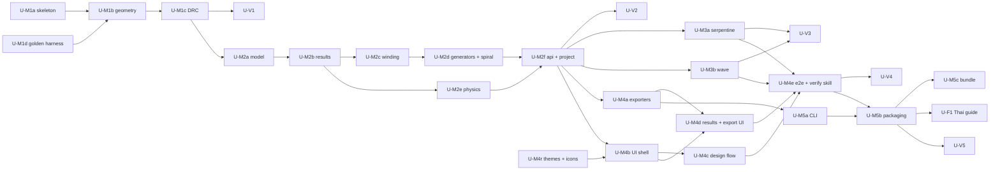

Prepared by: Agent 6 - Software Architecture Specialist - model: claude-opus-5-5

# embodic Phase 2 work breakdown (build contract v1, 2026-10-04)

Each unit below is one fresh worker with one git worktree and branch (standing order 6). A unit writes only its listed
paths. Two units that can run at the same time never share a path, and units of one milestone never share a path even
when ordered (`checks/check_contract.py` verifies both). A later unit may extend a file an earlier, finished unit wrote
only when the dependency graph orders them and the row says so. Interfaces, requirements and tests come from
`interfaces.md`, `requirements.md` and `test_plan.md`; a unit that needs a different signature reports a deviation to
Fable instead of changing the contract silently (architect skill, Phase D).

Revision 2026-10-04 (U-D1, ownership gaps from the W0 pilot): §1 gives 13 units their own issue-catalogue module, gives
U-M1b the GR-19 paths (`tools/golden/functions/m1_layout.mjs`, `tools/golden/cases/m1_layout.json`,
`tests/golden/data/m1_layout/**`, `tests/golden/m1_layout/**`) and gives U-M2e, U-M3a and U-M3b a golden function
module each. §4 records the two new splits. §5 lists the fix rounds U-M1a and U-M1d need. The paths were added by a
script, and `checks/check_contract.py` confirms that no two concurrent or same-milestone units share one.

Revision 2026-10-05 (U-D2, corrections from the W1 and W2 reports): §1 renames planned test folders to the naming rule
of package_layout.md §1 (`tests/unit/io` to `tests/unit/embodic_io`, golden folders to `<milestone>_<area>`, Qt test
folders to `qt_<area>`; a script did the renames and `checks/check_contract.py` now checks the rule). U-M1b's done
predicate uses the test IDs of test_plan.md. U-M2f gains `src/embodic/io/board_dump.py` for the `design` keyword. U-M4b
gains `tests/unit/ui/__init__.py`. §7 lists the fix rounds the W1 and W2 reports need, and §6 the hand-offs to Agents 1
and 4.

Revision 2026-10-05 (U-D3, units Fable added on 2026-10-05): §8 records the six units of that day with their batch,
write paths and merge order. `checks/check_contract.py` now also reads §8 and fails when two units of one batch, or a
§8 unit and a §1 unit of the wave it runs beside, share a write path. §7 marks which rows moved: the U-M1b fix round
is merged into the U-M1c fix round, the U-M1d fix round 2 runs beside W5, and the U-M2a fix round gains the two D-016
fields.

Revision 2026-10-08 (U-D4): §8 lists the fourteen units run or started since the U-D3 revision, with the write paths
their briefs granted, and adds U-M2e-4 for the D-031f physics items. `checks/check_contract.py` checks the new batches.

Sizes: S below 300 lines of code and tests, M 300 to 1000, L 1000 to 2500, XL above 2500 (`assumption`, estimated from
the Xcoil line counts in Agent 3's `migration_mapping.md` §3 and the Phase 1 module list).

`commit gates` below means `python tools/ci.py --profile commit` (ruff, `lint-imports`, mypy strict on the core, pytest
commit profile, trace matrix). Every unit ends with that command green and quotes its real output in the report.

## 1. Units

| Unit | M | Owner | Goal | Inputs | Outputs | Write paths | Verify | Done predicate | Size | Depends |
|---|---|---|---|---|---|---|---|---|---|---|
| U-M1a | M1 | Agent 3 | Repository skeleton, base modules, gates and CI as scaffold for every later unit | package_layout.md §1 to §5; interfaces.md §1 | installable package `embodic` 0.0.x with `units`, `errors`, `paths`; final import-linter contracts; `tools/ci.py`; CI workflow; static lints MT-04 to MT-07, LG-01, LG-08 | `pyproject.toml` `.github/**` `CHANGELOG.md` `src/embodic/__init__.py` `src/embodic/units.py` `src/embodic/errors/__init__.py` `src/embodic/errors/catalogue/__init__.py` `src/embodic/errors/catalogue/base.py` `src/embodic/paths.py` `tests/conftest.py` `tests/unit/base/**` `tests/static/**` `tools/ci.py` `tools/trace_matrix.py` | `pip install -e .[dev]`; `python tools/ci.py --profile commit`; `lint-imports` against a scratch module that breaks each contract once; resource-root check in editable and wheel installs (package_layout.md §1) | commit gates green; each contract C1 to C4 shown failing once on the scratch module; UT-UNI-01, MT-07 pass | M | - |
| U-M1d | M1 | Agent 3 | Golden harness skeleton: Node dumper, committed M1 fixtures, Python comparators and tolerance map | Xcoil `engine.js` (read-only); Agent 3 port notes §7; test_plan.md §3 | `tools/golden/dump_xcoil.mjs`; fixtures for discretise, primitive length, DRC distance kernels; comparator library with non-finite decoding | `tools/golden/dump_xcoil.mjs` `tools/golden/cases/m1.json` `tools/golden/README.md` `tests/golden/conftest.py` `tests/golden/harness/**` `tests/golden/data/m1/**` `tests/golden/expected_diffs/m1.toml` | `node tools/golden/dump_xcoil.mjs tools/golden/cases/m1.json` twice gives byte-identical fixtures; `pytest tests/golden/harness -q` | fixtures committed with `engine_sha256`; comparator self-tests pass (tolerance classes, band rule, non-finite round trip); nothing written under /home/claude/serpentine | M | - |
| U-M4r | M4 | Agent 1 | Final theme files and the original monochrome icon set | Agent 1 tokens.json; interfaces.md §11 (ThemeTokens, TOOLSTRIP icon stems) | `light.json`, `dark.json` with every token; one SVG per TOOLSTRIP icon stem drawn with `currentColor` | `resources/themes/**` `resources/icons/**` `docs/phase2/design/**` `tools/design/**` | Agent 1's palette validator on both themes; a script lists TOOLSTRIP icon stems without a file | 0 missing tokens or icons; validator passes for both themes; AX-08 thresholds met on paper | M | - |
| U-M1b | M1 | Agent 3 | Geometry primitives, transforms, discretise, electrical element list, Layout container and board dump | interfaces.md §5, §9.2; U-M1d fixtures | `embodic.geometry` (without `details.py`); `Layout` without the `derived` and `detail` fields (added by U-M2d, planned interim); shared enums in `model/vocabulary.py`; `io.board_dump` | `src/embodic/model/__init__.py` `src/embodic/model/vocabulary.py` `src/embodic/geometry/**` `src/embodic/io/__init__.py` `src/embodic/io/board_dump.py` `tests/unit/geometry/**` `tests/unit/embodic_io/board_dump/**` `tests/golden/m1_geometry/**` `src/embodic/errors/catalogue/geometry.py` `tools/golden/functions/m1_layout.mjs` `tools/golden/cases/m1_layout.json` `tests/golden/data/m1_layout/**` `tests/golden/m1_layout/**` | commit gates; `node tools/golden/dump_xcoil.mjs tools/golden/cases/m1_layout.json` twice gives byte-identical fixtures; `pytest tests/unit/geometry tests/golden/m1_geometry tests/golden/m1_layout -q` | UT-GEO-01, UT-GEO-15, UT-GEO-22, UT-GEO-23, GR-17, GR-19 pass (IDs amended 2026-10-05, test_plan.md §5.1); GR-19 maps the raw Xcoil layout of each topology to a board dump in Python (test_plan.md §3) | M | U-M1a, U-M1d |
| U-M1c | M1 | Agent 3 | DRC on any Layout with rule D-006, symmetry shortcut and exact kernels | interfaces.md §7; U-M1d fixtures; Phase 1 §11 performance design | `embodic.drc`; `DrcRules` | `src/embodic/drc/**` `src/embodic/model/drc_rules.py` `tests/unit/drc/**` `tests/golden/m1_drc/**` `src/embodic/errors/catalogue/drc.py` | commit gates; `pytest tests/unit/drc tests/golden/m1_drc -q`; board dump of a fault-injected layout | UT-DRC-02 to UT-DRC-08, GR-18, PR-01 on random primitive sets, PR-02 pass; 1 um intrusion reported | L | U-M1b |
| U-V1 | M1 | Agent 4 | Independent checks for the M1 pilot | interfaces.md; board-dump format; Agent 4 strategy | own brute-force clearance checker, continuity checker and board-dump reader; tests against the public API | `tests/independent/m1/**` | `pytest tests/independent/m1 -q` against the merged M1 head | independent checker agrees with `run_drc` on 50 random layouts and on the fault-injection case; any disagreement filed as a DEF row | M | U-M1c |
| U-M2a | M2 | Agent 3 | Design model, field table, draft and provenance | interfaces.md §2; ADR-0010 | `embodic.model` complete (extends `vocabulary.py` from U-M1b) | `src/embodic/model/**` `tests/unit/model/**` `tests/unit/boundary/**` `src/embodic/errors/catalogue/model.py` | commit gates; `pytest tests/unit/model tests/unit/boundary -q` | UT-MOD-01 to UT-MOD-05, BV-01 to BV-03, BV-06 pass | L | U-M1c |
| U-M2b | M2 | Agent 3 | Results, Traceable, registry loader, status rule and formatting | interfaces.md §3; Agent 2 registry v1 (U-S2); Agent 5 evidence JSON (U-S3) | `embodic.results`; packaged registry copies; `tools/sync_registry.py` | `src/embodic/results/**` `tests/unit/results/**` `tools/sync_registry.py` `resources/evidence/**` `src/embodic/errors/catalogue/results.py` | commit gates; `python tools/sync_registry.py --check` | UT-RES-01 to UT-RES-07, UT-UNI-03, TR-03, TR-04 pass; registry copies equal their sources by SHA-256 | M | U-M2a |
| U-M2c | M2 | Agent 3 | Spiral winding plan: feasibility, star of slots, winding factors | interfaces.md §4; Agent 2 EQ-08 | `embodic.winding` | `src/embodic/winding/**` `tests/unit/winding/**` `src/embodic/errors/catalogue/winding.py` | commit gates; `pytest tests/unit/winding -q` | UT-WND-01 to UT-WND-11 pass | M | U-M2b |
| U-M2e | M2 | Agent 3 | Physics kernels and `analyse()` for any Layout | interfaces.md §8; Agent 2 equation spec v1; golden fixtures it generates itself | `embodic.physics`; physics golden fixtures | `src/embodic/physics/**` `tests/unit/physics/**` `tests/golden/m2_physics/**` `tests/golden/data/physics/**` `tests/golden/expected_diffs/physics.toml` `tools/golden/cases/physics.json` `src/embodic/errors/catalogue/physics.py` `tools/golden/functions/physics.mjs` | commit gates; `pytest tests/unit/physics tests/golden/m2_physics -q` | UT-PHY-01 to UT-PHY-21, GR-01 to GR-16 pass; OR tests pass or `xfail` with the Phase 1 reason | XL | U-M2b |
| U-M2d | M2 | Agent 3 | Generator interface and the spiral generator | interfaces.md §5, §6; Agent 2 spiral algorithm (U-S2); ADR-0012 | `embodic.generators` with `GENERATORS`, spiral generator, serpentine and wave stubs returning UNSUPPORTED_TOPOLOGY; `geometry.details`; `Layout.derived` and `Layout.detail` added; outline and fasteners | `src/embodic/generators/**` `src/embodic/geometry/details.py` `src/embodic/geometry/layout.py` `src/embodic/geometry/outline.py` `src/embodic/geometry/fasteners.py` `tests/unit/generators/**` `tests/unit/geometry/m2/**` `src/embodic/errors/catalogue/generators.py` | commit gates; `pytest tests/unit/generators tests/unit/geometry -q` | UT-GEO-02 to UT-GEO-11, UT-GEO-13, UT-GEO-14, UT-GEO-16 to UT-GEO-21, UT-GEN-01, UT-GEN-02, OR-04 pass; default spiral passes DRC | XL | U-M2c |
| U-M2f | M2 | Agent 3 | Compute facade, outcome, project file v1, examples | interfaces.md §9.1, §10; Agent 2 default and oracle parameter sets | `embodic.api`, `embodic.outcome`, project load and save with the degree converter (interfaces.md §9.1), JSON Schema, spiral examples; `design` keyword of `write_board_dump` (§9.2) | `src/embodic/api.py` `src/embodic/outcome.py` `src/embodic/io/project.py` `src/embodic/io/canonical.py` `src/embodic/io/migrations.py` `src/embodic/io/examples.py` `src/embodic/io/board_dump.py` `src/embodic/io/schema/**` `resources/examples/**` `tests/unit/embodic_io/project/**` `tests/unit/api/**` `tests/unit/property/**` `src/embodic/errors/catalogue/project.py` | commit gates; `pytest tests/unit/embodic_io/project tests/unit/api tests/unit/property -q` | UT-IO-01 to UT-IO-05, UT-IO-07, UT-IO-08, PR-03, PR-05 to PR-12 pass; every example computes with no ERROR issue | L | U-M2d, U-M2e |
| U-V2 | M2 | Agent 4 | Independent M2 checks: closed forms, provenance truth table, project round trip | interfaces.md; Agent 2 reference cases | own expected values and scripts | `tests/independent/m2/**` | `pytest tests/independent/m2 -q` against the merged M2 head | agreement or DEF rows with reproduce steps | M | U-M2f |
| U-M3a | M3 | Agent 3 | Faithful serpentine port with layout-level golden regression | Xcoil `engine.js` l.163-753 (read-only); interfaces.md §2.2, §6; test_plan.md §3 | `generate_serpentine`; serpentine fixtures, parameter map, one serpentine example | `src/embodic/generators/serpentine/**` `tests/unit/generators/serpentine/**` `tests/golden/m3_serpentine/**` `tests/golden/data/serpentine/**` `tests/golden/expected_diffs/serpentine.toml` `tools/golden/cases/serpentine.json` `tools/golden/param_map/serpentine.json` `resources/examples/serpentine_16p_example.embodic.json` `tests/unit/property/serpentine/**` `src/embodic/errors/catalogue/serpentine.py` `tools/golden/functions/serpentine.mjs` | commit gates; `pytest tests/unit/generators/serpentine tests/golden/m3_serpentine -q` | GR-20, GR-22 (serpentine part), GR-23, UT-GEN-03, PR-13, PR-14 pass; every M2 gate still green | L | U-M2f |
| U-M3b | M3 | Agent 3 | Faithful wave port (involute, jog, chord, overlap) with layout-level golden regression | Xcoil `engine.js` l.1449-2230 (read-only); interfaces.md §2.2, §6 | `generate_wave`; wave fixtures, parameter map, one wave example | `src/embodic/generators/wave/**` `tests/unit/generators/wave/**` `tests/golden/m3_wave/**` `tests/golden/data/wave/**` `tests/golden/expected_diffs/wave.toml` `tools/golden/cases/wave.json` `tools/golden/param_map/wave.json` `resources/examples/wave_16p_example.embodic.json` `tests/unit/property/wave/**` `src/embodic/errors/catalogue/wave.py` `tools/golden/functions/wave.mjs` | commit gates; `pytest tests/unit/generators/wave tests/golden/m3_wave -q` | GR-21, GR-22 (wave part), GR-23, UT-GEN-04, PR-13, PR-14 pass; every M2 gate still green | L | U-M2f |
| U-V3 | M3 | Agent 4 | Independent checks of both ports | board dumps of both producers | own comparison of embodic and Xcoil dumps, brute-force DRC on ported boards | `tests/independent/m3/**` | `pytest tests/independent/m3 -q` | agreement or DEF rows | M | U-M3a, U-M3b |
| U-M4a | M4 | Agent 3 | Exporters: SVG, DXF complete, outline and screws, PDF report, README, bundle | interfaces.md §9.3; Xcoil writers (engine.js l.2796-2929, report.js) | `embodic.io` writers | `src/embodic/io/svg_writer.py` `src/embodic/io/dxf_writer.py` `src/embodic/io/pdf_writer.py` `src/embodic/io/report.py` `src/embodic/io/readme_writer.py` `src/embodic/io/bundle.py` `src/embodic/io/exporters.py` `tests/unit/embodic_io/exporters/**` `src/embodic/errors/catalogue/exporters.py` `tests/unit/property/t_junctions.py` | commit gates; `pytest tests/unit/embodic_io/exporters -q` | UT-EXP-01 to UT-EXP-05, UT-IO-06 pass for every example | L | U-M2f |
| U-M4b | M4 | Agent 3 | Desktop shell: app, worker, theme loading, toolstrip, geometry view, outcome view-model | interfaces.md §11; Agent 1 design spec v1 (U-S4); U-M4r resources | runnable `embodic` window showing an outcome | `src/embodic/ui/__init__.py` `src/embodic/ui/app.py` `src/embodic/ui/workers.py` `src/embodic/ui/theme.py` `src/embodic/ui/toolstrip.py` `src/embodic/ui/strings/__init__.py` `src/embodic/ui/strings/shell.py` `src/embodic/ui/viewmodels/__init__.py` `src/embodic/ui/viewmodels/observable.py` `src/embodic/ui/viewmodels/outcome.py` `src/embodic/ui/viewmodels/appearance.py` `src/embodic/ui/views/__init__.py` `src/embodic/ui/views/main_window.py` `src/embodic/ui/views/toolstrip_bar.py` `src/embodic/ui/views/geometry_view.py` `src/embodic/ui/views/style.py` `tests/ui/qt_shell/**` `tests/unit/ui/__init__.py` `tests/unit/ui/shell/**` `tools/contrast_check.py` `pyproject.toml` | commit gates; `QT_QPA_PLATFORM=offscreen pytest tests/ui/qt_shell -q`; `python tools/contrast_check.py` | UI-02 to UI-05, UI-12, UI-23, UI-25 to UI-27, AX-01, AX-03, AX-08, AX-09 pass | L | U-M2f, U-M4r |
| U-M4c | M4 | Agent 3 | New-design flow: session state machine, New design dialog, examples gallery, input panels for three topologies | interfaces.md §2.3, §2.4, §11; ADR-0010 | `DesignSessionViewModel`, form panels driven by the field table | `src/embodic/ui/strings/design.py` `src/embodic/ui/viewmodels/session.py` `src/embodic/ui/views/new_design_dialog.py` `src/embodic/ui/views/examples_gallery.py` `src/embodic/ui/views/coil_panel.py` `src/embodic/ui/views/phase_panel.py` `src/embodic/ui/views/layer_panel.py` `src/embodic/ui/views/board_rotor_panel.py` `src/embodic/ui/views/serpentine_panel.py` `src/embodic/ui/views/wave_panel.py` `tests/ui/qt_design/**` `tests/unit/ui/session/**` | commit gates; `pytest tests/unit/ui/session -q`; `QT_QPA_PLATFORM=offscreen pytest tests/ui/qt_design -q` | UT-SES-01, UT-SES-02, UI-11, UI-14 to UI-16, UI-18, UI-19, UI-21, UI-22, UI-24, UI-28 pass | L | U-M4b |
| U-M4d | M4 | Agent 3 | Results, checks, equation reference and export views | interfaces.md §11 (ResultsViewModel, ExportViewModel) | results rail, results view with disclosure, charts, checks list, export view and confirmation dialog | `src/embodic/ui/strings/results.py` `src/embodic/ui/strings/export.py` `src/embodic/ui/viewmodels/results.py` `src/embodic/ui/viewmodels/export.py` `src/embodic/ui/views/results_view.py` `src/embodic/ui/views/results_rail.py` `src/embodic/ui/views/charts.py` `src/embodic/ui/views/status_badge.py` `src/embodic/ui/views/checks_view.py` `src/embodic/ui/views/export_view.py` `src/embodic/ui/views/dialogs.py` `src/embodic/ui/views/equation_view.py` `tests/ui/qt_results/**` `tests/unit/ui/results/**` | commit gates; `QT_QPA_PLATFORM=offscreen pytest tests/ui/qt_results -q` | UI-06, UI-07, UI-10, UI-13, UI-17, UI-29 to UI-34 pass | L | U-M4b, U-M4a |
| U-M4e | M4 | Agent 3 | End-to-end UI walkthroughs for all three topologies and the project `verify` skill | U-M4c, U-M4d heads; pstack create-verification-skill | `.claude/skills/verify`; e2e tests | `.claude/skills/verify/**` `tests/ui/qt_e2e/**` | `QT_QPA_PLATFORM=offscreen pytest tests/ui/qt_e2e -q`; the verify skill drives the app offscreen and saves screenshots | AX-02 and UI-09 pass, AX-04 passes with four strict xfails (DEF-M4e2-01 to DEF-M4e2-03, test_plan.md §5.6), and UI-20 is not implemented (REQ-F-30 is a `could`); every example opens, computes and exports through the UI. Status on main 4fda98d (revision 2026-10-11, U-D12): partial. U-M4e-1 and U-M4e-2 are done (§8). The four xfails go to U-M4e-3, and Fable's acceptance of M4 is open | M | U-M4c, U-M4d, U-M3a, U-M3b |
| U-V4 | M4 | Agent 4 | Independent export parsing and UI accessibility review | exports from U-M4e; Agent 1 checklist | own parsers for SVG, DXF and PDF content; Narrator checklist record | `tests/independent/m4/**` | `pytest tests/independent/m4 -q` | agreement or DEF rows; AX-05 and AX-06 manual records filed | M | U-M4e |
| U-M5a | M5 | Agent 3 | Headless CLI | interfaces.md §12 | `embodic-cli` with compute, validate, export | `src/embodic/cli/**` `tests/unit/cli/**` `src/embodic/errors/catalogue/cli.py` | commit gates; `embodic-cli compute resources/examples/spiral_12c16p_default.embodic.json --json out.json` | UT-CLI-01, UT-CLI-02 pass; exit codes 0 to 3 shown | S | U-M4a |
| U-M5b | M5 | Agent 3 | Packaging, lock files, README, English install guide, licence list, performance baseline | package_layout.md §5; REQ-N-05 to REQ-N-07, REQ-N-19 | wheel, lock files, README, `docs/install/INSTALL.md`, baseline JSON | `pyproject.toml` `requirements/**` `README.md` `THIRD_PARTY_LICENSES.md` `docs/install/INSTALL.md` `tests/packaging/**` `tests/performance/**` | `python -m build` twice and compare; `python tools/ci.py --profile release` | PK-01 to PK-05, PK-07, PK-08 pass; PF-01 to PF-05 recorded with machine data | M | U-M5a, U-M4e |
| U-M5c | M5 | Agent 3 | PyInstaller one-folder build attempt (stretch, D-015) | U-M5b wheel | `tools/build_bundle.py`, spec files, smoke test | `tools/build_bundle.py` `packaging/pyinstaller/**` `tests/bundle/**` | `python tools/build_bundle.py`; bundle smoke test computes an example | PK-05 passes, or the unit reports `blocked` with the exact failure | M | U-M5b |
| U-F1 | M5 | Fable | Thai install guide from the English guide | `docs/install/INSTALL.md` | `docs/install/INSTALL_TH.md` | `docs/install/INSTALL_TH.md` | Fable reads it against INSTALL.md section by section | every command in INSTALL.md appears unchanged in the Thai guide | S | U-M5b |
| U-V5 | M5 | Agent 4 | Timed fresh-install walkthrough and release verification | README, wheel, INSTALL.md | PK-06 record | `tests/independent/m5/**` | walkthrough on a clean machine, timed | PK-06 below 10 minutes or a DEF row | S | U-M5b |

## 2. Dependency graph

## 3. Waves: which units may run in parallel

A wave starts when every dependency of its units has been merged by Fable. Units in one wave have disjoint write paths
(checked).

| Wave | Units | Agent 3 workers needed |
|---|---|---|
| W0 | U-M1a, U-M1d, U-M4r (Agent 1) | 2 |
| W1 | U-M1b | 1 |
| W2 | U-M1c | 1 |
| W3 | U-V1 (Agent 4), U-M2a | 1 |
| W4 | U-M2b | 1 |
| W5 | U-M2c, U-M2e | 2 |
| W6 | U-M2d (U-M2e may still be running) | 1 |
| W7 | U-M2f | 1 |
| W8 | U-V2 (Agent 4), U-M3a, U-M3b, U-M4a, U-M4b | 4 |
| W9 | U-V3 (Agent 4), U-M4c, U-M4d, U-M5a | 3 |
| W10 | U-M4e | 1 |
| W11 | U-V4 (Agent 4), U-M5b | 1 |
| W12 | U-M5c, U-F1 (Fable), U-V5 (Agent 4) | 1 |

Critical path: U-M1a, U-M1b, U-M1c, U-M2a, U-M2b, U-M2c, U-M2d, U-M2f, U-M4b, U-M4c, U-M4e, U-M5b, U-M5c. The XL units
on it (U-M2d) and beside it (U-M2e) carry most of the schedule risk; both depend on Agent 2's U-S2 deliverables.

## 4. Shared-state decisions

The principle applied: give each concurrent actor its own file instead of serialising writes to one file.

| Would-be shared file | Split | Why |
|---|---|---|
| one UI string catalogue | `embodic/ui/strings/{shell,design,results,export}.py`, merged by `strings/__init__.py` with a duplicate-key check | U-M4b, U-M4c and U-M4d add strings at the same time |
| one examples index | one self-describing file per example, folder scan | U-M2f, U-M3a and U-M3b add examples |
| one golden allow-list and parameter map | `tests/golden/expected_diffs/<area>.toml`, `tools/golden/param_map/<topology>.json` | U-M2e, U-M3a and U-M3b record deviations at the same time |
| one issue-message catalogue (`embodic.errors.MESSAGES`) | `src/embodic/errors/catalogue/<area>.py`, one module per owning unit (table below), merged by `errors/__init__.py` with `pkgutil.iter_modules` and a duplicate-code check | every unit that returns issues adds codes; U-M3a and U-M3b, and U-M4a with U-M5a, add them at the same time |
| one `FUNCTIONS` table in the golden dumper | M1 kernels stay in `dump_xcoil.mjs` (U-M1d); every other area adds `tools/golden/functions/<area>.mjs`, loaded by the area name in its case file | U-M1b, U-M2e, U-M3a and U-M3b each need engine functions; U-M3a and U-M3b run at the same time |
| import-linter contracts edited per package | written once in U-M1a with optional layers `( )` | no later unit edits `pyproject.toml` until U-M5b |
| generator registry | `GENERATORS` written once in U-M2d with serpentine and wave stubs; U-M3a and U-M3b replace only their own subpackage | no concurrent edit of `generators/__init__.py` |
| packaged registry JSON | written only by `tools/sync_registry.py` from the owners' files in docs | Agents 2 and 5 own content; one tool owns the copy |
| stage cache across UI threads | one `StageCache` per worker thread (interfaces.md §10) | no lock needed |

Issue codes and catalogue modules. A unit puts every issue code it introduces into its own module, never into another
unit's module, even when the dependency graph orders the two units. Codes are `UPPER_SNAKE` with a prefix from
`CODE_PREFIXES` and are unique across all modules. A unit without a module below that needs an issue code reports a
deviation to Fable. UI text is not an issue message and goes to `embodic/ui/strings/`.

| Catalogue module | Unit |
|---|---|
| `base.py`: the codes interfaces.md names in §1, §2.4 and §9.1 (already in U-M1a's `errors.py`) | U-M1a |
| `geometry.py` | U-M1b |
| `drc.py` | U-M1c |
| `model.py` | U-M2a |
| `results.py` | U-M2b |
| `winding.py` | U-M2c |
| `generators.py` | U-M2d |
| `physics.py` | U-M2e |
| `project.py` | U-M2f |
| `serpentine.py` | U-M3a |
| `wave.py` | U-M3b |
| `exporters.py` | U-M4a |
| `cli.py` | U-M5a |

Why every unit and not only the parallel ones. The U-D1 brief proposed that sequential units append to `errors.py` and
only parallel units get their own module. That would make U-M1a, U-M1b and U-M1c share one file inside M1, and U-M2a to
U-M2f share it inside M2. `checks/check_contract.py` rejects a shared path inside one milestone, and the shared file
buys nothing: the invariant is "codes unique and every code has a message", which the merge checks for any number of
modules. One rule for every unit is also one rule fewer for a worker to get wrong.

PyInstaller (U-M5c). A frozen build finds `embodic.errors.catalogue` and `embodic.ui.strings` modules only if the spec
collects them (for example `collect_submodules`). `inferred` from how `pkgutil.iter_modules` reads the import path;
`not tested`.

## 5. Pilot fix rounds (revision 2026-10-04, U-D1)

The W0 pilot units are merged. Each needs one fix round before U-M1b starts, run by a fresh worker under the same unit
ID and the same write paths (the paths in §1 already show the result).

| Fix round | Deliverable | Done when |
|---|---|---|
| U-M1a fix round | `errors.py` becomes `errors/__init__.py` plus `errors/catalogue/__init__.py` and `catalogue/base.py` with the existing codes, merged by discovery with a duplicate-code check; `round_half_away_from_zero` replaced by `js_round` and `quantise` (interfaces.md §1), the MT-06 message updated to name them; hatchling `>=1.27,<2` added to the `dev` extra | commit gates green; UT-UNI-01 as amended in test_plan.md §5.1 passes; a scratch catalogue module with a duplicate code makes `import embodic.errors` raise (shown once, then deleted); `pip wheel --no-build-isolation --no-deps .` succeeds offline |
| U-M1d fix round | the dumper loads `tools/golden/functions/<area>.mjs` for any area other than `m1` and rejects a function name defined twice; the helpers a function module needs (primitive record conversion, non-finite decoding) are importable from a module that does not run `main()` | `m1.json` fixtures stay byte-identical; a scratch area module is loaded and a duplicate function name stops the run (shown once, then deleted) |

## 6. Hand-offs that are not code units

| From | Deliverable | Needed by |
|---|---|---|
| Agent 2 (U-S2) | `docs/phase2/engineering/equation_registry.json` v1 with `validity_checks` in the ValidityCheckSpec shape (DEF-23 fields), spiral generator algorithm, examples' parameter sets, GR-22 tolerance | U-M2b, U-M2d, U-M2e, U-M2f, U-M3a, U-M3b |
| Agent 5 (U-S3) | evidence register JSON (Phase 1 §13 format) | U-M2b |
| Agent 1 (U-S4) | design spec v1 incl. toolstrip layout, New design dialog and example chip | U-M4b, U-M4c, U-M4d |
| Fable | merge after each wave; acceptance on the real artifact per milestone | every next wave |
| Agent 1 | screens.md revision per `screen_model_reconciliation.md` rows R1 to R14 (added 2026-10-05) | U-M2a fix round (objectNames of R9), U-M4c |
| Agent 4 | continuity instrument at the 1e-6 mm bound of interfaces.md §5 (`tests/independent/m1/continuity.py`); board dump v2 with Agent 6 (§13 point 4) (added 2026-10-05) | U-V1b or U-V2; U-V3 |

## 7. Fix rounds after W1 and W2 (revision 2026-10-05, U-D2)

Each row is one fresh worker under the named unit ID. The paths belong to finished units, so no concurrent unit
writes them; the "after" column names the in-flight unit that must merge first.

| Fix round | Write paths | After | Deliverable | Done when |
|---|---|---|---|---|
| U-M1d fix round 2 (band-rule fixtures, U-M1c report); revision 2026-10-05 (U-D3): deferred, runs beside W5, see §8 | `tools/golden/functions/m1_drc.mjs` `tools/golden/cases/m1_drc.json` `tests/golden/data/m1_drc/**` `tests/golden/m1_drc/**` | U-M1z | DRC golden cases whose fixtures carry the rule `p.clearance`, Xcoil's value and Xcoil's own verdict, so GR-18 can call `compare_drc(..., golden_pass=...)` with the band rule of test_plan.md §3. The M1 kernel fixtures carry no rule and no verdict today | at least one case below the band, one inside `[rule - 0.004, rule)` and one at or above the rule; the inside case is logged indeterminate, the others agree; two dumps are byte-identical; `tests/golden/data/m1/**` unchanged |
| U-M1b fix round (test IDs, DEF-M1b-01); revision 2026-10-05 (U-D3): merged into the U-M1c fix round, see §8 | `tests/unit/geometry/test_transforms.py` `tests/unit/geometry/test_discretise.py` | - | test names and docstrings say UT-GEO-22 and UT-GEO-23 instead of UT-GEO-12 and UT-GEO-15 | no test in `tests/unit/geometry` names UT-GEO-12, and only the determinism test in `test_layout.py` names UT-GEO-15; commit gates green |
| U-M2a fix round (model, U-M2a report and `screen_model_reconciliation.md`); revision 2026-10-05 (U-D3): runs after U-S4b and U-D3 merge and also adds the D-016 fields, see §8 | `src/embodic/model/**` `src/embodic/errors/catalogue/model.py` `tests/unit/model/**` | U-M1z, Agent 1's screens.md revision | units `UM`, `W_PER_M2_K`, `OHM_M`, `PER_K`, `G_PER_CM3` on plating, convection and material override values; `phases` optional with neutral value 3 (R9); widget ids of R5, R6 and R9; INFO issue `RANGE_COIL_GAP_BELOW_CLEARANCE` (R12); a UT-GEO-12 test (stack-up z exact, Phase 1 meaning) | commit gates green; UT-MOD-03 asserts the new units; a blank spiral draft no longer lists `/phases`; `checks/screen_model_diff.py` prints nothing in lists 2 and 3 |

## 8. Units added since 2026-10-05 (revision 2026-10-05, U-D3; revision 2026-10-08, U-D4; revision 2026-10-08 (U-D5); revision 2026-10-08 (U-D6); revision 2026-10-08 (U-D7); revision 2026-10-09 (U-D8); revision 2026-10-09 (U-D9); revision 2026-10-09 (U-D10); revision 2026-10-09 (U-D11); revision 2026-10-11 (U-D12))

Fable added these units from 2026-10-05 on. Units with the same **Batch** run at the same time. A batch named after a wave
of §3 (for example `W5`) runs beside that wave's §1 units. `checks/check_contract.py` parses this table and checks that
no two units of one batch share a write path. **After** names what must merge first; it orders merges, not runs.

| Unit | Owner | Batch | Write paths | After | Deliverable | Done when |
|---|---|---|---|---|---|---|
| U-M1c fix round | Agent 3 | B1 | `src/embodic/drc/**` `src/embodic/errors/catalogue/drc.py` `tests/unit/drc/**` `tests/unit/geometry/test_transforms.py` `tests/unit/geometry/test_discretise.py` | - | D-022 in `exempt_pairs` and `_check` per interfaces.md §7 (net waiver for interconnect ends on terminal vias and pads; fillet and taper exemption narrowed, DEF-M1V-01); DEF-M1V-05 object ids made to agree between `report.py` and `items.py`; the U-M1b fix-round test IDs (§7). One worker | commit gates green; UT-DRC-04 cases 1a to 4b of test_plan.md §5.1 pass, and the D-022 cases 1d, 2c and 3c fail on the pre-fix code; no test in `tests/unit/geometry` names UT-GEO-12, and only the determinism test names UT-GEO-15 |
| U-E2 | Agent 2 | B1 | `docs/phase2/engineering/**` | - | equation registry corrections (typed fields the results package reads) | the ACCEPTANCE of its brief; Fable reviews |
| U-S4b | Agent 1 | B1 | `docs/phase2/design/**` | - | screens.md revision per `screen_model_reconciliation.md` rows R1 to R14 | the ACCEPTANCE of its brief; Fable reviews |
| U-D3 | Agent 6 | B1 | `docs/phase2/architecture/**` | - | contract text for D-016, D-022, D-023 and DEF-M1V-04; this table | `checks/check_contract.py` passes |
| U-V1b-fix | Agent 4 | B1 | `tests/independent/m1/**` `tests/independent/README.md` | U-M1c fix round, for the DEF-M1V-01 xfail | stale xfail marks removed; continuity instrument at the 1e-6 mm bound of interfaces.md §5 | `pytest tests/independent/m1 -q` green on the merged head |
| U-M1d fix round 2 | Agent 3 | W5 | `tools/golden/functions/m1_drc.mjs` `tools/golden/cases/m1_drc.json` `tests/golden/data/m1_drc/**` `tests/golden/m1_drc/**` | U-M1c fix round | as in §7 (band-rule fixtures for GR-18) | as in §7 |
| U-M2a fix round | Agent 3 | B2 | `src/embodic/model/**` `src/embodic/errors/catalogue/model.py` `tests/unit/model/**` | U-S4b, U-D3 | as in §7, plus `StackMode`, `SerpentineWindingSpec.stack_mode` and `board_gap_mm` with the two FIELDS rows of interfaces.md §2.2, and the UT-GEN-03 relations (copper count per stack mode, gap range) | as in §7; UT-MOD-03 sees both new leaves with their rows; a blank serpentine draft holds `stack_mode` `"single"` and `board_gap_mm` 0.1 with `default` provenance |
| U-M1c-fix2 | Agent 3 | B2 | `src/embodic/drc/**` `tests/unit/drc/**` | U-M1c fix round | D-022c tap exemption: an interconnect path is exempt from every via whose centre lies within `pad_mm / 2` of its centreline (DEF-M1c3-01) | done, merged 1d94913; UT-DRC-04 case 2d passes and its phase-net near miss is reported |
| U-M2a-fix2 | Agent 3 | W5 | `src/embodic/model/**` `tests/unit/model/**` `src/embodic/errors/catalogue/model.py` | U-M2a fix round | D-024 derived layer pairs (`derive_layer_pairs`); odd copper count WARNING `RANGE_SPIRAL_COPPER_COUNT_ODD` (D-025d). The catalogue path was edited beyond the brief's SCOPE line (U-M2a-fix2 report) | done, merged 00ce3ba; `pytest tests/unit/model -q` green |
| U-M2e-2 | Agent 3 | B3 | `src/embodic/physics/**` `tests/unit/physics/**` `tests/golden/m2_physics/**` `tests/golden/data/physics/**` `tests/golden/expected_diffs/physics.toml` `tools/golden/cases/physics.json` `tools/golden/functions/physics.mjs` `src/embodic/errors/catalogue/physics.py` | U-M2e | `analyse()`, EC-05 downgrade, EQ-06/07/12/14/16/19/23/26/27 kernels, EQ-18 waveform (partial: EQ-20 and interconnect copper left) | done (partial), merged a7f3d8b; every `AnalysisResult` field is a `Traceable` with an EQ-ID on three mapped layouts |
| U-M2e-3a | Agent 3 | B4 | `tests/unit/physics/test_oracles.py` | U-M2e-2, U-M2d | OR-01 as a real test, strict xfail on a Ke miss only | done, merged 4591c48 |
| U-E3 | Agent 2 | B5 | `docs/phase2/engineering/**` | - | spiral spec revised for D-028 turn geometry and the DEF-M2d-01 lead; U-M2c questions answered (`inferred`) | done (partial), committed bd019c5 |
| U-M2e-3 | Agent 3 | B5 | `src/embodic/physics/**` `tests/unit/physics/**` `tests/golden/m2_physics/**` `tests/golden/data/physics/**` `tests/golden/expected_diffs/physics.toml` `tools/golden/cases/physics.json` `tools/golden/functions/physics.mjs` `src/embodic/errors/catalogue/physics.py` `src/embodic/results/analysis_result.py` | U-M2e-3a | goldens EQ-06/12/18/23/26, XD-PHY-002 (D-029), EQ-20 port for three phases, `ke_line_peak_v_s_per_rad`; drive helpers (interfaces.md §8) | done (partial), merged bd019c5; the stopped items move to U-M2e-4 |
| U-E3b | Agent 2 | B6 | `docs/phase2/engineering/**` | U-E3 | G5 centre-via rule for D08's three turns, half closing | done, committed c13f8e4 |
| U-M2d-2 | Agent 3 | B7 | `src/embodic/generators/**` `src/embodic/geometry/details.py` `src/embodic/geometry/layout.py` `src/embodic/geometry/outline.py` `src/embodic/geometry/fasteners.py` `tests/unit/generators/**` `tests/unit/geometry/m2/**` `src/embodic/errors/catalogue/generators.py` `tests/unit/physics/test_oracles.py` | U-E3b | spiral generator per the revised spec: G3 to G5 both closings, G8 chains, star and delta interconnect, `Layout.derived`; OR-01 passes (D-030) | done (partial), merged c071967; CF-11 and D08 DRC-clean |
| U-M2d-fix | Agent 3 | B8 | `src/embodic/generators/spiral/**` `src/embodic/generators/base.py` `src/embodic/errors/catalogue/generators.py` `tests/unit/generators/**` | U-M2d-2 | generator bounds before geometry (D-030), `MAX_TURNS_PER_LAYER = 100` | done, merged 7ce1c3e; fuzz test in bounded memory, gate 6 of 6 twice |
| U-M2d-3 | Agent 3 | B9 | `src/embodic/generators/**` `src/embodic/geometry/details.py` `src/embodic/geometry/fasteners.py` `src/embodic/geometry/outline.py` `src/embodic/geometry/layout.py` `tests/unit/generators/**` `tests/unit/geometry/m2/**` `src/embodic/errors/catalogue/generators.py` `src/embodic/model/outline.py` `src/embodic/model/fields.py` `tests/unit/model/test_outline*.py` `tests/unit/model/test_fields.py` `tests/unit/physics/test_oracles.py` | U-M2d-fix | G9 fillets, side and end styles, several layer pairs, fasteners from `hole_diameter_mm` (D-031a), `TurnLimit.closing` (D-031b), any finite first coil angle (D-031c); `model/` paths for D-031 only | its brief's ACCEPTANCE; UT-GEO-21, UT-GEO-24 and UT-GEO-25 pass; DEF-U-D4-01 and DEF-U-D4-03 closed |
| U-D4 | Agent 6 | B9 | `docs/phase2/architecture/**` | - | contract text for D-022c, D-025, D-026 and D-031; this table | `checks/check_contract.py` and `checks/physics_signatures.py` pass |
| U-S4c | Agent 1 | B9 | `docs/phase2/design/**` | - | screens.md v2.1: DEF-1, `param-screw-hole-diameter`, board picker, derived layer pairs | the ACCEPTANCE of its brief; Fable reviews |
| U-E4 | Agent 2 | B9 | `docs/phase2/engineering/**` | - | D08 phase-resistance explanation, turn-limit wording | the ACCEPTANCE of its brief; Fable reviews |
| U-S3b | Agent 5 | B9 | `docs/phase2/evidence/**` | - | evidence entries requested since U-S3 (ISO 273 hole sizes among them) | the ACCEPTANCE of its brief; Fable reviews |
| U-M2-fix | Agent 3 | B11 | `src/embodic/winding/feasibility.py` `tests/unit/winding/**` `src/embodic/model/draft.py` `src/embodic/model/validate.py` `src/embodic/errors/catalogue/model.py` `src/embodic/errors/catalogue/winding.py` `tests/unit/model/**` `tests/unit/boundary/test_bv_design.py` `tests/unit/results/test_registry.py` | U-D4 | D-032a feasibility t mod a = 0, D-032b layer-pair identity by layer names, D-032c single-mode copper count (DEF-U-D4-02), D-032d `hole_diameter_mm` example values | done, merged 6cf3b8a |
| U-M1c-fix3 | Agent 3 | B11 | `src/embodic/drc/kernels.py` `tests/unit/drc/**` | - | D-032e relative collinearity tolerance in the DRC kernel (DEF-M2d3-01) | done, merged 6cf3b8a; the pinned xfail passes |
| U-M2d-4 | Agent 3 | B11 | `src/embodic/generators/**` `src/embodic/geometry/details.py` `src/embodic/geometry/fasteners.py` `src/embodic/geometry/outline.py` `src/embodic/geometry/layout.py` `tests/unit/generators/**` `tests/unit/geometry/m2/**` `src/embodic/errors/catalogue/generators.py` | U-M2d-3 | D-032g per-corner fillet check; series pairs with the DRC refusal of D-020; one rotation shared by every pair; hole placement from `hole_diameter_mm` | done (partial), merged 6cf3b8a; `/outline/screws` still refused |
| U-E5 | Agent 2 | B11 | `docs/phase2/engineering/**` | - | per-corner fillet closed form and tolerance (D-033a); stadium construction `not tested` | done (partial), committed |
| U-M2-fix2 | Agent 3 | B12 | `tests/golden/expected_diffs/m1.toml` `tests/unit/results/test_registry.py` `src/embodic/model/outline.py` `src/embodic/model/fields.py` `src/embodic/model/schema.py` `src/embodic/model/draft.py` `src/embodic/io/schema/**` `tests/unit/model/**` `tests/unit/boundary/**` `src/embodic/winding/plan.py` `tests/unit/winding/**` `src/embodic/errors/catalogue/winding.py` `src/embodic/errors/catalogue/generators.py` `src/embodic/generators/spiral/turns.py` `src/embodic/generators/spiral/generate.py` `src/embodic/geometry/distance.py` `tests/unit/geometry/**` `src/embodic/generators/fasteners.py` `tests/unit/generators/test_fasteners*.py` | U-M2-fix, U-M1c-fix3, U-M2d-4 | D-033c XD-M1-002 and the distance tolerance, D-033d `hole_diameter_mm` and the code rename, D-033e cause value and end-style code, D-033f registry pins | done (partial), merged e1536b8; `/outline/screws` still refused |
| U-E6 | Agent 2 | B12 | `docs/phase2/engineering/**` | U-E5 | spec G6 series via fan (DEF-M2d4-02), 2k + 1 vias per coil, rotated-apart pairs forbidden | done (partial), committed; stadium closing not produced |
| U-M2e-4 | Agent 3 | W7 | `src/embodic/physics/**` `tests/unit/physics/**` `tests/golden/m2_physics/**` `tests/golden/data/physics/**` `tests/golden/expected_diffs/physics.toml` `tools/golden/cases/physics.json` `tools/golden/functions/physics.mjs` `src/embodic/errors/catalogue/physics.py` `src/embodic/results/analysis_result.py` `src/embodic/geometry/circuit.py` `tests/unit/geometry/test_circuit*.py` | U-M2d-3, U-D4 | interfaces.md §5 `InterconnectRole` and `Circuit.interconnect_roles` with an "unclassified" default; §3 loss-sum fields; §8 EQ-20 with `phases` and `connection` (D-031f) | commit gates green; UT-PHY-22 and UT-PHY-23 pass; `checks/physics_signatures.py` lists no PENDING name; DEF-U-D4-04 closed |
| U-M2d-5 | Agent 3 | W7 | `src/embodic/generators/**` `src/embodic/geometry/details.py` `src/embodic/geometry/fasteners.py` `src/embodic/geometry/outline.py` `tests/unit/generators/**` `tests/unit/geometry/m2/**` `src/embodic/errors/catalogue/generators.py` | U-M2-fix2, U-E6 | spec G6 series via fan; `/outline/screws` from `hole_diameter_mm`; `UNBUILDABLE_PAIRS_ROTATED_APART` | UT-GEO-11, UT-GEO-13 and UT-GEO-26 as test_plan.md §5.1 states them; the ACCEPTANCE of its brief |
| U-D5 | Agent 6 | W7 | `docs/phase2/architecture/**` | - | contract text for D-032 and D-033; this table | `checks/check_contract.py` passes |
| U-M2-fix3 | Agent 3 | B13 | `src/embodic/units.py` `tests/unit/base/**` `src/embodic/model/validate.py` `src/embodic/model/rotor.py` `tests/unit/model/**` `tests/unit/boundary/**` `src/embodic/physics/**` `tests/unit/physics/**` `src/embodic/results/analysis_result.py` `src/embodic/generators/**` `tests/unit/generators/**` `src/embodic/api.py` `src/embodic/outcome.py` `tests/unit/property/**` `tests/unit/api/**` `src/embodic/errors/catalogue/model.py` `src/embodic/errors/catalogue/physics.py` `src/embodic/errors/catalogue/project.py` `pyproject.toml` | U-M2f, U-M2e-4, U-M2d-5 | PR-05 hang root cause (DEF-M2f-03); no raise and no ±inf on a validated design (DEF-M2f-01, DEF-M2f-02); `Unit.N_M_PER_SQRT_W` and `motor_constant_n_m_per_sqrt_w` (DEF-M2e4-01); `Circuit.interconnect_roles` from the spiral generator; PR-10 and the partial PR tests | the ACCEPTANCE of its brief: commit gate 6 of 6 three times, each under 5 minutes |
| U-D6 | Agent 6 | B13 | `docs/phase2/architecture/**` | - | empty PENDING list (DEF-M2e4-02); interfaces.md §9.1 answers to the U-M2f questions; this table | `checks/physics_signatures.py` and `checks/check_contract.py` pass on main a336531 |
| U-E7 | Agent 2 | B13 | `docs/phase2/engineering/**` | - | `series_fan_check.py` against the rewritten `series.py` (DEF-M2d5-01); EQ-23 text on the neutral-pad continuation in a star layout | `series_fan_check.py` prints RESULT PASS on main a336531; `check_consistency` passes |
| U-M2-fix5 | Agent 3 | B14 | `src/embodic/model/validate.py` `src/embodic/errors/catalogue/model.py` `tests/unit/model/**` `src/embodic/results/analysis_result.py` `src/embodic/physics/analyse.py` `tests/unit/physics/**` `tests/unit/property/**` `tests/unit/drc/test_run_drc.py` `tests/static/**` `src/embodic/units.py` `tests/unit/base/**` `tests/golden/expected_diffs/m1.toml` `tests/golden/expected_diffs/physics.toml` | - | seven D-034 items (block magnet wider than its radius, PR-07 field, PR-11 rule, display units among them) | done, merged into 4aec992; gate 6 of 6 |
| U-S3c | Agent 5 | B14 | `docs/phase2/evidence/**` | - | pytest-timeout licence entry and the evidence gaps of its brief | done, committed 4aec992 |
| U-M3-wire | Agent 3 | B15 | `src/embodic/generators/__init__.py` `src/embodic/generators/stubs.py` `tests/unit/generators/test_spiral_generate.py` `tests/unit/results/test_registry.py` | U-M3a, U-M3b | `GENERATORS[WAVE]` is `generate_wave`; `stubs.py` deleted | done, merged 4aec992; gate 6 of 6, 2006 tests |
| U-M3-fix | Agent 3 | B16 | `src/embodic/geometry/layout.py` `src/embodic/outcome.py` `src/embodic/api.py` `src/embodic/drc/items.py` `src/embodic/drc/engine.py` `tests/unit/drc/**` `src/embodic/physics/analyse.py` `tests/unit/physics/**` `src/embodic/generators/serpentine/**` `src/embodic/generators/wave/**` `tests/unit/generators/serpentine/**` `tests/unit/generators/wave/**` `tests/golden/m3_serpentine/**` `tests/golden/m3_wave/**` `src/embodic/model/validate.py` `tests/unit/model/**` `src/embodic/errors/catalogue/serpentine.py` `src/embodic/errors/catalogue/wave.py` `src/embodic/errors/catalogue/drc.py` | U-M3-wire | D-035 a to e: `BoardStack.issues`, §7 rule 5, DEF-M3a-01 fix, DEF-M3a-02 diagnosis, wave star split, wave copper count in `validate_design` | `python tools/ci.py --profile commit` 6 of 6 twice; GR-20 and GR-21 green; the 7 serpentine strand cases DRC-clean |
| U-D7 | Agent 6 | B16 | `docs/phase2/architecture/**` | - | contract text for D-035; this table | `checks/check_contract.py` and `checks/physics_signatures.py` pass |
| U-M3-fix2 | Agent 3 | B17 | `src/embodic/drc/items.py` `src/embodic/drc/engine.py` `tests/unit/drc/**` `src/embodic/generators/wave/**` `tests/unit/generators/wave/**` `tests/golden/expected_diffs/wave.toml` `tests/golden/m3_wave/**` `tests/unit/property/**` `src/embodic/io/project.py` `src/embodic/io/examples.py` `tests/unit/embodic_io/**` `tests/unit/api/**` `resources/examples/**` `src/embodic/errors/catalogue/drc.py` `src/embodic/errors/catalogue/wave.py` `src/embodic/errors/catalogue/project.py` | U-M3-fix, U-D7, U-V3 | D-036 a to f: rule 2b (per primitive after D-037a), the end-group fillet (DEF-UV3-01), PR-14 at 1e-8, `RANGE_WAVE_INTERCONNECT_EXTERNAL`, XD-WAVE-001, packaged examples load as projects | done, merged 695be33; gate 5 of 6 with only the five expected `tests/independent` failures, 2145 passed |
| U-V3b | Agent 4 | B18 | `tests/independent/**` | U-M3-fix2 | rules 5 and 2b in the independent exemption model; the DEF-M3a-01, DEF-UV3-01 and DEF-UV3-02 xfails retired after re-measuring | done, merged 3246f09; `pytest tests/independent -q` 302 passed, 1 skipped, 2 xfailed (DEF-M1V-03) |
| U-D8 | Agent 6 | B19 | `docs/phase2/architecture/**` | - | contract text for D-036 and D-037; this table | `checks/check_contract.py` and the trace matrix pass |
| U-E8 | Agent 2 | B19 | `docs/phase2/engineering/**` `docs/phase2/evidence/evidence_register.md` `docs/phase2/evidence/evidence_register.json` `docs/phase2/evidence/source_gaps_phase2.md` | - | positions on the three items M3 left open: XD-WAVE-001 and the overlap delta case, serpentine strands > 1 beside a same-net via, the per-phase stack interconnect | the ACCEPTANCE of its brief; Fable reviews |
| U-M4r-fix | Agent 1 | B20 | `resources/themes/**` `tools/design/**` `docs/phase2/design/design_spec.md` | - | the theme files carry the status tokens (D-038a); design_spec.md §6 names the toolstrip icon stems of interfaces.md §11 | done, merged 199a655; `tools/design/check_theme_tokens.py` exits 0 and `tests/unit/ui/shell/test_contrast_check.py` passes (U-M4r-fix report) |
| U-M4-fix | Agent 3 | B20 | `src/embodic/ui/viewmodels/appearance.py` `tests/unit/property/t_junctions.py` `tests/golden/expected_diffs/wave.toml` `tests/golden/m3_wave/test_gr22_results.py` `src/embodic/io/exporters.py` `src/embodic/io/report.py` `tests/unit/embodic_io/exporters/**` `src/embodic/results/labels.py` `src/embodic/results/__init__.py` `tests/unit/results/**` | U-M4a, U-M4b | one `PhaseRenderMode` enum; `t_junctions.py` without private imports; XD-WAVE-001 `verified` and XD-WAVE-002 (D-038b, D-038c); `engine_version` is the embodic version (D-038d); `embodic.results.labels` read by the PDF report (D-038e) | done, merged 71cdcf1; merged gate 6 of 6 (store `decisions.tsv`, 2026-10-09T04:10Z) |
| U-M4c-2 | Agent 3 | B21 | `src/embodic/ui/views/coil_panel.py` `src/embodic/ui/views/phase_panel.py` `src/embodic/ui/views/layer_panel.py` `src/embodic/ui/views/board_rotor_panel.py` `src/embodic/ui/viewmodels/session.py` `src/embodic/ui/strings/design.py` `tests/ui/qt_design/**` `tests/unit/ui/session/**` `tests/unit/embodic_io/project/make_examples.py` `resources/examples/**` | U-M4c | the inspector items U-M4c left unbuilt and three defects: segment controls, pair rotation, board picker, screw table, "Mark as measured", `phase-balance-status`, the `offer_recovery` test, DEF-3 heading, and the example builder rounding derived values to 1e-9 (DEF-1, D-038f) | the ACCEPTANCE of its brief; Fable reviews |
| U-S4d | Agent 1 | B21 | `docs/phase2/design/**` `tools/design/**` `resources/themes/**` `resources/icons/**` | U-M4c | design review of the first M4 screens, with one ruling per open point (greyscale exports, label density, new objectNames, tab focus ring, DRC wording in the rail, rail below 1280 px) | the ACCEPTANCE of its brief; Fable reviews |
| U-D9 | Agent 6 | B21 | `docs/phase2/architecture/**` | - | contract text for D-038; this table | `checks/check_contract.py` and the trace matrix pass |
| U-M4f | Agent 3 | B22 | `resources/fonts/**` `src/embodic/ui/fonts.py` `src/embodic/ui/app.py` `src/embodic/ui/viewmodels/outcome.py` `src/embodic/geometry/marks.py` `src/embodic/geometry/labels.py` `src/embodic/io/svg_writer.py` `src/embodic/io/pdf_writer.py` `src/embodic/io/report.py` `src/embodic/errors/catalogue/exporters.py` `pyproject.toml` `tests/unit/embodic_io/exporters/**` `tests/unit/geometry/marks/**` `tests/unit/ui/fonts/**` `tests/ui/qt_shell/test_fonts.py` | U-M4a, U-M4b, U-S4d | Inter and JetBrains Mono bundled under `resources/fonts/` with their licence texts and `FONTS.md`, and `register_fonts` called from `app.py` (D-039 a). The PDF writer embeds both fonts whole with its own stdlib TrueType reader, and a missing glyph raises `MissingGlyphError` (D-039 b). `embodic.geometry.marks` and `embodic.geometry.labels`. SVG and PDF draw labels with a halo, clipped eye fills, a solid legend and an unclipped footer in both modes (D-039 c, d). `pyproject.toml` gets the `fonttools` dev line only | done, merged 1711728. Branch gate 6 of 6, 2441 passed, 4 xfailed; pypdf finds `502 mΩ`, `434 mΩ` and `1.34 µH` in the D08 report (U-M4f report). Two strict xfails: JetBrains Mono has no U+202F |
| U-M4d-fix | Agent 3 | B22 | `src/embodic/ui/views/main_window.py` `src/embodic/ui/views/results_rail.py` `src/embodic/ui/views/results_view.py` `src/embodic/ui/views/checks_view.py` `src/embodic/ui/views/style.py` `src/embodic/ui/views/toolstrip_bar.py` `src/embodic/ui/viewmodels/results.py` `src/embodic/ui/strings/results.py` `src/embodic/results/labels.py` `tests/ui/qt_results/**` `tests/ui/qt_shell/test_rail_layout.py` `tests/unit/ui/results/**` `tests/unit/results/**` | U-M4d, U-S4d | from 1280 px the rail is a third pane in a scroll area, below it the Key results tab; Inputs and DRC cards; the focus-ring test passes on the QSS template rules alone; the DRC message column shows the catalogue text in full; `QUANTITY_SYMBOLS` and `quantity_title` with 21 symbols and four held back; `ResultRow.title` (D-039 e, f) | done (partial: four Greek symbols held back by LG-01), merged 3d70170. Branch gate 6 of 6; merged gate 5 of 6, the one failure was DEF-M3b-03. Open: DEF-1 (Results card grid clipped at 1280 x 800) and DEF-2 (DRC table scrolls sideways at 1280 px) |
| U-M3-fix3 | Agent 3 | B23 | `src/embodic/generators/wave/**` `src/embodic/generators/serpentine/**` `src/embodic/generators/base.py` `src/embodic/errors/catalogue/wave.py` `src/embodic/errors/catalogue/serpentine.py` `tests/unit/generators/wave/**` `tests/unit/generators/serpentine/**` | U-M3-fix2, U-M4d-fix | D-030 input bounds for the wave and serpentine ports before any geometry is built (DEF-M3b-03): the shared `unusable_sizes` in `generators/base.py`, `DegenerateBiarcError` from `biarc`, the codes `UNBUILDABLE_WAVE_END_TURN_DEGENERATE` and `UNBUILDABLE_SERPENTINE_INPUT_OUT_OF_RANGE`, and the first serpentine fuzz test | done, merged 7c6c3a0; DEF-M3b-03 closed. Both fuzz tests passed five times after `rm -rf .hypothesis` (rss_max 98068 to 99012 kB, wall 1.15 to 1.38 s); branch gate 6 of 6, 2531 passed. Open: the spiral generator keeps its inline guard (U-M4c-4 d) |
| U-M4c-3 | Agent 3 | B23 | `src/embodic/ui/views/geometry_view.py` `src/embodic/ui/views/main_window.py` `src/embodic/ui/views/toolstrip_bar.py` `src/embodic/ui/views/new_design_dialog.py` `src/embodic/ui/views/examples_gallery.py` `src/embodic/ui/views/coil_panel.py` `src/embodic/ui/views/phase_panel.py` `src/embodic/ui/views/layer_panel.py` `src/embodic/ui/views/board_rotor_panel.py` `src/embodic/ui/views/style.py` `src/embodic/ui/viewmodels/outcome.py` `src/embodic/ui/viewmodels/session.py` `src/embodic/ui/strings/shell.py` `src/embodic/ui/strings/design.py` `src/embodic/io/examples.py` `src/embodic/model/fields.py` `tests/ui/qt_design/**` `tests/ui/qt_shell/**` `tests/unit/ui/**` `tests/unit/embodic_io/examples/**` | U-M4f, U-M4d-fix | the canvas places labels with `place_labels` after every zoom, pan and resize step, with a legend and a screen-space eye hatch (UX-AC-27); ruling g in the inspector, dialogs and gallery, with `ExampleInfo.display_note`; each bore pointer has its own `widget_id` (ruling c) | done (partial), merged eca1c80, 190 minutes against 100. Not done: the board picker (moves to U-M4c-4) and the series-group context menu. Two strict xfails at 300 px and one for the serpentine example title. Merged gate 5 of 6; the one failure was the registry count pin after U-S5a (D-040 b) |
| U-S5a | Agent 5 | B23 | `docs/phase2/evidence/**` | U-M4f | licence rows for fonttools, pytest-qt and PySide6-Essentials; the Inter and JetBrains Mono OFL texts (EV-106, EV-107) and fontTools (EV-108); the Fonts section after D-039; `check_pdf_font_embedding.py`; the list of licence files the M5 packages carry | done, merged 03fa544. `check_dependency_licences.py`, its `--coverage` and `check_ev_ids.py` exit 0; the report's embedded fonts equal the files on disk byte for byte (U-S5a report). Registry synced in fd190c1 |
| U-M4c-4 | Agent 3 | B24 | `src/embodic/ui/views/toolstrip_bar.py` `src/embodic/ui/views/main_window.py` `src/embodic/ui/views/geometry_view.py` `src/embodic/ui/views/checks_view.py` `src/embodic/ui/views/results_view.py` `src/embodic/ui/viewmodels/outcome.py` `src/embodic/ui/viewmodels/results.py` `src/embodic/ui/strings/shell.py` `src/embodic/ui/strings/design.py` `src/embodic/ui/strings/results.py` `src/embodic/ui/toolstrip.py` `src/embodic/results/labels.py` `src/embodic/generators/spiral/generate.py` `tests/static/test_lg_language.py` `tests/unit/generators/spiral/**` `tests/ui/qt_shell/**` `tests/ui/qt_results/**` `tests/ui/qt_design/**` `tests/unit/ui/**` `tests/unit/results/**` | U-M4c-3, U-M3-fix3, U-S5a | (a) the board picker of screens.md §4.1; (b) D-040: LG-01 admits the Greek letters of the equation specification in `results/labels.py` only, and `QUANTITY_SYMBOLS` gains the four held-back symbols; (c) the dead `sum-ok` and `sum-drc` code and strings are deleted; (d) the spiral generator uses `unusable_sizes`; (e) the Results card grid accounts for the scrollbar width (DEF-1); (f) the registry count test derives from the source documents (D-040 b) | done, merged cb8b7b7 (head 9faad17, store `units.tsv`). The brief asked for gate 6 of 6, tests named for (a) to (f), `--smoke` exit 0 and screenshots. Its report is not in the store (`reports/` holds no `U-M4c-4.md`, `verified` by listing), so those results are `unresolved` here. The code carries the six items (interfaces.md §3, §6 and §11, test_plan.md §5.1 UT-RES-03 and §5.4 LG-01) |
| U-S4e | Agent 1 | B24 | `docs/phase2/design/**` `tools/design/**` `resources/themes/**` `resources/icons/**` | U-M4c-3, U-M4f, U-M4d-fix, U-S5a | the second design review of the screens of U-M4c-3, U-M4f and U-M4d-fix, and the rulings U-M4e needs: the 26 object names of screens.md §14a, the vertical split, the 300 px inspector, DRC table and card grid widths, U+202F and Inter weights, the PDF font credit (OFL condition 2), example titles | done, merged 0173443 (head bb511ff, store `units.tsv`): the review table R1 to R19 and rulings a to h are in `docs/phase2/design/m4_review_2.md`. The `screens_coverage.py` exit is in the U-S4e report, which the store does not hold (`unresolved`) |
| U-D10 | Agent 6 | B24 | `docs/phase2/architecture/**` | U-M4f, U-M4d-fix, U-M3-fix3, U-M4c-3, U-S5a | contract text for D-039 and D-040: interfaces.md §3, §5, §6, §9.1, §9.3, §11 and §13, package_layout.md §1 and §5, test_plan.md §5 and §5.6; this table; `check_contract.py` reads the §1 rows only | `checks/check_contract.py` and `tools/trace_matrix.py` pass. Done, merged d0573af (head c8b796c, store `units.tsv`) |
| U-M4e-1 | Agent 3 | B25 | `src/embodic/ui/**` `src/embodic/geometry/labels.py` `src/embodic/results/formatting.py` `src/embodic/io/pdf_writer.py` `src/embodic/io/report.py` `src/embodic/io/svg_writer.py` `src/embodic/io/examples.py` `src/embodic/model/fields.py` `resources/fonts/**` `resources/examples/**` `tests/unit/embodic_io/**` `tests/unit/geometry/**` `tests/unit/results/**` `tests/unit/ui/**` `tests/ui/**` `tests/unit/model/**` | U-M4c-4, U-S4e, U-D10 | the change requests of `docs/phase2/design/m4_review_2.md` §3 (U-M4e 1 to 11 and U-M4c-4 1): the vertical split of `centre-split` and the "Drawing" tab, start widths 340 and 360 px, `pair-list` and the screw fields, the DRC columns and the card grid, U+00A0 between number and unit, the two static Inter faces in the UI and the PDF, the PDF colophon line, gallery selection ink and `st-counts`, `register_fonts` in every capture lever and the UI fixtures, the Open command, and forced labels per phase and sign | done, merged 9776555 (15 commits after cb8b7b7, `git log`). Requests 1 to 8 and 10 to 12 of its brief landed. Request 9 landed as the export scan test only (commit 5970de6): the retitle waits for the schema pattern, which U-M4e-1b removes. The code and tests are described in interfaces.md §3, §5, §9.3 and §11 and test_plan.md §5. The gate result is in the U-M4e-1 report, which the store does not hold (`unresolved`) |
| U-M4e-1b | Agent 3 | B26 | `src/embodic/io/schema/**` `src/embodic/io/project.py` `src/embodic/io/examples.py` `src/embodic/io/report.py` `src/embodic/results/formatting.py` `tests/static/test_lg_language.py` `tests/unit/embodic_io/**` `tests/unit/generators/serpentine/make_example*.py` `tests/unit/generators/wave/make_example*.py` `tests/unit/generators/d08_example.py` `tests/unit/generators/default_example.py` `resources/examples/**` `tests/ui/qt_design/**` | U-M4e-1 | D-041a: the project schema no longer requires "Example" in `example.title`, and the five packaged examples carry the display titles of ruling g, regenerated through their builders with the design hashes unchanged; D-040 c: LG-01 admits U+00A0 in `embodic.results.formatting` only and `UNIT_SPACE` becomes the literal; the colophon position follows design_spec.md §4 | the ACCEPTANCE of its brief: scoped suites green, the full gate 6 of 6 once, the five titles pasted with their design hashes before and after (store `briefs/U-M4e-1b.md`; in flight on main 9776555) |
| U-S5b | Agent 5 | B26 | `docs/phase2/evidence/**` | U-M4e-1 | `dependency_licences.md` and `evidence_register.{md,json}` describe the two static Inter files; EV-106 names them with their SHA-256 values; `check_pdf_font_embedding.py` reruns on a fresh D08 report | the ACCEPTANCE of its brief: the evidence checks pass and the hashes are pasted (store `briefs/U-S5b.md`; in flight on main 9776555). Fable runs `tools/sync_registry.py` after the merge |
| U-D11 | Agent 6 | B26 | `docs/phase2/architecture/**` | U-M4c-4, U-M4e-1 | contract text for D-040 and D-041a after U-M4c-4 and U-M4e-1: interfaces.md §3, §5, §6, §9.1, §9.3, §11 and §13, package_layout.md §1, §4 and §5, test_plan.md §5 and §5.6; this table | `checks/check_contract.py` and `tools/trace_matrix.py` pass |
| U-S4f | Agent 1 | B26 | `docs/phase2/design/**` | U-M4e-1 | `ts-section-board` declared in screens.md §14a, a review of the U-M4e-1 screens appended to `m4_review_2.md` as §4, and the final `screenshot_checklist.md` that U-M4e-2 captures | the ACCEPTANCE of its brief: `screens_coverage.py` and `check_checklist` exit 0, the §4 table present (store `briefs/U-S4f.md`; in flight on main 9776555) |
| U-M4e-2 | Agent 3 | B27 | `tests/ui/qt_e2e/**` `tests/ui/conftest.py` `tests/ui/**/capture_*.py` `.claude/skills/verify/**` `tests/unit/embodic_io/project/make_examples.py` `tests/unit/generators/serpentine/make_example.py` `tests/unit/generators/wave/make_example.py` `resources/examples/**` `tests/unit/embodic_io/project/test_examples.py` `tests/unit/embodic_io/project/test_project.py` `tests/ui/qt_results/test_charts_compare_guide_export.py` `tests/unit/embodic_io/exporters/test_report_readme_bundle.py` `src/embodic/ui/views/layer_panel.py` `src/embodic/ui/views/board_rotor_panel.py` `src/embodic/io/report.py` `src/embodic/ui/viewmodels/outcome.py` `src/embodic/ui/strings/shell.py` `pyproject.toml` | U-M4e-1b, U-S4f | D-041b (each example's design `/name` equals its display title, five design hashes moved); the fixes F2, ruling i and ruling j of `m4_review_2.md` §6; the colophon at the end of the PDF (ruling f); the end-to-end UI tests of `tests/ui/qt_e2e/` for three topologies, AX-02, AX-04 and UI-09 (`test_plan.md` §5.3.1); the project `verify` skill; the acceptance screenshots of `screenshot_checklist.md` | done (partial, one item open), merged 4fda98d (head 36a0c66, store `units.tsv`). Gate on 65624b6: 6 of 6, 2665 passed, 1 skipped, 88 deselected, 6 xfailed. `verify.py --acceptance`: e2e `12 passed, 4 xfailed`, rows `40 of 41` captured (S33 has no Tests dialog), `shot_measure` no findings, `passed: true`. `pytest tests/ui/qt_e2e -q -rx` rerun on the branch of U-D12: `12 passed, 4 xfailed in 111.42s`. Open: DEF-M4e2-01 to DEF-M4e2-03 (four strict xfails, owner Agent 1 rules then U-M4e-3 fixes), `OutcomeReady.summary` kept for a test outside its scope (U-M4e-3), and one unconfirmed layer-bar glitch (U-V4). UI-20 is not implemented. Its brief took 120 minutes (store `briefs/U-M4e-2.md`) |
| U-V4 | Agent 4 | B28 | `tests/independent/m4/**` | U-M4e-2 | independent checks on main 4fda98d: the five examples' SVG, DXF, PDF, bundle ZIP and DRC refusal parsed by Agent 4's own readers; the UI behaviours that `m4_review_2.md` §4.3 marks `not tested`; the AX-05 and AX-06 records in `tests/independent/m4/records/`; the reproduction attempt for the layer-bar glitch | the ACCEPTANCE of its brief: `pytest tests/independent/m4 -q` green except strict xfails that name a DEF-UV4 row, both records filed, the full gate 6 of 6 once (store `briefs/U-V4.md`; in flight on main 4fda98d). Windows Narrator is `not tested` here |
| U-S4g | Agent 1 | B28 | `docs/phase2/design/**` `tools/design/**` `resources/themes/**` | U-M4e-2 | the review of the 41-row acceptance set against `screenshot_checklist.md`; rulings a to c: fix or exception for DEF-M4e2-01 to DEF-M4e2-03, S33 (Tests dialog) to M5, and the change requests for U-M4e-3; updates to `screenshot_checklist.md`, `acceptance_criteria.md` and `m4_review_2.md` §7. `resources/themes/**` is the template only | the ACCEPTANCE of its brief: the review table covers S01 to S41, rulings a to c cite a principle and a section, and `screens_coverage.py`, `check_checklist`, `qss_smoke` and `contrast` exit 0 (store `briefs/U-S4g.md`; in flight on main 4fda98d) |
| U-D12 | Agent 6 | B28 | `docs/phase2/architecture/**` | U-M4e-1b, U-M4e-2 | contract text for D-041a, D-041b and U-M4e-2: `requirements.md` REQ-F-38, `test_plan.md` §5.1 (UT-IO-08), §5.3.1 and §5.6, `interfaces.md` §3, §9.1, §9.3, §11 and §13 point 11, `package_layout.md` §1; this table | `checks/check_contract.py` and `tools/trace_matrix.py` pass (store `briefs/U-D12.md`; in flight on main 4fda98d) |
| U-M4e-3 | Agent 3 | B29 | unresolved | U-S4g, U-V4 | Fable's next unit, as the notes on the U-M4e-2 report state it: the target-size fixes of DEF-M4e2-01 to DEF-M4e2-03 as U-S4g rules them, the change requests of U-S4g and U-V4, and the deletion of `OutcomeReady.summary` with the test that reads it | planned. The store holds no brief for it on 2026-10-11 (`verified` by listing `briefs/`), so the write paths are `unresolved`. The files that carry the defects are `status_badge.py` (DEF-M4e2-01) and `tools/design/theme_template.qss` (DEF-M4e2-03), and the template is Agent 1's. Done when the four strict xfails of `test_plan.md` §5.6 pass and their marks are removed, or Agent 1's exception replaces a defect (`unresolved`) |

The M1 rows of §1 keep U-M1c's full path list. The U-M1c fix round leaves out `src/embodic/model/drc_rules.py` and
`tests/golden/m1_drc/**`, so it shares no path with the U-M2a fix round or the U-M1d fix round 2. U-V1b-fix may run
beside the U-M1c fix round, but Fable merges it second: once D-022 lands, the strict DEF-M1V-01 xfail in
`tests/independent/m1/test_drc_agreement.py` passes unexpectedly and fails the run until its mark is removed.

Revision 2026-10-08 (U-D4). The table now lists every unit run since 2026-10-05 that §1 does not hold, with the paths
its brief granted (store `briefs/`), and the next physics unit U-M2e-4. U-M2e-2 ran beside U-M2d (W6) but continues U-M2e,
which §3 also names in W6, so it has its own batch B3. Batches B3 to B8 ran one after another; their merge commits are
on main. Batch B9 runs now, beside no §1 unit, because U-M2f (W7 in §3) has not started. U-M2d-3 and U-M2e-4 both
write `tests/unit/physics/test_oracles.py` and the spiral generator, so U-M2e-4 waits for U-M2d-3 (B10).
U-M2e-4 also writes `src/embodic/geometry/circuit.py` and `src/embodic/units.py`, which no running unit owns. U-V2
(Agent 4) is not listed: its brief does not exist yet, and it applies test_plan.md §5.5. DEF-U-D4-02 (single-mode copper
count) has no unit yet: it needs `src/embodic/model/validate.py` and `tests/unit/boundary/test_bv_design.py`.

Revision 2026-10-08 (U-D5). The table adds the units dispatched since U-D4 with the paths their briefs granted (store
`briefs/`, `units.tsv`). B11 ran on main 8026666 and B12 on main fba454a. Batch W7 runs now on main e1536b8 beside
U-M2f, the §1 unit of §3 wave W7, so the check compares U-M2f's §1 paths with the batch (U-M2f's brief grants the same
paths). U-M2f and U-V2 keep their §1 rows: §1 owns every unit ID of that form, and `checks/check_contract.py` reads
such a row as an 11-column §1 row wherever it stands. U-V2 runs in §3 wave W8 after U-M2f; it adds the XD-M1-002
re-check (D-033c) and the timing rule of test_plan.md §5.5, and its brief is not written yet.
U-M2-fix took DEF-U-D4-02. U-M1c-fix3 also removed one xfail mark in
`tests/unit/generators/test_spiral_styles.py`, a file U-M2d-4 owned in the same batch; Fable allowed that one edit and
merged both. U-M2-fix2 edited four test files beyond its brief (`tests/golden/m1_drc/test_gr18_kernels.py`,
`test_allow_list.py`, `tests/unit/generators/test_spiral_bounds.py`, `test_spiral_styles.py`); Fable accepted them as
test defects. U-M2e-4 moves from B10 to W7 (D-032h) with its brief's paths. Its brief writes no generator file, so
no unit in W7 fills `Circuit.interconnect_roles` from the spiral generator.

Revision 2026-10-08 (U-D6). Batch B13 runs on main a336531 (store `units.tsv`, `briefs/`). U-V2 keeps its §1 row,
as U-D5 states, so it has no row here. It runs after U-M2-fix3 merges, because Fable puts a deterministic commit
gate before U-V2 (store `decisions.tsv`, 2026-10-08T07:20Z). Its open items are in the store `CHECKPOINT.md`:
DEF-M2e3-01, DEF-M1V-03, gate stability over three runs and `-board<k>` ids. Its brief is not written yet.

Revision 2026-10-08 (U-D7). The table adds the units dispatched since U-D6 (store `units.tsv`, `briefs/`, `decisions.tsv`
2026-10-08T13:00Z and 17:40Z). U-M3a, U-M3b and U-V3 keep their §1 rows, as U-D5 states for U-M2f and U-V2, so they
have no row here. Batch B14 ran on main 2952b63 beside U-M3a and U-M3b, which §3 places in wave W8. Its name is not
W8, because the check would then compare it with every W8 unit of §1, including U-M4a and U-M4b, which did not run.
The grants of that run overlap in one place: U-M2-fix5's brief grants `tests/unit/property/**`, which contains U-M3a's
`tests/unit/property/serpentine/**` and U-M3b's `tests/unit/property/wave/**`. Fable merged all three into 4aec992
with the gate at 6 of 6. Whether the branches touched one file is `unresolved` here, because this unit runs no git.
B15 ran on main 4bacef6 after both ports merged. B16 runs now on main 72b3231 beside U-V3, whose §1 path
`tests/independent/m3/**` no B16 unit writes. U-M3-fix's brief names `src/embodic/outcome.py` and `src/embodic/api.py`
as one item, and `src/embodic/drc/engine.py` only if rule 5 needs it; the row lists each path.

Revision 2026-10-09 (U-D8). The table adds the units dispatched since U-D7 (store `units.tsv` and `briefs/`). B17 and
B18 ran one after the other on main a1e9e8c and 695be33. U-M3-fix2's row lists its brief's paths, and its accepted
deviations wrote two more files: `tests/golden/expected_diffs/serpentine.toml` (stale entries removed) and the PR-13
model in `tests/unit/property/t_junctions.py` (U-M3-fix2 report). The brief's "generators/wave/** + its tests" is read
here as `tests/unit/generators/wave/**` (`inferred`).

The M4 wave runs now on main 8a297a0: U-M4r, U-M4a and U-M4b keep their §1 rows, and B19 (U-D8, U-E8) runs beside
them. The write-path cells of the three §1 rows now match the briefs Fable dispatched:

- U-M4r is a small Agent 1 unit. It writes the theme files with ThemeTokens validation, draws the three TOOLSTRIP icon
  stems that have no file (`compute`, `export-pdf`, `theme`), moves the design check scripts to `tools/design/` and
  writes the M4 screenshot checklist in `docs/phase2/design/`. Its row gains `docs/phase2/design/**` and
  `tools/design/**`.
- U-M4a gains `src/embodic/io/exporters.py` and `tests/unit/property/t_junctions.py`. The second path is for one item:
  PR-13 stops importing the private `drc_universe._box_gap` and uses `contract_exemptions` or its own helper (D-037d).
  The brief also allows `src/embodic/io/__init__.py` only if the package already re-exports, so the row does not list
  it.
- U-M4b gains `pyproject.toml`, for the `embodic` entry point only (`[project.scripts]` or `[project.gui-scripts]`).

`checks/check_contract.py` compares a batch with the §1 units of the §3 wave that has its name. The M4 units sit in
§3 waves W0 and W8, and naming B19 after either would also compare units that are not running. The check therefore
does not see B19 beside the three M4 units. The five dispatched path lists share no path (`verified` by running
`paths_overlap` from `checks/check_contract.py` over them, U-D8).

Revision 2026-10-09 (U-D9). Wave M4-2 is two dispatches (store `decisions.tsv`, 2026-10-09T02:30Z and 04:10Z). The
table calls them B20 and B21 and names neither after a §3 wave, for the reason given for B19.

B20 ran on main bcc6749: U-M4r-fix (Agent 1), U-M4-fix (Agent 3) and U-M4c (Agent 3, keeps its §1 row). Fable merged
them as 199a655, 71cdcf1 and 3acb044, and the merged gate was 6 of 6 with 2323 passed (store `decisions.tsv`, not
re-run here). U-M4c is done with part of its scope. Its report lists what it did not build: screw-table editing, manual
phase assignment, pair rotation, `layer-pairs-notice`, the board picker, the "Mark as measured" menu and
`phase-balance-status`, and it left the segment controls as combo boxes. Those items move to U-M4c-2. The two panels
`serpentine_panel.py` and `wave_panel.py` of its §1 row do not exist on main 3acb044 (`verified` by listing
`src/embodic/ui/views`): the field table already places those rows, and the shared row code sits in `coil_panel.py`.
U-M4c also edited two files outside its brief, `src/embodic/ui/strings/__init__.py` and
`tests/ui/qt_shell/test_toolstrip_and_start.py` (U-M4c report).

B21 runs on main 3acb044: U-M4c-2, U-S4d, U-D9 and U-M4d (Agent 3, keeps its §1 row). U-M4e and U-V4 keep their §1
rows unchanged. The brief of U-M4d grants the wiring in `src/embodic/ui/views/main_window.py` and
`src/embodic/ui/app.py`, as the brief of U-M4c did. Neither §1 row lists those two files, because U-M4b owns them there
and a second M4 row with the same path fails the milestone rule of `checks/check_contract.py`. U-M4c-2 does not touch
them (its brief stops and reports if a panel needs a hook there). The B21 path lists, U-M4d's included, share no path
(`verified` by running `paths_overlap` over the brief lists, U-D9). U-M4c-2 also names "the one test module that pins
example hashes, if any"; its path is `unresolved` here, so the row omits it.

Revision 2026-10-09 (U-D10, claude-sonnet-5-5; the table of main fd190c1 and the branches `unit/U-M4f`,
`unit/U-M4d-fix`, `unit/U-M3-fix3`, `unit/U-M4c-3` and `unit/U-S5a` were read with `git diff --name-only` against their
bases). The table adds the eight units dispatched since U-D9 (store `units.tsv`, `briefs/`, `decisions.tsv` at
2026-10-09T06:40Z, 08:50Z and 11:40Z). U-M4e and U-V4 keep their §1 rows unchanged: U-M4e follows B24, because
Agent 1 reviews the screens before the end-to-end walkthroughs encode them (store `decisions.tsv`, 11:40Z), and U-V4
follows U-M4e.

- B22 ran on main c4c9e8f: U-M4f and U-M4d-fix. B23 ran on main 3d70170: U-M3-fix3, U-M4c-3 and U-S5a. B24 runs on main
  fd190c1: U-M4c-4, U-S4e and U-D10. The B22 and B23 units are merged (1711728, 3d70170, 7c6c3a0, 03fa544 and eca1c80).
- The U-M4f row is the first in this table whose ID has the form of a §1 ID (`U-M` digit letter). The U-D5 remark that
  `checks/check_contract.py` reads such a row as an 11-column §1 row wherever it stands no longer holds: the check reads
  the §1 rows from §1 only (`parse_units`), and §8 rows from §8.
- Where the grants of one batch overlapped, the row lists a narrower path. The grants of U-M4f and U-M4d-fix shared
  `src/embodic/io/report.py`, and U-M4d-fix's `tests/unit/ui/**` and `tests/ui/qt_shell/**` contain U-M4f's
  `tests/unit/ui/fonts/**` and `tests/ui/qt_shell/test_fonts.py`. The U-M4d-fix row therefore omits `report.py` (it
  changed the title symbol; both branches edited that file, `verified` by `git diff --name-only`) and lists the test
  folders it wrote: `tests/ui/qt_shell/test_rail_layout.py` and `tests/unit/ui/results/**`. U-M4d-fix also wrote
  `tests/unit/embodic_io/exporters/test_phase_render_mode.py`, which its brief item (f) asked for outside its SCOPE, in
  its own commit 7395f9f. That path lies in U-M4f's `tests/unit/embodic_io/exporters/**`, so the row omits it. Fable
  merged U-M4f first (1711728) and U-M4d-fix second (3d70170).
- The path lists of each batch then share no path: `check_contract.py` reports the section 8 batch write paths as
  disjoint for B22, B23 and B24.
- U-M4c-4 is Fable's plan after the merged gate of eca1c80 (store `decisions.tsv`, 11:40Z): the board picker that
  U-M4c-3 left out, the LG-01 allow-list of D-040, the dead strings U-M4d-fix named, and the move of the spiral guard
  that U-M3-fix3 left inline. Items (e) and (f) of its brief come from the U-M4d-fix defect DEF-1 and from the registry
  count pin that broke on the EV rows of U-S5a.

Revision 2026-10-09 (U-D11, claude-sonnet-5-5; the table of main 9776555, the store's `units.tsv`, `briefs/` and `git log`
were read). The table marks U-M4c-4, U-S4e and U-D10 done, with the merge commits of `git log`, and adds seven rows.

- B25 ran on main cb8b7b7 and holds U-M4e-1 alone. B26 runs on main 9776555 and holds U-M4e-1b, U-S5b, U-D11 and
  U-S4f; their write paths share nothing (`checks/check_contract.py` reports the section 8 batches as disjoint). B27
  and B28 are plans. U-M4e-2 and U-V4 keep the IDs and scope of the §1 rows U-M4e and U-V4, and the §1 rows stay as
  they are until Fable re-plans; no brief exists for either unit in the store.
- U-M4e-1 is Fable's brief for the change requests of `m4_review_2.md` §3, ordered differently from that table: the
  split first, the label rules last. It took 15 commits (`git log --no-merges cb8b7b7..9776555`).
- U-M4e-1b exists because request 9 of U-M4e-1 could not finish: the schema required the word "Example" in a title
  (`project.v1.schema.json` l.1016), and the files are not hand-edited. D-040 c (U+00A0 in LG-01) and the colophon
  position went into the same unit. Its brief says it is a Sonnet unit of 30 minutes.
- Where units edit one file, the order is the dependency. U-M4e-1b edits `io/report.py` and `results/formatting.py`,
  which U-M4e-1 also changed, so it follows U-M4e-1. U-S5b follows the fonts of U-M4e-1 and U-S4f follows its screens.

Revision 2026-10-11 (U-D12, claude-sonnet-5-5; the table of main 4fda98d, the store's `units.tsv`, `briefs/` and `reports/U-M4e-2.md` were read).
The table marks U-M4e-2 done and updates U-V4, and adds U-S4g, U-D12 and U-M4e-3. The §1 row U-M4e is amended.

- B27 held U-M4e-2 alone and merged at 4fda98d. B28 runs U-V4, U-S4g and U-D12 beside each other on main 4fda98d; their
  write paths share nothing (`checks/check_contract.py` reports the section 8 batches as disjoint). B29 is a plan.
  U-M4e-3 has no brief, so its write paths are `unresolved`. Agent 3 cannot edit `tools/design/theme_template.qss`, which
  belongs to Agent 1, so a scroll bar fix needs U-S4g to change the template or to rule an exception.
- U-M4e-2 is a partial. Items (1) to (3) of its brief are done, and item (0) has one open point: `OutcomeReady.summary`
  stays, because a test outside its scope reads it. The report asks who fixes DEF-M4e2-01 to DEF-M4e2-03, whether the WCAG
  spacing exception applies to scroll bars, and whether `OutcomeReady.summary` and its test may go. Fable's notes answer
  the first and the last: Agent 1 rules (U-S4g), Agent 3 fixes (U-M4e-3), and U-M4e-3 deletes the field. The spacing
  question goes to U-S4g.
- M5 carries the Tests dialog (row S33 of the checklist; D-042 draft, which `docs/decision_log.md` does not hold, so its
  wording is `unresolved`). The dialog runs the bundled self-tests and shows their results. It needs the `passed_tests`
  evidence packaged into `resources/evidence` and a test bundle in the wheel (D-034; `briefs/U-S4g.md`). No M5 row of §1
  owns either, and the owner is `unresolved`. The toolstrip and Help entry stay hidden until then (Fable's position, quoted
  from `briefs/U-S4g.md`). U-M5b (packaging) is the nearest row, because it builds the wheel.
- Fable verifies M4 on the real artifact before M5 starts (CHECKPOINT step 4 in the store). U-V4 and U-S4g may add change
  requests, which join U-M4e-3.
